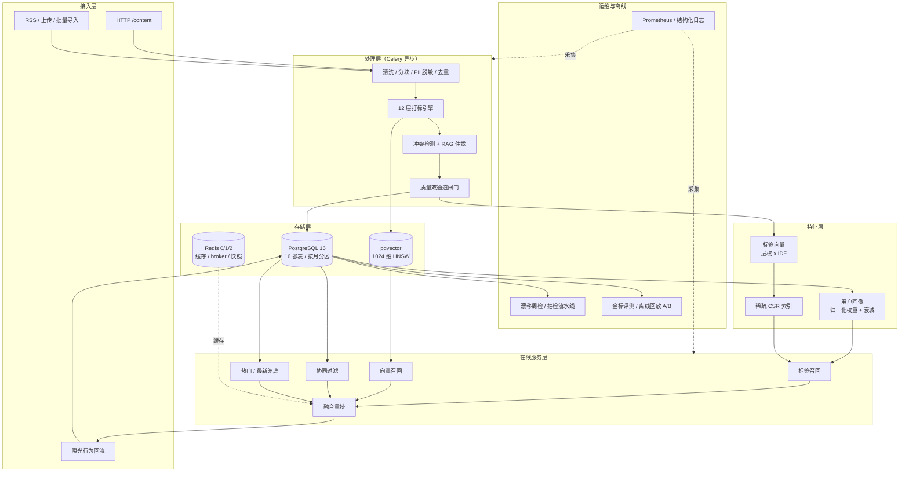

# tagmind


-4CAF50)

> 企业级 LLM 驱动的智能打标与个性化内容分发系统。

用一套**可运营的 12 层标签体系**，把 UGC/PGC 内容在分钟级变成「机器可读的兴趣向量」：
用大模型替代人工标注，用多路召回替代热门单点分发，每一条标签结论都可追溯、可回放、可抽检。

tagmind 面向「内容量大、标签体系复杂、召回延迟要求高」的内容平台，提供一条
完整链路：**接入 → 清洗 → 脱敏 → 打标 → 冲突仲裁 → 质量审核 → 画像 → 多路召回 → 排序 → 曝光回流**。

---

## 目录

- [它解决什么问题](#它解决什么问题)
- [三支柱](#三支柱)
- [12 层标签体系](#12-层标签体系)
- [真实输出](#真实输出)
- [阶段状态](#阶段状态)
- [快速开始](#快速开始)
- [架构分层](#架构分层)
- [部署与运维](#部署与运维)
- [API 文档](#api-文档)
- [指标口径（诚实声明）](#指标口径诚实声明)
- [评估与验证](#评估与验证)
- [关键取舍与风险](#关键取舍与风险)
- [数据与合规声明](#数据与合规声明)
- [开发规范](#开发规范)
- [文档](#文档)
- [许可](#许可)

---

## 它解决什么问题

**问题一：人工标注贵且慢。** 一家内容平台日均数万条 UGC/PGC，人工逐条打标
既贵又慢，标签体系还常常停留在运营脑子里、无法沉淀为机器可读的坐标。

**问题二：标签体系深了就会打架。** 层级一多，父子标签冲突、互斥标签冲突
随之而来，最终标签无法解释，投放效果也无从归因。

**问题三：分发只靠热门。** 热门榜推给所有人，冷启动用户拿不到任何个性化
内容；一旦行为数据稀疏，协同过滤直接失效。

tagmind 给出的答案是：

```
一条内容进来
  → 清洗 / 脱敏 / 分块
  → 12 层标签体系打标（配置驱动，非硬编码提示词）
  → 冲突检测 + 仲裁（证据可追溯）
  → 质量双通道闸门（规则 + 评分，阈值可配）
  → 内容向量 + 标签向量入库
  → 用户画像（标签权重向量，与内容同构）
  → 多路召回（标签偏好 / 稠密向量 / 协同过滤 / 热门兜底）
  → 融合重排 → 分发
  → 曝光回流 → 画像增量更新
```

关键设计：**`user_profile.tag_weights` 与 `content.labels` 在同一个标签空间里**。
标签不只是展示用的分类，而是直接进入召回打分的偏好坐标。

---

## 三支柱

| 支柱 | 解决什么 | 关键设计 |
| --- | --- | --- |
| **12 层多标签体系** | 业务可解释 + 模型可打标 | L1–L4 严格树（单选/同父互斥），L5–L12 开放多选；标签定义配置化，加标签不改代码 |
| **RAG 冲突消解** | 标签打架时如何可解释地裁决 | 标签定义 + 金标样本入库 → top-k 检索取证 → CoT 仲裁 → 置信度闸门转人工；冲突 log 全量可回放 |
| **轻量推荐引擎** | 冷启动与稀疏行为 | 标签偏好召回 + 稠密向量召回 + 协同过滤 + 热门/最新兜底；LightFM 可选，纯 NumPy 备选实现保底 |

---

## 12 层标签体系

| 层 | 层名 | 结构 | 配额 | 召回特征 |
| --- | --- | --- | --- | --- |
| L1 | 领域域 Domain | 严格树 · 单选 | 1 | 强 |
| L2 | 一级类目 Category | 严格树 · 单选 | 1 | 强 |
| L3 | 二级类目 Sub-category | 严格树 · 同父互斥 | ≤3 | 强 |
| L4 | 主题簇 Topic | 严格树 · 同父互斥 | ≤3 | 强 |
| L5 | 事件与场景 Event/Scenario | 开放多选 | ≤5 | 是 |
| L6 | 人物实体 Person | 开放多选 | ≤5 | 弱 |
| L7 | 机构与品牌 Org/Brand | 开放多选 | ≤5 | 弱 |
| L8 | 地理与场所 Geo/Place | 开放多选 | ≤5 | 弱 |
| L9 | 商品与作品 Product/Work | 开放多选 | ≤5 | 弱 |
| L10 | 属性与量化 Attribute | 开放多选 | ≤8 | 否 |
| L11 | 消费意图 Intent | 开放多选 | ≤3 | 强 |
| L12 | 情感·立场·风险 | 开放多选 + 互斥组 | ≤3 | 强 |

**仓库内置 1490 个真实中文标签**（L1=20 / L2=71 / L3=206 / L4=593 / L5–L12=480），
不是 `TAG_001` 这类占位符。

**十条硬约束**（C1–C10）在写入时生效，违反即转人工复核：

| 约束 | 内容 |
| --- | --- |
| C1 | 树层唯一：L1–L4 每层一个主归属 |
| C2 | 同父互斥：同层同父标签不能并存 |
| C3 | 祖先闭包：命中深层标签必须命中其全部祖先 |
| C4 | 跨层可多选：L5–L12 允许多标签 |
| C5 | 每层配额：不得超过该层 `max_select` |
| C6 | 显式互斥组：同组最多一个 |
| C7 | 置信度门槛：低于阈值不进正式标签（保留在原始输出） |
| C8 | 语义冲突仲裁：疑似冲突走检索 + 仲裁 |
| C9 | 覆盖率闸门：无树标签的内容不发布 |
| C10 | 版本一致：内容标签版本与定义版本必须匹配 |

---

## 真实输出

```
$ python -m tagmind.cli seed-labels
标签体系导入完成：version=v1，标签数=1490
  L1=20  L2=71  L3=206  L4=593  L5=60  L6=60
  L7=60   L8=60  L9=60   L10=60 L11=60 L12=180
约束校验：A1–A10 零违规
```

```
$ python -m pytest tests -q
277 passed, 36 skipped in 16.60s
TOTAL   2588   628   400   42   71%
Required test coverage of 70% reached. Total coverage: 71.08%
```

---

## 阶段状态

本仓库当前处于 **阶段 0：工程地基**。

| 阶段 | 内容 | 状态 |
| --- | --- | --- |
| 0 | 配置 / 日志 / 异常 / 领域模型 / DB 层 / 迁移 / 标签体系 / 容器 / CI | ✅ 已完成 |
| 1 | 清洗分块脱敏、LLM 三档后端、提示词装配、Celery 与 DLQ | ⏳ 未开始 |
| 2 | RAG 冲突仲裁、质量审核双通道、用户画像与漂移 | ⏳ 未开始 |
| 3 | 向量存储、多路召回融合、重排、协同过滤 | ⏳ 未开始 |
| 4 | 完整 API、调度、可观测、评测回放、作品集化 | ⏳ 未开始 |

阶段 0 已交付的能力：

- **12 层标签体系**：1490 个真实中文标签，通过发布期校验（A1–A10 零违规），
  物化路径 / 邻接表 / 祖先数组三写一致。
- **16 张物理表**的 Alembic 迁移，幂等（连续执行两次 `upgrade head` 无报错），
  含分区表、不可变触发器与权限回收。
- **配置 / 日志 / 异常**三件套：生产环境缺密码即启动失败；日志敏感字段在
  渲染前脱敏；异常错误码唯一且分层。
- **领域层零框架依赖**：由 AST 扫描在 CI 中强制。

---

## 快速开始

### Docker（推荐）

```bash
cp .env.example .env
# 至少设置 TAGMIND_POSTGRES_PASSWORD（生产环境必填）
docker compose up -d --build
docker compose exec api alembic -c alembic.ini upgrade head
docker compose exec api python -m tagmind.cli seed-labels
```

五个服务：`api` / `worker` / `beat` / `postgres`（`pgvector/pgvector:pg16`）/ `redis`。
`api`、`worker`、`beat` **复用同一镜像**，靠 `TAGMIND_ROLE` 分派。

### 本地开发

```bash
pip install -e ".[dev]"
python -m tagmind.cli migrate
python -m tagmind.cli seed-labels
python -m tagmind.cli serve --reload
```

### 常用命令

| 命令 | 说明 |
| --- | --- |
| `make serve` / `make run` | 启动 API |
| `make migrate` | 应用数据库迁移 |
| `make labels` | 导入 12 层标签体系 |
| `make seed` | 灌入合成数据集 |
| `make test` | 跑全量测试 |
| `make lint` | ruff |
| `make typecheck` | mypy |

---

## 架构分层

```
tagmind/
├── config/      环境变量映射、常量、阈值、提示词模板
├── core/        异常体系、结构化日志、请求上下文、安全原语
├── domain/      纯领域模型（零框架依赖，由 AST 扫描强制）
├── db/          ORM 模型 + 仓储（业务模块唯一的数据入口）
├── ingestion/   清洗 · 分块 · 脱敏 · 去重
├── labeling/    标签树 · 提示词装配 · 约束校验 · 冲突仲裁 · 质量闸门
├── llm/         LLM 后端三档（deterministic / llm_local / llm_api）
├── vector/      向量存储与标签特征空间
├── profile/     用户画像构建 · 更新 · 衰减 · 漂移
├── recommendation/  多路召回 · 融合 · 重排 · 协同过滤
├── scheduler/   Celery 应用与定时任务
├── observability/  指标 · 健康探针 · 告警
├── evaluation/  金标 · κ · 分层 F1 · 回放 · 漂移抽检
└── api/         FastAPI 应用与路由
```

**依赖红线**：`domain/` 不得 import fastapi / sqlalchemy / pydantic / numpy /
celery / redis；业务模块一律经 `db/repositories` 访问数据库。

### 系统分层图



**读图要点**：离线链路（打标 → 特征 → 索引）与在线链路（召回 → 重排）**只在存储层交汇**，
因此打标任务的积压不会直接拖慢在线 P99；曝光回流同时喂给画像更新与离线回放。

---

## 部署与运维

### 环境划分

| 环境 | 用途 | 配置要点 |
| --- | --- | --- |
| `development` | 本地开发与单测 | `TAGMIND_LLM_BACKEND=deterministic`；无密钥可跑；集成测试无 DB 时显式 skip |
| `staging` | 灰度前验证 | 与生产同构的 Compose；灌合成数据；跑全量回归 + 离线回放 |
| `production` | 生产 | **强制** `TAGMIND_POSTGRES_PASSWORD`；`DEMO_MODE=0` 强制 API Key；密钥走环境变量 / 密钥管理，绝不入库 |

`TAGMIND_ROLE` 让**同一镜像**分派成 `api` / `worker` / `beat` 三种角色，
避免三份镜像漂移。首次启动顺序由 compose 的 `depends_on` + healthcheck 保证
（postgres / redis 健康后 api 才起）。

### 灰度发布

标签体系与提示词都带版本号，灰度按三条轴独立控制：

| 轴 | 配置 | 回滚动作 |
| --- | --- | --- |
| 标签体系版本 | `TAGMIND_LABEL_CANARY_VERSION` + `TAGMIND_LABEL_CANARY_RATIO` | 把比例调回 0，历史内容的 `labels_version` 不变，可继续按旧版本解释 |
| 提示词版本 | `prompt_version` 记入审计 | 切回上一版 `prompt_version`，`prompt_hash` 校验保证不会串版 |
| 模型 / 后端 | `TAGMIND_LLM_BACKEND` | 降级链**单向不可回**（ADR-0003），回滚靠重新提交而非自动切回 |

数据迁移回滚：5 个 Alembic 版本均有 `downgrade`，但**分区表与触发器不可盲降**——
先跑 `scripts/consistency_check.py`，再按 ADR-0010 的迁移回滚清单执行。

### 监控告警

| 类别 | 指标 | 告警阈值（可在配置调整） |
| --- | --- | --- |
| 打标链路 | JSON 一次解析成功率 / 队列积压 / 单条平均耗时 | 解析成功率 < 98%；积压 > 5000 持续 5min |
| 质量 | 低质拒绝率、仲裁转人工率 | 转人工率 > 15% |
| 在线 | P99 延迟、QPS、错误率 | P99 > 100ms；5xx > 1% |
| 数据一致性 | 向量与标签表一致率、画像与曝光对账差异 | 任一非 100% |

结构化日志用 `request_id` 贯穿 HTTP → contextvar → `exposure_log`，
错误体带 `trace_id`，可与服务端日志对上。

### 数据回溯与一致性校验

`scripts/consistency_check.py` 覆盖架构 §13 的 18 项校验（V1–V18），核心是：

- **向量 vs 标签**：`content_vector` 的 `tag_vector` 与 `content.labels` 逐条一致，
  `tag_space_version` 不匹配时**拒绝打分**（避免新旧分数混算）
- **画像 vs 曝光**：按时间窗重算 `tag_weights`，与 `user_profile` 落库值对账
- **迁移后**：表数 / 索引 / 分区 / 触发器 / 权限逐项比对，退出码非 0 即阻断发布
- **离线回放可复现**：强制 `cache_bypass=True`，按回放时间窗从 `exposure_log`
  重算热门榜，**不读 Redis 缓存**（ADR-0006）

---

## API 文档

> **实现状态**：阶段 0 仅上线健康探针；下表是完整契约，业务接口随阶段 4 交付。
> 交互式 OpenAPI 在 `http://localhost:8000/docs`。

| 方法 | 路径 | 说明 | 状态 |
| --- | --- | --- | --- |
| GET | `/healthz` | 存活探针（Docker HEALTHCHECK 指向此路径） | ✅ 已实现 |
| GET | `/readyz` | 就绪探针，返回 DB 连通状态 | ✅ 已实现 |
| GET | `/openapi.json` | OpenAPI schema | ✅ 已实现 |
| POST | `/content` | 提交内容，返回 `202` + `content_id` + `task_id`；空正文 `400` 带字段级错误码 | 阶段 4 |
| GET | `/content/{id}` | 状态 + labels + quality + `conflict_count` + `last_error` | 阶段 4 |
| GET | `/labels/tree` | 12 层标签树（按版本） | 阶段 4 |
| POST | `/recommend` | 个性化分发，返回 `algo` / `debug.fallback_reason` | 阶段 4 |
| POST | `/events` | 曝光与行为回流 | 阶段 4 |
| GET | `/metrics` | Prometheus 指标 | 阶段 4 |
| GET | `/dlq` · POST `/dlq/replay` | 死信列表与重放 | 阶段 4 |

**统一错误体**（架构 §14.3）：

```json
{ "error": { "code": "CONTENT_NOT_FOUND", "message": "内容不存在",
             "details": {"content_id": "c-1"}, "trace_id": "..." } }
```

**鉴权**：`DEMO_MODE=1` 时管理接口免鉴权但启动日志显式披露；
非演示模式所有管理类接口要求 `X-API-Key`。

---

## 指标口径（诚实声明）

本项目对所有对外数字强制携带 `evidence_type`：

| 类型 | 何时可用 | 可否对外承诺 |
| --- | --- | --- |
| `offline_evaluation` | 有金标集 | 可承诺「在该测试集上的准确率」 |
| `offline_simulation` | 有历史日志的回放 | **不可**承诺「线上 CTR 提升」 |
| `online_gray` | 灰度真实流量 | 需显著性与实验期说明 |
| `online_real` | 全量真实流量 | 需 PRD 变更方可使用 |

`MetricValue` 的 `evidence_type` **没有默认值**——忘记填会在构造时直接
`TypeError`，而不是在报告里静默缺失。这是刻意的摩擦。

---

## 评估与验证

### 离线：标签质量

500 条金标集上分层计算 macro F1。报告**同时输出三个数**，避免分母口径含混：

| 指标 | 定义 | 用途 |
| --- | --- | --- |
| `macro_f1_all12` | 固定 12 层平均（含低支撑层） | 辅助参考 |
| `macro_f1_supported` | 仅 `support >= 10` 的层平均 | **正式口径** |
| `macro_f1_by_l1_subset` | 按 L1 类目子集 | 验收判定：>= 6 个类目子集 >= 90% |

配套：打标覆盖率 >= 95%、层级路径完整率 100%（硬约束）、约束违规率 0%（硬约束）、
冲突检出覆盖 >= 90%、质量评分与人工评分 Spearman rho >= 0.6。

> **诚实声明**：本仓库的 500 条金标集是**合成参考集**（`synthetic_gold=true`），
> 不是人工标注，README 与所有报告均显式声明。双人独立标注 + Cohen's kappa 的工具链已实现，
> 但**人工回填需业务方参与，工程侧不代劳也不伪造**（Q11 / Q20）。

### 离线：排序质量与业务效果

- **排序模型**：按用户分组计算 AUC / GAUC（GAUC 按用户曝光数加权），
  避免活跃用户主导整体 AUC；同时报告 Recall@K 与 NDCG@K。
- **三条基线并列**（Q13），才能说清增量来自「个性化」还是「某个组件」：
  1. 业务基线 = 热门 + 最新
  2. 算法消融 = 纯标签召回 / 纯向量召回
  3. 全量融合
- **业务指标**：CTR（有效点击 / 曝光）、标签覆盖率、**7 日回访率**（留存代理指标）、
  有效分发率、P99 延迟、QPS。
- **证据标签**：回放报告首页固定写明 `evidence_type=offline_simulation`、
  「非线上真实流量」，`sample_size` 与 `as_of` 必带。

> ⚠️ 蓝本中「CTR +40%」「留存 +25%」在本仓库中**从未被宣称达成**。
> 无真实流量时这些数字不可验证；离线仿真结论不得冒充线上效果。
> 「7 日回访率」是**代理指标**，不等同于真实留存。

### 线上：A/B 实验

灰度阶段才可用，需同时满足：实验分组写入 `experiment_assignment`、
曝光日志带 `exp_group`、给出显著性检验与实验期说明、指标标 `online_gray`。
`online_real` 在架构中**结构性不可达**（ADR-0010），需 PRD 变更才能启用。

### 工程验证

```bash
ruff check src tests && ruff format --check src tests   # 静态规范
mypy src/tagmind                                       # 类型
pytest tests -q                                        # 单测 + 覆盖率门槛 70%
python scripts/consistency_check.py                     # 数据一致性（需 DB）
```

CI 另跑密钥扫描（`sk-` / `AKIA` / `token=`）、依赖扫描与迁移幂等校验。

---

## 关键取舍与风险

| # | 取舍 | 为什么这样选 | 代价与风险 |
| --- | --- | --- | --- |
| 1 | **pgvector 而非独立向量库** | 10 万向量远低于其舒适区；可与 `content` 表 JOIN、同事务，省掉双写一致性 | 索引构建慢、与业务负载争抢资源；大规模需迁 Milvus |
| 2 | **`deterministic` 为默认后端** | 零密钥、逐位可复现，CI 与评测可无人值守 | 规则后端准确率**不能**当作大模型能力评估；只验证流水线确定性与口径 |
| 3 | **不引入 LlamaIndex** | 仲裁只是「向量检索 + 固定模板 + 结构化解析」，自写少 8 个依赖 | 后续若做标签图谱推理需重新评估 |
| 4 | **LightFM 可选 + 纯 NumPy `fallback_cf` 必交付** | LightFM 无 wheel、2023 后停更，编译常失败 | 两后端结果以 `algo` 分列、**绝不混算**；性能弱于编译版 |
| 5 | **标签 1490 个，L4 以下按需注入** | 全量注入 system prompt 需 4–6 万 token/条，是主要成本项 | 检索注入有漏召回风险，需监控 L4 覆盖率 |
| 6 | **标签向量：层权 + IDF** | 树层是强特征，实体层是弱特征，需区别对待 | 层权改动必须触发 `tag_space_version` 变更，否则新旧分数混算 |
| 7 | **16 张物理表 + 原生 SQL 迁移** | DDL 与架构契约逐字符一致，便于 `information_schema` 零差异比对 | 迁移与 ORM 需靠 `test_db_metadata.py` 锁死一致性 |
| 8 | **离线回放不读缓存** | 读 Redis 会让仿真结果依赖运行时状态、不可复现 | 回放更慢，且必须按时间窗重算热门榜 |

### 已知风险

| 风险 | 表现 | 缓解 |
| --- | --- | --- |
| 标签漂移 | 运营改了类目含义，模型输出逐渐跑偏 | 每周抽检 200 条 → 回灌 few-shot → 提示词版本递增（工具链已实现，人工回填需业务方） |
| RAG 误仲裁 | 冲突裁决结论错误且被自动放行 | 置信度 < 0.75 自动转人工；`label_conflict_log` 全量可回放；`resolved_before` 保留推翻前结论 |
| 冷启动 | 新用户无行为，协同过滤失效 | 热门 + 最新兜底，响应显式标 `cold_start=true` 与兜底来源 |
| 推荐指标不可验证 | 把仿真 CTR 说成线上提升 | `evidence_type` 无默认值 + 报告首页固定文案 + 三基线并列 |
| 数据合规 | 真实 UGC 与 PII 泄漏 | 仓库全为合成数据；PII 双点脱敏；`pii_mask_map` 只存哈希且对 PUBLIC 无权限；外发记 `egress_log` |
| 本机未验证项 | 无 PostgreSQL / Docker，迁移幂等、分区、触发器、容器启动**只做静态审查** | CI 的 `migration-idempotent` job 用真实 PG 服务容器验证；QA 报告显式标注「未验证」 |

---

## 数据与合规声明

- 仓库内**所有演示数据都是合成数据**（`synthetic=true` 显式标记），
  不含任何平台真实 UGC。
- `raw_text` 是未脱敏的原始正文（受控访问）；送入 LLM 的一定是
  `clean_text`（已脱敏）。
- `pii_mask_map` 只存 sha256 哈希，不存原值，且对 `PUBLIC` 无权限。
- 所有外发请求记 `egress_log`（不含正文）。

---

## 开发规范

```bash
ruff check src tests          # lint
ruff format --check src tests # 格式
mypy src/tagmind              # 类型
pytest tests -q               # 测试（覆盖率门槛 70%）
```

提交前请确保四条命令全绿。密钥扫描（`sk-` / `AKIA` / `token=` 模式）在 CI 中
强制执行。

---

## 文档

| 文档 | 内容 |
| --- | --- |
| [`docs/prd.md`](docs/prd.md) | 产品需求文档：用户故事、67 条需求池、12 层体系设计、指标口径、非功能需求、阶段计划 |
| [`docs/architecture.md`](docs/architecture.md) | 架构设计：分层图、组件清单、完整文件列表、最终 DDL、召回链路时序、调度、20 任务分解 |
| [`docs/adr/`](docs/adr/) | 10 篇架构决策记录（向量库、标签规模、LLM 分档、CF 备选、幂等与 DLQ、口径诚实与回滚……） |
| [`docs/qa/`](docs/qa/) | 各阶段 QA 验证报告 |

贡献指南见 [`CONTRIBUTING.md`](CONTRIBUTING.md)，
行为准则见 [`CODE_OF_CONDUCT.md`](CODE_OF_CONDUCT.md)，
安全问题请见 [`SECURITY.md`](SECURITY.md)。

---

## 许可

- **源代码**：[Apache License 2.0](LICENSE)
- **文档与设计材料**（`docs/`、ADR、README 架构描述）：[CC BY 4.0](LICENSE-docs)

Copyright (c) 2026 Nephets1010
