# tagmind 系统架构设计

> 项目代号：`tagmind` ｜ 仓库：`Nephets1010/tagmind`
> 上游文档：[`docs/prd.md`](./prd.md)（PRD v1.0，许清楚）
> 本文档：`v1.0`，架构师 高见远（Gao）
> ADR 索引：[`docs/adr/`](./adr/)

---

## 目录

| 章节 | 内容 |
| --- | --- |
| §0 | 阅读指引与设计前提 |
| §1 | 决策追溯矩阵（PRD 章节 / 拍板决策 → 架构落点） |
| §2 | 系统分层图与组件清单 |
| §3 | 模块依赖图 |
| §4 | 完整文件列表（可施工） |
| §5 | 数据模型与最终 DDL |
| §6 | 标签计算与更新策略 |
| §7 | 特征与向量存储选型 |
| §8 | 召回与排序链路（时序图 + 延迟预算） |
| §9 | 离线/在线数据流与调度 |
| §10 | 标签体系建模与 C1–C10 校验器 |
| §11 | 向量/标签召回的数学定义 |
| §12 | 可回滚设计 |
| §13 | 数据一致性校验 |
| §14 | 共享知识（跨文件契约） |
| §15 | 任务分解（按 PRD §9 阶段） |
| §16 | ADR 索引与待确认歧义 |

---

## §0 阅读指引与设计前提

### 0.1 本文档的边界

- **唯一需求事实来源**是 `docs/prd.md`。本文档**不新增业务能力**，只把 PRD 落成可施工的工程方案。
- 主理人已拍板的 20 条决策（Q1–Q20）**不再讨论替代方案**，直接作为约束条件使用。全部决策的技术后果由 §12（可回滚）与 §16.2（歧义）承接。
- 本文档**不含实现代码**，只含 DDL、接口签名、伪代码、公式与配置项。
- PRD §1.3 的「Out of scope 纪律」在本架构中被严格继承：多模态、分布式、多租户、实时推送、版权去重、真实 A/B 平台**均不进入架构**。

### 0.2 基准前提（不可协商）

| 前提 | 取值 | 影响的设计 |
| --- | --- | --- |
| 基准硬件（Q4） | 8 核 CPU / 16 GB 内存 / 无独显 / PCIe SSD | 所有延迟预算按此推算；无 GPU 路径必须一等公民 |
| 目标规模 | 10 万内容 / 千级用户 / 1000 万曝光日志 | 单机 PostgreSQL + 单进程特征索引可行；不需要 Milvus |
| Python | >= 3.11 | LightFM 只能源码编译 → 必须有 `fallback_cf` |
| 演示可用性 | **零密钥、零 GPU、断网可跑** | `deterministic` 后端是默认档而非降级占位符 |
| 时间 | 全部 UTC 存储，展示层本地化 | `TIMESTAMPTZ` + `created_at/updated_at` |
| 部署 | 单机 Docker Compose（api / worker / postgres / redis / beat） | 无 K8s、无多副本状态 |

### 0.3 架构风格

采用 **Ports & Adapters（六边形）+ 分层单体**：

- **Domain（`src/tagmind/domain/`）**：纯 dataclass + Protocol，**零框架依赖**（不 import fastapi / sqlalchemy / numpy）。
- **Ports（SPI）**：`llm/base.py`（LLM 后端）、`vector/base.py`（向量库）、`db/repositories/base.py`（仓储）三组 Protocol。
- **Adapters**：`llm/deterministic.py`、`llm/openai_compat.py`、`vector/pgvector_store.py`、`vector/chroma_store.py`、`db/repositories/*`。
- **Orchestration（应用层）**：`labeling/engine.py`、`recommendation/service.py`、`scheduler/tasks/*` 编排端口，不写协议细节。

选它的理由：PRD §8.5 的 NF-E01/NF-E02/NF-E04 明确要求「后端可插拔、向量库可插拔、流水线阶段可插拔」，六边形是这三条需求的最小成本实现；同时单机部署下不必引入微服务治理开销。

---

## §1 决策追溯矩阵

### 1.1 主理人拍板决策 → 架构落点

| 决策 | 结论 | 架构落点（文件） | 落地方式 |
| --- | --- | --- | --- |
| Q1 | 向量库 = pgvector | `vector/pgvector_store.py`、`vector/chroma_store.py`、`vector/base.py` | `VectorStore` Protocol 双实现，`TAGMIND_VECTOR_BACKEND` 切换；pgvector 为默认 |
| Q2 | 标签 1200–1800，L1–L3 全量 + L4 按需注入 | `labeling/shard_loader.py`（合并入 `labeling/taxonomy.py`）、`labeling/prompt_builder.py` | 提示词装配器按「层分片 + 检索 top-N」构造 system prompt，预算 1.5–2 万 token |
| Q3 | 三档后端，默认 `deterministic` | `llm/base.py`、`llm/deterministic.py`、`llm/openai_compat.py`、`llm/registry.py` | `LLMBackend` Protocol；`deterministic` 用规则+词典+启发式产出结构合法标签树 |
| Q4 | 基准 8 核 / 16 GB / 无独显 | §8.4 延迟预算、§7.3 HNSW 参数 | 全部性能承诺以此为准，GPU 另报一档 |
| Q5 | LightFM 放 `[rec]` extra | `pyproject.toml`、`recommendation/cf/lightfm_backend.py` | 编译失败 → `recall_only` 降级，**不报错、不空结果** |
| Q6 | 不引入 LlamaIndex | `labeling/conflict/retriever.py` + `arbitrator.py` | 仲裁 = 向量检索 + 固定提示模板 + 结构化解析，自写编排 |
| Q7 | 纯 Python `fallback_cf` 必交付 | `recommendation/cf/fallback_cf.py` | 纯 NumPy item-based 标签共现 + ALS/BPR；与 LightFM **口径分别标注、结果不混算** |
| Q8 | Redis DB 分离 | `config/settings.py`、`core/context.py` | `/0` 应用缓存、`/1` Celery broker、`/2` 结果缓存；离线回放**不读缓存** |
| Q9 | 标签向量：按层赋权 + IDF 归一化 | `vector/tag_space.py`、`config/thresholds.py` | 层权重写配置并记入 `pipeline_version`；`content_vector.tag_vector` 与 `user_profile.tag_weights` 同空间 |
| Q10 | exposure_log 保留 90 天 + 按月分区；种子日志标 synthetic | `db/models/interaction.py`、`scheduler/tasks/maintenance.py` | 声明式分区（`PARTITION BY RANGE(ts)`）+ 保留策略作业；`synthetic BOOLEAN` 列 |
| Q11 | 合成参考集 + 双盲 κ 工具 | `evaluation/gold.py`、`evaluation/agreement.py` | 500 条 `synthetic_gold=true`；Cohen's κ 计算工具；README 全局声明 |
| Q12 | 分层达标 | `evaluation/metrics.py`、`evaluation/report.py` | ≥6 个 L1 子集宏 F1 ≥ 90%，整体值如实报告；`support<10` 标 `low_support` 不计入平均 |
| Q13 | 离线回放跑三条基线并列 | `evaluation/replay.py` | 业务基线（热门+最新）/ 消融（纯标签、纯向量、全量融合）同一人群对比 |
| Q14 | 留存用「7 日回访率」代理 | `evaluation/replay.py` | 显式标注 `proxy_metric=true`，**不等同**「留存 +25%」 |
| Q15 | 内置示例敏感词/广告词规则集 | `rules/sensitive_words.txt`、`rules/ad_words.txt`、`ingestion/rules.py` | 200–500 条示例集 + README 声明 + 外部规则文件热加载 |
| Q16 | 广告残留四判据 + 必须可解释 | `ingestion/ad_detector.py`、`ingestion/rules.py` | 每条命中产出 `{rule_id, span, matched, category}`，可回溯到位置 |
| Q17 | API 双模式 | `api/middleware.py`、`config/settings.py` | `DEMO_MODE=1` 管理接口免鉴权，**启动日志显式披露**；否则强制 API Key |
| Q18 | Apache-2.0 + 数据声明 | `LICENSE`、`README.md` | 「演示数据全部为合成或公开许可语料，不含任何平台真实 UGC」 |
| Q19 | 合成语料生成器 + 公开许可语料抽样 | `scripts/generate_corpus.py`、`evaluation/gold.py` | 二者标注来源字段 `source`（`synthetic` / `public-licensed`） |
| Q20 | 抽检流水线到「生成抽检表」为止 | `evaluation/drift_check.py` | 产出 `label_drift_check` + 抽检表文件；人工回填为**可选输入**；README 明确「工程侧不代劳也不伪造」 |

### 1.2 PRD 章节 → 架构组件映射（节选，完整见 §2.2 组件清单表）

| PRD 章节 | 核心需求 | 主责组件 |
| --- | --- | --- |
| §3.1.1 PRE | P4-PRE-001~004 | `ingestion/cleaner.py`、`ingestion/chunker.py`、`ingestion/dedup.py` |
| §3.1.2 TAG | P4-TAG-001~005 | `labeling/engine.py`、`labeling/prompt_builder.py`、`labeling/constraints.py` |
| §3.1.3 RAG | P4-RAG-001~004 | `labeling/conflict/detector.py`、`retriever.py`、`arbitrator.py` |
| §3.1.4 QA | P4-QA-001~004 | `labeling/quality/rules_channel.py`、`llm_channel.py`、`gate.py` |
| §3.1.5 REC | P4-REC-001~005 | `recommendation/recall/*`、`fusion.py`、`ranker.py` |
| §3.1.6 USR | P4-USR-001~003 | `profile/builder.py`、`profile/updater.py`、`profile/decay.py` |
| §3.1.7~12 | DAT/API/LLM/OPS/SEC/EVA/ENG | `db/*`、`api/*`、`llm/audit.py`、`observability/*`、`evaluation/*`、`scheduler/*` |

---

## §2 系统分层图与组件清单

### 2.1 系统分层图

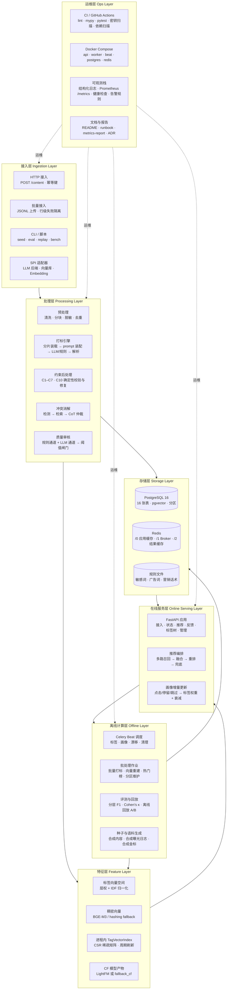

**各层职责一句话**

| 层 | 职责 |
| --- | --- |
| 接入层 | 把外部内容/请求/命令变成带幂等键的内部任务，不做业务判断 |
| 处理层 | 承担 PRD §4.5 硬约束与 §5.1 主流程的确定性工作，是唯一的写库入口 |
| 存储层 | 状态与事实的唯一持久化点，保证原始数据不可变、结论带来源与版本 |
| 特征层 | 把内容与用户压缩到同一坐标空间，供召回直接内积/余弦计算 |
| 在线服务层 | 低延迟读路径（推荐）+ 高频写路径（曝光回流），必须满足 P99 ≤ 100 ms |
| 离线计算层 | 批处理、周期作业、评测与回放，是唯一允许「慢」的地方 |
| 运维层 | 构建、部署、可观测、文档与合规扫描，保证可复现与可审计 |

### 2.2 组件清单表

| 组件 | 所属层 | 职责（一句话） | 主要依赖 | 对应 PRD 需求 |
| --- | --- | --- | --- | --- |
| `api/app.py` | 在线服务层 | FastAPI 应用工厂，注册中间件、异常处理、路由与生命周期 | fastapi, core.logging, observability.metrics | P4-API-001~005, NF-O06 |
| `api/middleware.py` | 在线服务层 | request_id 生成与透传、API Key 鉴权、DEMO_MODE 豁免、限流 | core.context, core.security, config.settings | P4-SEC-001, NF-S07, Q17 |
| `api/deps.py` | 在线服务层 | 提供 DB Session、仓储、向量库、LLM 后端的依赖注入 | db.session, llm.registry, vector.base | P4-API-001, P4-OPS-003 |
| `api/errors.py` | 在线服务层 | 把领域异常映射为统一错误体 `{code,message,details}` | core.errors | P4-API-001 |
| `api/routers/content.py` | 接入层 | 内容接入（单条/批量）、状态查询、强制重打 | db.repos, ingestion.pipeline, scheduler | P4-API-001, P4-API-002, P4-API-005 |
| `api/routers/labels.py` | 在线服务层 | 标签树/元数据查询、覆盖率与配额统计 | db.repos.taxonomy, labeling.taxonomy | P4-API-004, P4-TAG-001 |
| `api/routers/recommend.py` | 在线服务层 | 推荐列表、反馈回流、召回来源归因 | recommendation.service, profile.updater | P4-API-003, P4-REC-002~005 |
| `api/routers/admin.py` | 在线服务层 | 复核任务领取/裁决、阈值调整、规则热加载、演示态开关 | db.repos.workflow, labeling.quality.gate | P4-RAG-004, P4-QA-003, P4-QA-004 |
| `core/errors.py` | 横切 | 异常体系与错误码规范（§14.3） | — | P4-API-001, P4-OPS-002 |
| `core/logging.py` | 运维层 | structlog JSON 渲染、request_id 绑定、敏感字段脱敏 | structlog | P4-OPS-001, NF-O01, NF-O03 |
| `core/context.py` | 横切 | contextvar 上下文（request_id/trace_id/user_id/content_id） | — | P4-OPS-001, NF-O02 |
| `core/security.py` | 横切 | API Key 校验、PII 正则族、路径白名单、限流令牌桶 | — | P4-SEC-001, P4-SEC-002, NF-S06, NF-S07 |
| `config/settings.py` | 横切 | 全部 `TAGMIND_*` 环境变量映射（与 `.env.example` 逐项对齐） | pydantic-settings | P4-SEC-002, NF-S05 |
| `config/thresholds.py` | 横切 | 质量阈值、冲突阈值、融合权重、层权、IDF 开关的集中定义 | pydantic | P4-QA-003, P4-REC-002, Q9 |
| `domain/label.py` | 领域层 | 标签定义/标签集/候选标签的纯 dataclass 与不变量 | — | P4-TAG-003, P4-TAG-005 |
| `domain/content.py` | 领域层 | 内容、清洗统计、分块、状态机的纯 dataclass | — | P4-PRE-004, P4-API-002 |
| `domain/conflict.py` | 领域层 | 冲突候选、证据、仲裁结果、复核状态的纯 dataclass | — | P4-RAG-003, P4-RAG-004 |
| `domain/quality.py` | 领域层 | 规则命中明细、LLM 评分、审核结论的纯 dataclass | — | P4-QA-001~004 |
| `domain/profile.py` | 领域层 | 用户画像、标签权重、置信度、冷启动标记 | — | P4-USR-001~003 |
| `domain/interaction.py` | 领域层 | 曝光/行为事件与请求上下文 | — | P4-REC-005 |
| `domain/vector.py` | 领域层 | 稠密向量、标签稀疏向量、相似度结果 | — | P4-REC-001, Q9 |
| `domain/versioning.py` | 领域层 | `PipelineVersion` 值对象（清洗/体系/提示/模型/约束/特征空间版本聚合） | — | P4-DAT-002, §7.5 声明 6 |
| `db/models/*` | 存储层 | 16 张物理表的 SQLAlchemy 2.0 ORM 映射 | sqlalchemy, pgvector | P4-DAT-001 |
| `db/repositories/*` | 存储层 | 仓储接口约定 + 事务边界（§14.5） | sqlalchemy | P4-DAT-001, NF-R01 |
| `db/session.py` | 存储层 | Engine/SessionFactory/连接池与健康探针 | sqlalchemy, psycopg | NF-R10 |
| `ingestion/pipeline.py` | 处理层 | 接入内容 → 清洗 → 分块 → 脱敏 → 落库 `pending` | cleaner, chunker, pii, dedup | P4-PRE-001~004, P4-API-001 |
| `ingestion/cleaner.py` | 处理层 | HTML/表情/广告清洗、Unicode 归一化，产出 `clean_stats` | rules | P4-PRE-001, P4-PRE-002, P4-PRE-005 |
| `ingestion/chunker.py` | 处理层 | 分块分句 + token 估算，覆盖率 ≥ 99% | — | P4-PRE-003 |
| `ingestion/pii.py` | 处理层 | PII 识别与占位符替换，只落类型不落原值 | core.security, db.repos.pii | P4-SEC-001, NF-S01 |
| `ingestion/ad_detector.py` | 处理层 | 四判据广告残留检测，输出可解释命中明细 | rules | Q16, P4-QA-001 |
| `ingestion/dedup.py` | 处理层 | 归一化内容哈希与幂等键生成 | — | P4-PRE-002, SP-09 |
| `ingestion/rules.py` | 处理层 | 规则集加载、版本指纹与热加载 | — | Q15, P4-QA-001, P4-QA-003 |
| `labeling/taxonomy.py` | 处理层 | 12 层标签树装载、邻接表 + 物化路径构建、祖先闭包查询 | db.repos.taxonomy | P4-TAG-001, Q2 |
| `labeling/prompt_builder.py` | 处理层 | 提示词装配器：L1–L3 全量 + L4 检索 top-N，预算 1.5–2 万 token | taxonomy, vector.indexer | Q2, P4-TAG-002 |
| `labeling/parser.py` | 处理层 | 容忍 JSON 包裹与前后噪声的容错解析与修复性提取 | llm.structured_output | P4-TAG-003, MQ-09 |
| `labeling/constraints.py` | 处理层 | C1–C7 + C10 确定性校验器与自动修复（零 LLM 成本） | domain.label | §4.5, P4-TAG-003 |
| `labeling/engine.py` | 处理层 | 打标编排：装载 → 装配 → 调用 → 解析 → 校验 → 落库 | prompt_builder, llm.registry, constraints | P4-TAG-003~005 |
| `labeling/conflict/detector.py` | 处理层 | 父子/同父互斥/显式互斥组/跨层语义候选 四类冲突检测 | domain.conflict | P4-RAG-002 |
| `labeling/conflict/retriever.py` | 处理层 | 标签定义 + 金标样本 top-k 检索，证据带 score 与来源 | vector.indexer, db.repos | P4-RAG-001 |
| `labeling/conflict/arbitrator.py` | 处理层 | CoT 提示模板 + 结构化解析 + 置信度闸门（<0.75 转人工） | llm.registry | P4-RAG-003, Q6 |
| `labeling/quality/rules_channel.py` | 处理层 | 敏感词/长度/广告残留规则通道，按 L1 类目差异化阈值 | ingestion.rules | P4-QA-001 |
| `labeling/quality/llm_channel.py` | 处理层 | 0–10 分评分通道 + 理由锚定 | llm.registry | P4-QA-002 |
| `labeling/quality/gate.py` | 处理层 | 双通道融合、阈值闸门、一票否决、降级标记、审核轨迹追加 | rules_channel, llm_channel | P4-QA-003, P4-QA-004 |
| `llm/base.py` | 接入层 | `LLMBackend` Protocol：chat/embed 统一签名与错误分类 | — | NF-E01 |
| `llm/deterministic.py` | 接入层 | 规则+词典+启发式打标与评分后端（零密钥、可复现） | domain.label | Q3, P4-ENG-002 |
| `llm/openai_compat.py` | 接入层 | OpenAI 兼容客户端，本地端点与云端 API 共用一套协议 | httpx | P4-TAG-004, Q3 |
| `llm/registry.py` | 接入层 | 后端选择（`deterministic` / `llm_local` / `llm_api`）与降级 | llm.base | Q3, P4-TAG-004 |
| `llm/audit.py` | 存储层 | LLM 调用审计写入 + `prompt_hash` 校验还原 | db.repos.audit | P4-LLM-AUDIT-001 |
| `vector/base.py` | 接入层 | `VectorStore` Protocol：upsert/search/delete/rebuild | — | NF-E02 |
| `vector/pgvector_store.py` | 接入层 | pgvector 实现（HNSW + cosine） | pgvector, sqlalchemy | Q1, P4-REC-001 |
| `vector/chroma_store.py` | 接入层 | Chroma 实现（开发态可插拔替代） | chromadb | Q1, NF-E02 |
| `vector/embedding.py` | 接入层 | `Embedder` Protocol + BGE-M3 适配 + hashing 确定性回退 | numpy | P4-REC-001, Q3 |
| `vector/tag_space.py` | 特征层 | 层权 + IDF 归一化的标签向量构造与相似度 | numpy | Q9, P4-USR-001 |
| `vector/indexer.py` | 特征层 | 稠密向量写入/重建、TagVectorIndex 周期刷新 | vector.base | P4-REC-001, NF-E05 |
| `profile/builder.py` | 离线计算层 | 全量重建用户标签权重画像 | db.repos.interaction | P4-USR-001 |
| `profile/updater.py` | 在线服务层 | 曝光回流后的增量权重更新与置信度维护 | db.repos.interaction | P4-USR-002, P4-USR-003 |
| `profile/decay.py` | 特征层 | 半衰期衰减与归一化 | numpy | P4-USR-002 |
| `profile/drift.py` | 离线计算层 | 兴趣漂移检测（近 14 天 vs 前 14 天 TV 距离） | numpy | P4-USR-005 |
| `recommendation/service.py` | 在线服务层 | 召回编排、兜底判定、结果装配与归因 | recall.*, fusion, ranker | P4-REC-001~005 |
| `recommendation/recall/tag_preference.py` | 特征层 | 标签偏好召回：内积(user.tag_weights, content.tag_vector) | vector.tag_space | P4-REC-002 |
| `recommendation/recall/dense.py` | 特征层 | 稠密向量 ANN 召回 | vector.base | P4-REC-002 |
| `recommendation/recall/collaborative.py` | 特征层 | 协同过滤召回（LightFM 或 fallback_cf） | recommendation.cf | P4-REC-003 |
| `recommendation/recall/hot_latest.py` | 特征层 | 热门 + 最新兜底召回（近 7 天窗口重算） | db.repos.interaction | P4-REC-004 |
| `recommendation/fusion.py` | 特征层 | 各路分数归一化 + 加权融合 + 去重 | numpy | P4-REC-002 |
| `recommendation/ranker.py` | 在线服务层 | 重排、同标签打散、探索位、最终截断 | recommendation.cf | P4-REC-003, P4-REC-006, P4-REC-007 |
| `recommendation/cf/base.py` | 特征层 | `CFBackend` Protocol + 统一 `predict` 签名 | — | Q5, Q7 |
| `recommendation/cf/lightfm_backend.py` | 特征层 | LightFM 适配（可选依赖），编译缺失即不可用 | lightfm | P4-REC-003, Q5 |
| `recommendation/cf/fallback_cf.py` | 特征层 | 纯 NumPy item-based 标签共现 + ALS/BPR 备选实现 | numpy | Q7, P4-REC-003 |
| `scheduler/celery_app.py` | 离线计算层 | Celery 应用、队列路由、DLQ 落地 | celery, redis | P4-OPS-003, Q8 |
| `scheduler/tasks/labeling.py` | 离线计算层 | 批量打标/仲裁/审核任务，幂等重试 | labeling.engine | P4-OPS-003, NF-R02 |
| `scheduler/tasks/profile.py` | 离线计算层 | 画像重建、热门榜刷新、向量重建 | profile.*, vector.indexer | P4-USR-001, P4-REC-004 |
| `scheduler/tasks/maintenance.py` | 离线计算层 | 分区维护/保留期清理/漂移抽检/规则热加载 | db.repos, evaluation.drift_check | Q10, P4-EVA-005, Q15 |
| `observability/metrics.py` | 运维层 | ≥15 个 Prometheus 指标 | prometheus-client | NF-O04, P4-OPS-004 |
| `observability/health.py` | 运维层 | 分组件健康探针（PG/Redis/向量/LLM/Worker），自身 P99 < 100 ms | db.session, httpx | P4-OPS-002, NF-O06 |
| `observability/alerts.py` | 运维层 | ≥5 条告警规则定义与校验 | — | P4-OPS-004, NF-O05 |
| `evaluation/gold.py` | 离线计算层 | 金标集加载与结构校验（500 条 / ≥6 L1 / 每类 ≥30） | db.repos.audit | P4-EVA-001, Q11, Q19 |
| `evaluation/agreement.py` | 离线计算层 | 双盲 Cohen's κ 一致性计算 | numpy | Q11, P4-EVA-001 |
| `evaluation/metrics.py` | 离线计算层 | 分层 precision/recall/F1、`support`、`low_support` | numpy | P4-EVA-002, Q12 |
| `evaluation/replay.py` | 离线计算层 | 离线回放 A/B（业务基线 + 三条消融基线 + 7 日回访代理） | recommendation.service | P4-EVA-003, Q13, Q14 |
| `evaluation/drift_check.py` | 离线计算层 | 每周 200 条抽检 → 抽检表 + 一致率 + 漂移判定 | db.repos, labeling | P4-EVA-005, Q20 |
| `evaluation/report.py` | 离线计算层 | 报告渲染，统一注入 `evidence_type`/`sample_size`/`as_of` | evaluation.metrics | §7.5, P4-EVA-002/003 |

> 组件统计（共 **81 个**）：处理层 18 · 离线计算层 12 · 特征层 11 · 在线服务层 10 · 接入层 9 · 领域层 8 · 横切 5 · 运维层 4 · 存储层 4。

---

## §3 模块依赖图

依赖方向严格单向：`api → orchestration → ports ← adapters`，`domain` 不依赖任何上层。

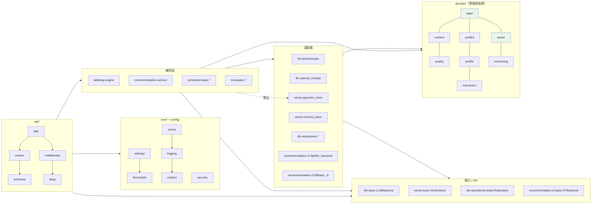

**依赖红线（CI 可静态检查）**

1. `domain/**` 只允许 `import dataclasses / enum / datetime / typing / math` 等标准库与 `domain` 内部。**禁止** `fastapi / sqlalchemy / numpy / pydantic / celery`。
2. `labeling/**`、`recommendation/**`、`evaluation/**` **禁止** `import psycopg2 / psycopg / sqlalchemy`（只能经 `db.repositories`）。
3. `llm/**`、`vector/**` 中的具体实现（`deterministic` / `pgvector_store` / `chroma_store`）**禁止**被 `domain` 引用。
4. 跨层调用只允许走 Protocol，禁止 `isinstance` 判断具体后端类；后端选择一律在 `llm/registry.py` / `vector/indexer.py` 完成。

---

### 3.1 核心类结构（Class Diagram）

```mermaid
classDiagram
    direction LR

    class Content {
        <<entity>>
        +int id
        +str raw_text
        +str clean_text
        +list labels
        +dict label_raw
        +str labels_version
        +float quality_score
        +ContentStatus status
        +QualityStatus quality_status
        +dict clean_stats
        +str pipeline_version
        +bool synthetic
    }

    class LabelDef {
        <<entity>>
        +int id
        +str code
        +int layer
        +str name
        +str description
        +str parent
        +str path
        +list ancestors
        +int max_select
        +str exclusive_group
        +bool is_feature
        +str version
        +float idf
    }

    class LabelTree {
        <<service>>
        +str version
        +load(version) LabelTree
        +node(code) LabelNode
        +ancestors(code) tuple
        +children(code) tuple
        +siblings(code) tuple
        +by_layer(layer) tuple
        +path(code) str
        +validate_release() list
    }

    class LabelCandidate {
        <<value object>>
        +int label_id
        +str code
        +int layer
        +float confidence
        +str source
        +str def_version
    }

    class ConstraintValidator {
        <<service>>
        +validate(candidates, tree, ctx) ValidationResult
        +check_c1(candidates, tree) list
        +check_c2(candidates, tree) list
        +check_c3(candidates, tree) list
        +check_c5(candidates, tree) list
        +check_c6(candidates, tree) list
        +check_c7(candidates, tree) list
        +check_c10(candidates, ctx) list
        +repair(candidates, violations) list
    }

    class PromptBuilder {
        <<service>>
        +build(content, tree, budget) PromptBundle
        +load_shards(tree, text) ShardSet
        +estimate_tokens(text) int
        +render_branch_defs(branches) str
    }

    class LabelingEngine {
        <<service>>
        +tag(content_id) TagResult
        +resolve_pipeline_version() str
        +fallback_to_rule(labels) list
    }

    class LLMBackend {
        <<interface>>
        +str name
        +str provider
        +chat(request) LLMResponse
        +embed(texts) list
        +health() BackendHealth
    }

    class DeterministicBackend {
        <<implementation>>
        +chat(request) LLMResponse
        +embed(texts) list
    }

    class OpenAICompatBackend {
        <<implementation>>
        +chat(request) LLMResponse
        +embed(texts) list
    }

    class ConflictDetector {
        <<service>>
        +detect(candidates, tree) list
        +detect_parent(candidates, tree) list
        +detect_mutual(candidates, tree) list
        +detect_exclusive(candidates, tree) list
        +detect_semantic_candidate(candidates) list
    }

    class EvidenceRetriever {
        <<service>>
        +retrieve(candidates, content, k) list
        +normalize_scores(hits) list
    }

    class Arbitrator {
        <<service>>
        +arbitrate(candidate, evidence) ArbitrationResult
        +build_cot_prompt(candidate, evidence) str
        +check_confidence(result) bool
    }

    class QualityGate {
        <<service>>
        +evaluate(content, rules, llm) QualityVerdict
        +fuse(rule_score, llm_score) float
        +decide(final_score) QualityStatus
        +append_trail(content_id, event) ReviewRecord
    }

    class UserProfile {
        <<entity>>
        +str user_id
        +dict tag_weights
        +dict label_affinity
        +bool cold_start
        +float confidence
        +int behavior_count
        +int label_dims
        +str tag_space_version
    }

    class ProfileUpdater {
        <<service>>
        +apply_event(event, profile) UserProfile
        +decay(profile, now) UserProfile
        +normalize(raw) dict
        +compute_confidence(profile) float
    }

    class VectorStore {
        <<interface>>
        +str name
        +upsert(records, batch_size) int
        +search(query, top_k, filters) list
        +search_by_tags(label_ids, top_k, filters) list
        +delete(content_ids) int
        +rebuild_index() None
    }

    class PgVectorStore {
        <<implementation>>
    }

    class TagSpace {
        <<service>>
        +layer_weight(layer) float
        +idf(label_id) float
        +build_content_vector(labels) dict
        +normalize(vec) dict
        +cosine(a, b) float
    }

    class TagVectorIndex {
        <<service>>
        +refresh() None
        +top_by_labels(label_ids, top_k) list
        +score(user_weights, candidates) list
        +invalidate() None
    }

    class RecallChannel {
        <<interface>>
        +str name
        +recall(ctx, top_k) list
    }

    class TagPreferenceRecall {
        <<implementation>>
    }

    class DenseRecall {
        <<implementation>>
    }

    class CollaborativeRecall {
        <<implementation>>
    }

    class HotLatestRecall {
        <<implementation>>
    }

    class Fusion {
        <<service>>
        +normalize_channel(scores) list
        +fuse(channels, weights) dict
        +dedup(hits) list
    }

    class Ranker {
        <<service>>
        +rerank(candidates, ctx) list
        +diversify(candidates, max_per_l2) list
        +inject_explore(candidates, ratio) list
    }

    class CFBackend {
        <<interface>>
        +str name
        +str algo
        +fit(interactions) None
        +predict(user_id, top_k) list
    }

    class FallbackCF {
        <<implementation>>
        +fit_item_cooccurrence(interactions) None
        +fit_als(interactions) None
        +predict(user_id, top_k) list
    }

    class LightFMBackend {
        <<implementation>>
    }

    class RecommendService {
        <<service>>
        +recommend(user_id, ctx) RecommendResult
        +resolve_recall_plan(ctx) tuple
        +fallback_hot_latest(ctx) list
    }

    class RecContext {
        <<value object>>
        +str request_id
        +datetime replay_ts
        +bool cache_bypass
        +int debug_level
        +tuple recall_plan
    }

    class ExposureEvent {
        <<entity>>
        +str user_id
        +int content_id
        +str action
        +datetime ts
        +str request_id
        +int rank_pos
        +str algo
        +str recall_source
        +str exp_group
    }

    class PipelineVersion {
        <<value object>>
        +str clean_rules_ver
        +str label_def_ver
        +str prompt_ver
        +str model_ver
        +str constraint_ver
        +str tag_space_ver
        +build(...) str
        +parse(s) PipelineVersion
    }

    class MetricValue {
        <<value object>>
        +str name
        +float value
        +EvidenceType evidence_type
        +int sample_size
        +date as_of
        +str pipeline_version
    }

    class EvidenceType {
        <<enumeration>>
        OFFLINE_EVALUATION
        OFFLINE_SIMULATION
        LOAD_TEST
        ENGINEERING_STAT
        ONLINE_GRAY
        ONLINE_REAL
    }

    Content "1" --> "0..*" LabelCandidate : labels
    LabelDef "0..*" --> "0..*" LabelDef : parent 自引用
    LabelTree "1" o-- "0..*" LabelDef : 装载快照
    ConstraintValidator ..> LabelTree : 依赖
    ConstraintValidator ..> LabelCandidate : 校验与修复
    PromptBuilder ..> LabelTree : 依赖
    LabelingEngine --> PromptBuilder : 装配
    LabelingEngine --> LLMBackend : 调用
    LabelingEngine ..> ConstraintValidator : 校验
    LLMBackend <|.. DeterministicBackend
    LLMBackend <|.. OpenAICompatBackend
    LabelingEngine ..> ConflictDetector : 检出
    ConflictDetector ..> LabelTree : 依赖
    EvidenceRetriever ..> VectorStore : 检索
    Arbitrator --> LLMBackend : 仲裁
    Arbitrator ..> EvidenceRetriever : 取证
    QualityGate --> LLMBackend : 评分通道
    QualityGate ..> ConflictDetector : 依赖
    ProfileUpdater ..> UserProfile : 更新
    TagSpace ..> LabelDef : 取层权与 IDF
    TagVectorIndex ..> TagSpace : 构建
    TagVectorIndex ..> VectorStore : 读取
    VectorStore <|.. PgVectorStore
    RecallChannel <|.. TagPreferenceRecall
    RecallChannel <|.. DenseRecall
    RecallChannel <|.. CollaborativeRecall
    RecallChannel <|.. HotLatestRecall
    TagPreferenceRecall ..> TagVectorIndex : 依赖
    DenseRecall ..> VectorStore : 依赖
    CollaborativeRecall ..> CFBackend : 依赖
    CFBackend <|.. FallbackCF
    CFBackend <|.. LightFMBackend
    RecommendService --> RecallChannel : 编排多路
    RecommendService --> Fusion : 融合
    RecommendService --> Ranker : 重排
    RecommendService ..> RecContext : 参数化基线
    Ranker ..> CFBackend : 重排信号
    RecommendService ..> ExposureEvent : 产出
    ProfileUpdater ..> ExposureEvent : 消费
    LabelingEngine ..> PipelineVersion : 记录
    PipelineVersion ..> MetricValue : 绑定
    LabelingEngine ..> LabelCandidate : 产出
```

### 3.2 离线批处理与在线请求的边界

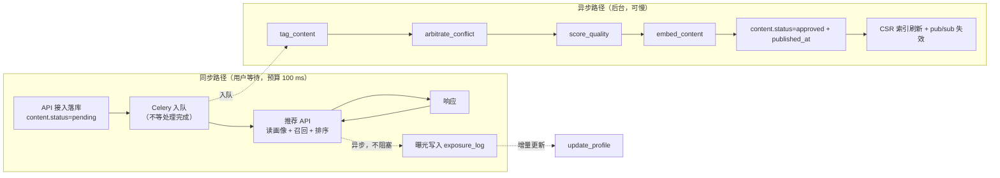

**关键边界**：

| 边界 | 规则 |
| --- | --- |
| 接入接口 | **只落库 + 入队**，返回 202 + `content_id` + `task_id`；不等待打标完成（P4-API-001） |
| 推荐接口 | 只读已 `approved` 的内容；不触发任何写操作（曝光写入异步） |
| 曝光写入 | 在响应之后异步执行，**不在用户请求关键路径** |
| 画像更新 | 异步增量；周期任务每小时做全量重建校验 |
| 批量导入 | P4-API-005（JSONL ≤ 1 万行）—— **P1，本期降级方案为逐条提交 + 本地脚本循环**；接口位与 schema 需预留 |

---

## §4 完整文件列表（可施工）

> 口径：**源文件 = `src/` 下的 Python 模块 + `scripts/` + `migrations/` 的 Python 文件**，不含测试、不含数据/配置资源。
> 行数为预估规模（误差 ±30% 属正常），供工程师排期用。
> 清单共 **136 个 .py 文件**：`src/` 127 + `scripts/` 4 + `migrations/` 5（`env.py` 与 5 个 version 脚本，`script.py.mako` 是模板不计入）。
> 全部 136 个文件在 §15 的 20 个任务中**均有归属**（无遗漏、无重复），分阶段统计见 §15.4。

### 4.1 `src/tagmind/` 源码清单

| # | 路径 | 行数 | 职责一句话 |
| --- | --- | --- | --- |
| 1 | `src/tagmind/__init__.py` | 20 | 包元信息：`__version__`、`__all__` |
| 2 | `src/tagmind/__main__.py` | 15 | `python -m tagmind` 入口，委派 CLI |
| 3 | `src/tagmind/cli.py` | 420 | Typer 多命令入口：`serve` / `migrate` / `seed-labels` / `seed` / `demo` / `bench`（Makefile 已引用）+ `eval` / `replay` / `drift` / `dlq`（新增） |
| 4 | `src/tagmind/py.typed` | 0 | PEP 561 类型标记 |
| 5 | `src/tagmind/config/__init__.py` | 15 | 配置包导出 |
| 6 | `src/tagmind/config/settings.py` | 340 | `TAGMIND_*` 全量映射（含 `.env.example` 逐项对齐 + 3 项新增） |
| 7 | `src/tagmind/config/constants.py` | 180 | 层定义/配额/状态枚举/错误码常量/规则类别字典 |
| 8 | `src/tagmind/config/thresholds.py` | 200 | 质量/冲突/融合/层权/IDF 等可调阈值集中定义 |
| 9 | `src/tagmind/config/prompt_templates.py` | 260 | 提示词模板文本与版本号（system/user/仲裁/评分四套） |
| 10 | `src/tagmind/core/__init__.py` | 10 | 核心横切包导出 |
| 11 | `src/tagmind/core/errors.py` | 180 | 异常层级 + 错误码 + `to_payload()` |
| 12 | `src/tagmind/core/logging.py` | 160 | structlog 处理器链、JSON 渲染、敏感字段脱敏 |
| 13 | `src/tagmind/core/context.py` | 120 | contextvar：request_id / trace_id / user_id / content_id |
| 14 | `src/tagmind/core/security.py` | 220 | API Key、PII 正则族、路径白名单、令牌桶限流 |
| 15 | `src/tagmind/domain/__init__.py` | 30 | 领域层导出与「零框架依赖」守卫说明 |
| 16 | `src/tagmind/domain/base.py` | 90 | 领域基类（frozen dataclass 约定、序列化助手） |
| 17 | `src/tagmind/domain/content.py` | 180 | Content / CleanStats / Chunk / ContentStatus / QualityStatus |
| 18 | `src/tagmind/domain/label.py` | 210 | LabelDef / LabelNode / LabelSet / LabelCandidate / ConflictType |
| 19 | `src/tagmind/domain/conflict.py` | 150 | ConflictCandidate / Evidence / ArbitrationResult / ReviewStatus |
| 20 | `src/tagmind/domain/quality.py` | 150 | RuleHit / LlmScore / QualityVerdict / RejectReason |
| 21 | `src/tagmind/domain/profile.py` | 140 | UserProfile / TagWeights / ProfileState |
| 22 | `src/tagmind/domain/interaction.py` | 120 | ExposureEvent / BehaviorAction / RequestContext |
| 23 | `src/tagmind/domain/vector.py` | 130 | DenseVector / TagVector / SimilarityHit |
| 24 | `src/tagmind/domain/versioning.py` | 120 | PipelineVersion / LabelDefVersion / PromptVersion 值对象 |
| 25 | `src/tagmind/db/__init__.py` | 10 | 持久化包导出 |
| 26 | `src/tagmind/db/base.py` | 90 | DeclarativeBase、公共列类型、命名约定 |
| 27 | `src/tagmind/db/session.py` | 170 | Engine/SessionFactory/连接池/`ping()` 探针 |
| 28 | `src/tagmind/db/models/__init__.py` | 40 | 全部 ORM 模型导出（保证 metadata 完整） |
| 29 | `src/tagmind/db/models/content.py` | 200 | `content` 表映射 + `content_vector` 复用公共列 |
| 30 | `src/tagmind/db/models/taxonomy.py` | 180 | `label_def` 表映射（含 path/ancestors/df/idf） |
| 31 | `src/tagmind/db/models/workflow.py` | 260 | `label_conflict_log` / `review_task` / `review_record` / `label_drift_check` |
| 32 | `src/tagmind/db/models/interaction.py` | 220 | `user_profile` / `exposure_log`（分区表） |
| 33 | `src/tagmind/db/models/vector.py` | 150 | `content_vector`（pgvector） |
| 34 | `src/tagmind/db/models/audit.py` | 230 | `llm_call_audit` / `egress_log` / `experiment` / `experiment_assignment` / `annotation_set` / `annotation` |
| 35 | `src/tagmind/db/repositories/__init__.py` | 30 | 仓储包导出 |
| 36 | `src/tagmind/db/repositories/base.py` | 140 | 仓储 Protocol 基类、事务边界、乐观锁重试 |
| 37 | `src/tagmind/db/repositories/content_repo.py` | 280 | 内容 CRUD、幂等键查询、标签/状态更新、标签过滤 |
| 38 | `src/tagmind/db/repositories/taxonomy_repo.py` | 240 | 标签定义读写、版本快照、树查询、DF/IDF 刷新 |
| 39 | `src/tagmind/db/repositories/workflow_repo.py` | 320 | 冲突日志、复核任务/轨迹、漂移记录 |
| 40 | `src/tagmind/db/repositories/interaction_repo.py` | 300 | 曝光写入（批量）、画像读写、热门榜窗口聚合 |
| 41 | `src/tagmind/db/repositories/vector_repo.py` | 240 | 向量 upsert/search/delete、HNSW 重建、标签倒排 |
| 42 | `src/tagmind/db/repositories/audit_repo.py` | 260 | LLM 审计、外发日志、实验分组、标注集读写 |
| 43 | `src/tagmind/ingestion/__init__.py` | 15 | 预处理包导出 |
| 44 | `src/tagmind/ingestion/pipeline.py` | 260 | 接入 → 清洗 → 分块 → 脱敏 → 落库的阶段编排 |
| 45 | `src/tagmind/ingestion/cleaner.py` | 320 | HTML/表情/广告清洗、Unicode 归一化、`clean_stats` 产出 |
| 46 | `src/tagmind/ingestion/chunker.py` | 200 | 分块分句、token 估算、覆盖率与偏移量记录 |
| 47 | `src/tagmind/ingestion/pii.py` | 240 | PII 识别、占位符映射、哈希落库、只记类型不记原值 |
| 48 | `src/tagmind/ingestion/rules.py` | 280 | 敏感词/广告词/营销话术加载、版本指纹、热加载 |
| 49 | `src/tagmind/ingestion/ad_detector.py` | 230 | 四判据广告残留检测与可解释命中明细 |
| 50 | `src/tagmind/ingestion/dedup.py` | 90 | 归一化哈希与幂等键生成 |
| 51 | `src/tagmind/labeling/__init__.py` | 15 | 打标包导出 |
| 52 | `src/tagmind/labeling/taxonomy.py` | 300 | 12 层树装载、邻接表+物化路径、祖先闭包查询 |
| 53 | `src/tagmind/labeling/prompt_builder.py` | 340 | 提示词装配器：分片 + L4 检索注入 + token 预算控制 |
| 54 | `src/tagmind/labeling/parser.py` | 200 | JSON 容错解析与修复性提取、字段级错误定位 |
| 55 | `src/tagmind/labeling/constraints.py` | 420 | C1–C7 + C10 校验器与自动修复（零 LLM 成本） |
| 56 | `src/tagmind/labeling/engine.py` | 380 | 打标编排：装载→装配→调用→解析→校验→落库 |
| 57 | `src/tagmind/labeling/conflict/__init__.py` | 10 | 冲突子包导出 |
| 58 | `src/tagmind/labeling/conflict/detector.py` | 320 | 四类冲突检测（parent/mutual/exclusive/semantic_candidate） |
| 59 | `src/tagmind/labeling/conflict/retriever.py` | 280 | 标签定义 + 金标 top-k 检索，证据带 score 与来源 |
| 60 | `src/tagmind/labeling/conflict/arbitrator.py` | 300 | CoT 提示模板、结构化解析、置信度闸门与转人工 |
| 61 | `src/tagmind/labeling/quality/__init__.py` | 10 | 质量子包导出 |
| 62 | `src/tagmind/labeling/quality/rules_channel.py` | 280 | 敏感词/长度/广告残留规则通道，类目差异化阈值 |
| 63 | `src/tagmind/labeling/quality/llm_channel.py` | 180 | 0–10 分评分通道 + 理由锚定 + 解析失败不默认放行 |
| 64 | `src/tagmind/labeling/quality/gate.py` | 340 | 双通道融合、阈值闸门、一票否决、降级标记、轨迹追加 |
| 65 | `src/tagmind/llm/__init__.py` | 15 | LLM 包导出 |
| 66 | `src/tagmind/llm/base.py` | 200 | `LLMBackend` Protocol、请求/响应 DTO、错误分类 |
| 67 | `src/tagmind/llm/deterministic.py` | 420 | 规则+词典+启发式打标与评分后端，零密钥可复现 |
| 68 | `src/tagmind/llm/openai_compat.py` | 260 | OpenAI 兼容客户端（本地端点 + 云端 API 共用） |
| 69 | `src/tagmind/llm/registry.py` | 200 | 后端选择与降级策略、`backend` 标签透传 |
| 70 | `src/tagmind/llm/structured_output.py` | 150 | 输出 JSON Schema 定义与校验 |
| 71 | `src/tagmind/llm/audit.py` | 160 | LLM 调用审计写入 + `prompt_hash` 校验还原 |
| 72 | `src/tagmind/vector/__init__.py` | 15 | 向量包导出 |
| 73 | `src/tagmind/vector/base.py` | 180 | `VectorStore` / `Embedder` Protocol 与命中结构 |
| 74 | `src/tagmind/vector/pgvector_store.py` | 300 | pgvector 实现：HNSW、cosine、标签过滤 upsert |
| 75 | `src/tagmind/vector/chroma_store.py` | 240 | Chroma 实现（开发态可插拔替代） |
| 76 | `src/tagmind/vector/embedding.py` | 260 | Embedder 适配 + hashing 确定性回退 + 批处理 |
| 77 | `src/tagmind/vector/tag_space.py` | 320 | 层权 + IDF 归一化标签向量、稀疏矩阵构建、余弦 |
| 78 | `src/tagmind/vector/indexer.py` | 280 | 向量写入/重建、TagVectorIndex 周期刷新、门控 |
| 79 | `src/tagmind/profile/__init__.py` | 15 | 画像包导出 |
| 80 | `src/tagmind/profile/builder.py` | 240 | 全量重建用户画像（含重算校验） |
| 81 | `src/tagmind/profile/updater.py` | 260 | 增量权重更新、置信度、冷启动判定 |
| 82 | `src/tagmind/profile/decay.py` | 180 | 半衰期衰减与归一化 |
| 83 | `src/tagmind/profile/drift.py` | 170 | 兴趣漂移 TV 距离检测 |
| 84 | `src/tagmind/recommendation/__init__.py` | 15 | 推荐包导出 |
| 85 | `src/tagmind/recommendation/service.py` | 400 | 召回编排、兜底、结果装配与归因 |
| 86 | `src/tagmind/recommendation/fusion.py` | 260 | 各路归一化 + 加权融合 + 去重 |
| 87 | `src/tagmind/recommendation/ranker.py` | 320 | 重排、打散、探索位、截断 |
| 88 | `src/tagmind/recommendation/recall/__init__.py` | 10 | 召回子包导出 |
| 89 | `src/tagmind/recommendation/recall/base.py` | 150 | `RecallChannel` Protocol 与候选结构 |
| 90 | `src/tagmind/recommendation/recall/tag_preference.py` | 220 | 标签偏好召回（内积） |
| 91 | `src/tagmind/recommendation/recall/dense.py` | 200 | 稠密向量 ANN 召回 |
| 92 | `src/tagmind/recommendation/recall/collaborative.py` | 220 | 协同过滤召回 + 交互不足跳过原因 |
| 93 | `src/tagmind/recommendation/recall/hot_latest.py` | 200 | 热门 + 最新兜底（回放模式重算） |
| 94 | `src/tagmind/recommendation/cf/__init__.py` | 10 | CF 子包导出 |
| 95 | `src/tagmind/recommendation/cf/base.py` | 160 | `CFBackend` Protocol、统一 `predict`、口径标签 |
| 96 | `src/tagmind/recommendation/cf/lightfm_backend.py` | 280 | LightFM 适配（可选依赖），不可用即明确降级 |
| 97 | `src/tagmind/recommendation/cf/fallback_cf.py` | 420 | 纯 NumPy item-based 共现 + ALS/BPR 实现 |
| 98 | `src/tagmind/api/__init__.py` | 10 | API 包导出 |
| 99 | `src/tagmind/api/app.py` | 260 | FastAPI 应用工厂：中间件/异常/路由/生命周期 |
| 100 | `src/tagmind/api/deps.py` | 220 | Session / 仓储 / 向量库 / LLM 后端注入 |
| 101 | `src/tagmind/api/middleware.py` | 240 | request_id、鉴权、DEMO_MODE、限流、访问日志 |
| 102 | `src/tagmind/api/errors.py` | 140 | 异常 → HTTP 映射与统一错误体 |
| 103 | `src/tagmind/api/schemas/__init__.py` | 20 | Schema 包导出 |
| 104 | `src/tagmind/api/schemas/common.py` | 180 | 分页、错误体、标签节点/树、复核、标签体系查询响应 |
| 105 | `src/tagmind/api/schemas/content.py` | 200 | 内容接入/状态查询请求与响应 |
| 106 | `src/tagmind/api/routers/__init__.py` | 10 | 路由包导出 |
| 107 | `src/tagmind/api/routers/content.py` | 260 | 接入、批量、状态、重打 |
| 108 | `src/tagmind/api/routers/labels.py` | 240 | 标签树查询、覆盖率、版本查询 |
| 109 | `src/tagmind/api/routers/recommend.py` | 300 | 推荐、反馈、归因统计 |
| 110 | `src/tagmind/api/routers/admin.py` | 320 | 复核、阈值、规则热加载、演示态开关 |
| 111 | `src/tagmind/observability/__init__.py` | 10 | 可观测包导出 |
| 112 | `src/tagmind/observability/metrics.py` | 320 | ≥15 个 Prometheus 指标定义与注册 |
| 113 | `src/tagmind/observability/health.py` | 260 | 分组件健康探针与聚合状态 |
| 114 | `src/tagmind/observability/alerts.py` | 180 | ≥5 条告警规则定义与格式校验 |
| 115 | `src/tagmind/scheduler/__init__.py` | 10 | 调度包导出 |
| 116 | `src/tagmind/scheduler/celery_app.py` | 240 | Celery 应用、队列路由、DLQ 落地、重试策略 |
| 117 | `src/tagmind/scheduler/tasks/__init__.py` | 30 | 任务注册入口 |
| 118 | `src/tagmind/scheduler/tasks/labeling.py` | 260 | 打标/仲裁/审核任务，幂等与 checkpoint |
| 119 | `src/tagmind/scheduler/tasks/profile.py` | 220 | 画像重建、热门榜刷新、向量重建 |
| 120 | `src/tagmind/scheduler/tasks/maintenance.py` | 240 | 分区维护、保留清理、漂移抽检、规则热加载 |
| 121 | `src/tagmind/evaluation/__init__.py` | 10 | 评测包导出 |
| 122 | `src/tagmind/evaluation/gold.py` | 280 | 金标集加载/校验 + 500 条合成参考集生成 + 语料生成器 |
| 123 | `src/tagmind/evaluation/agreement.py` | 200 | Cohen's κ 双盲一致性计算 |
| 124 | `src/tagmind/evaluation/metrics.py` | 300 | 分层 P/R/F1、support、low_support、微平均 |
| 125 | `src/tagmind/evaluation/replay.py` | 380 | 离线回放 A/B（业务基线 + 三条消融 + 7 日回访代理） |
| 126 | `src/tagmind/evaluation/drift_check.py` | 260 | 每周 200 条抽检 → 抽检表 + 一致率 + 漂移判定 |
| 127 | `src/tagmind/evaluation/report.py` | 240 | 报告渲染，统一注入 `evidence_type`/`sample_size`/`as_of` |

### 4.2 `scripts/` 清单

| # | 路径 | 行数 | 职责一句话 |
| --- | --- | --- | --- |
| 128 | `scripts/seed_demo.py` | 200 | 一键灌种子：标签体系、合成内容、合成曝光日志、合成金标 |
| 129 | `scripts/generate_corpus.py` | 180 | 合成语料生成器（20 L1 × 5 L2 长文本），标注来源 |
| 130 | `scripts/consistency_check.py` | 260 | 数据一致性巡检：向量↔标签、profile↔exposure、迁移后校验 |
| 131 | `scripts/bench_recall.py` | 220 | 推荐链路压测：P50/P95/P99、QPS、空结果率 |

### 4.3 `migrations/` 清单（Alembic）

| # | 路径 | 行数 | 职责一句话 |
| --- | --- | --- | --- |
| 132 | `migrations/env.py` | 120 | Alembic 环境：URL 注入、target_metadata 绑定、离线/在线模式 |
| 133 | `migrations/script.py.mako` | 40 | 迁移模板 |
| 134 | `migrations/versions/0001_extensions_and_types.py` | 90 | 启用 `vector` / `pg_trgm` 扩展、创建公共域与枚举域 |
| 135 | `migrations/versions/0002_core_tables.py` | 420 | `content` / `label_def` / `label_conflict_log` / `user_profile` |
| 136 | `migrations/versions/0003_interaction_and_vector.py` | 260 | `exposure_log` 分区表 / `content_vector` / `pii_mask_map` |
| 137 | `migrations/versions/0004_workflow_and_audit.py` | 380 | `review_task` / `review_record` / `llm_call_audit` / `egress_log` |
| 138 | `migrations/versions/0005_experiment_and_annotation.py` | 260 | `experiment` / `experiment_assignment` / `annotation_set` / `annotation` / `label_drift_check` |

### 4.4 资源与基础设施（非 Python 源文件，但必须同步交付）

| 路径 | 职责 |
| --- | --- |
| `Dockerfile` | 单一镜像（api / worker / beat 复用，`TAGMIND_ROLE` 切换） |
| `docker-compose.yml` | api / worker / beat / postgres(pgvector 镜像) / redis 五个服务 |
| `Makefile` | `make up` / `make migrate` / `make seed` / `make demo` / `make test` / `make lint` / `make eval` / `make replay` |
| `.github/workflows/ci.yml` | lint + mypy + pytest（cov ≥ 70）+ 密钥扫描 + 依赖漏洞扫描 + 迁移幂等 |
| `.github/workflows/nightly.yml` | 夜间全量评测 + 回放，产出 artifact 报告 |
| `rules/sensitive_words.txt` | 示例敏感词集（示例集声明） |
| `rules/ad_words.txt` | 示例广告词与营销话术集 |
| `rules/exclusive_groups.yaml` | 显式互斥组定义（L12 情感组等） |
| `data/label_taxonomy/*.yaml` | 12 层标签体系种子（分层文件，合计 1200–1800 条） |
| `data/gold/gold_v1.jsonl` | 500 条合成参考集（`synthetic_gold=true`） |
| `data/sample/demo_corpus.jsonl` | 20 条演示内容 |
| `data/fixtures/*.json` | 单测夹具（冲突样本、脏数据、越界样本） |
| `LICENSE` | Apache-2.0 |
| `README.md` | 架构、快速启动、**指标口径表**、已知限制、数据与合规声明 |
| `docs/runbook.md` | 故障处置手册（NF-O08） |
| `docs/metrics-report.md` | 指标报告（所有数字带 `evidence_type`） |
| `docs/adr/ADR-0001~0010.md` | 10 篇架构决策记录 |
| `.env.example` | 已在仓库存在；本次新增 3 项（见 §14.1），其余逐项对齐不改名 |

### 4.5 测试文件规模规划（不计入源文件统计）

| 目录 | 文件数 | 覆盖重点 |
| --- | --- | --- |
| `tests/unit/` | 约 34 | 清洗/分块/约束 C1–C10/标签向量数学/融合归一化/ALS/κ/指标/解析/异常/脱敏 |
| `tests/integration/` | 约 22 | 迁移幂等、仓储事务、API 契约、Celery 幂等、向量写入检索、回放一致性 |
| `tests/fixtures/` | 约 10 | JSON 夹具与工厂函数 |
| `tests/conftest.py` | 1 | DB/Redis 可用性探测与 `skip` 策略（§14.8） |

---

## §5 数据模型与最终 DDL

### 5.0 表清单与 PRD §6 的对应

PRD §6 的「12 张表」按物理表拆开是 **15 张**（`review_task`/`review_record`、`experiment`/`experiment_assignment`、`annotation_set`/`annotation` 均为成对两张），加上 NF-S03 要求的 `egress_log` 外发日志，共 **16 张物理表**。

| # | 物理表 | PRD §6 分组 | 关键点 |
| --- | --- | --- | --- |
| 1 | `content` | §6.1 | 内容主表；含 `label_ids` 数组扩展列（GIN） |
| 2 | `label_def` | §6.2 | 标签定义；邻接表 `parent` + 物化路径 `path` + `ancestors` |
| 3 | `label_conflict_log` | §6.3 | 冲突与仲裁全量日志，7 要素齐全 |
| 4 | `user_profile` | §6.4 | 用户标签权重画像 |
| 5 | `exposure_log` | §6.5 | **按月 RANGE 分区**，90 天保留，`synthetic` 标记 |
| 6 | `content_vector` | §6.6 | pgvector `VECTOR(1024)` + HNSW + `tag_vector` JSONB |
| 7 | `llm_call_audit` | §6.7 | LLM 调用审计，`prompt_hash` 可还原 |
| 8 | `review_task` | §6.8 | 人工复核任务 |
| 9 | `review_record` | §6.8 | 复核轨迹（**追加式，不可改写**） |
| 10 | `experiment` | §6.9 | A/B 实验定义 |
| 11 | `experiment_assignment` | §6.9 | 用户分组（`hash(user_id, salt)` 稳定） |
| 12 | `annotation_set` | §6.10 | 金标集（含 `synthetic_gold` 标记） |
| 13 | `annotation` | §6.10 | 标注明细（含 Cohen's κ） |
| 14 | `label_drift_check` | §6.11 | 漂移周检记录 |
| 15 | `pii_mask_map` | §6.12 | PII 脱敏映射（**只存哈希**） |
| 16 | `egress_log` | NF-S03 增补 | 外发请求留痕（**不含正文**） |

### 5.1 扩展与公共约定

```sql
-- migrations/versions/0001_extensions_and_types.py 的等价效果
CREATE EXTENSION IF NOT EXISTS vector;      -- pgvector
CREATE EXTENSION IF NOT EXISTS pg_trgm;     -- 标签名/内容模糊检索
CREATE EXTENSION IF NOT EXISTS btree_gin;   -- JSONB + 标量复合索引

-- 所有时间戳统一 UTC
CREATE DOMAIN ts_tz   AS TIMESTAMPTZ NOT NULL;
-- 质量分域：0-10，一位小数
CREATE DOMAIN quality_score_t AS NUMERIC(3,1)
  CHECK (VALUE >= 0 AND VALUE <= 10);
-- 置信度域：0-1
CREATE DOMAIN confidence_t AS NUMERIC(4,3)
  CHECK (VALUE >= 0 AND VALUE <= 1);
-- 状态枚举域
CREATE DOMAIN content_status_t AS VARCHAR(16)
  CHECK (VALUE IN ('pending','processing','approved','rejected','needs_review','archived'));
CREATE DOMAIN quality_status_t AS VARCHAR(16)
  CHECK (VALUE IN ('approved','rejected','needs_review'));
CREATE DOMAIN conflict_type_t AS VARCHAR(24)
  CHECK (VALUE IN ('parent','mutual','exclusive','semantic_candidate'));
CREATE DOMAIN review_status_t AS VARCHAR(16)
  CHECK (VALUE IN ('pending','approved','overridden','auto'));
CREATE DOMAIN action_t AS VARCHAR(8) CHECK (VALUE IN ('view','click','skip','dwell'));
```

**公共约定**

| 约定 | 规则 |
| --- | --- |
| 主键 | 全部 `BIGINT GENERATED BY DEFAULT AS IDENTITY`（不用 `SERIAL`，便于后续切 UUID） |
| 时间 | 一律 `TIMESTAMPTZ`，默认 `now()`；`updated_at` 由 `BEFORE UPDATE` 触发器维护 |
| 命名 | 表/索引/约束全小写蛇形；索引前缀 `ix_<表>_<列>`，唯一索引 `ux_`，检查约束 `ck_`，外键 `fk_` |
| JSONB | 一律带 `CHECK (jsonb_typeof(col) IN ('object','array'))` |
| 幂等 | 写路径统一带 `idempotency_key` 或业务唯一键；`ON CONFLICT DO NOTHING` 兜底 |
| 原始不可变 | `raw_text` / `label_raw` / `review_record` 只增不改；修正走新版本行 |

### 5.2 `content` — 内容主表（完整 DDL）

```sql
CREATE TABLE content (
    id                BIGINT GENERATED BY DEFAULT AS IDENTITY PRIMARY KEY,
    raw_text          TEXT        NOT NULL,              -- 原始正文（未脱敏，受控访问）
    clean_text        TEXT        NOT NULL,              -- 清洗 + 脱敏后正文
    labels            JSONB       NOT NULL DEFAULT '[]'::jsonb
                      CHECK (jsonb_typeof(labels) = 'array'),
    label_raw         JSONB       CHECK (label_raw IS NULL OR jsonb_typeof(label_raw) = 'object'),
    label_confidence  JSONB       CHECK (label_confidence IS NULL OR jsonb_typeof(label_confidence) = 'object'),
    label_stats       JSONB       CHECK (label_stats IS NULL OR jsonb_typeof(label_stats) = 'object'),
    labels_version    VARCHAR(64) NOT NULL,              -- 打标当时生效的 label_def.version
    quality_score     quality_score_t,
    quality_reason    TEXT,
    quality_status    quality_status_t NOT NULL DEFAULT 'needs_review',
    status            content_status_t NOT NULL DEFAULT 'pending',
    reject_reason     JSONB       CHECK (reject_reason IS NULL OR jsonb_typeof(reject_reason) = 'object'),
    clean_stats       JSONB       CHECK (clean_stats IS NULL OR jsonb_typeof(clean_stats) = 'object'),
    chunks            JSONB       CHECK (chunks IS NULL OR jsonb_typeof(chunks) = 'array'),
    pii_masked        BOOLEAN     NOT NULL DEFAULT FALSE,
    pii_fields        JSONB       CHECK (pii_fields IS NULL OR jsonb_typeof(pii_fields) = 'array'),
    source            VARCHAR(32),                       -- RSS / crawler / api / upload / synthetic
    content_hash      VARCHAR(64),                       -- 归一化内容哈希（去重）
    idempotency_key   VARCHAR(128),
    embedding_version VARCHAR(64),
    model_version     VARCHAR(128),
    prompt_version    VARCHAR(64),
    pipeline_version  VARCHAR(128) NOT NULL,             -- 清洗+体系+提示+模型+约束+特征空间 的组合版本
    -- ↓↓↓ 扩展列（PRD 未列，但为召回/投放查询所必需，理由见 §5.9） ↓↓↓
    label_ids         BIGINT[]   NOT NULL DEFAULT '{}',  -- labels 中的 label_id 平铺，供 GIN 倒排
    layer_label_ids   BIGINT[]   NOT NULL DEFAULT '{}',  -- 仅 L1-L4 的 label_id
    l1_code           VARCHAR(64),                       -- 一级类目 code，便于按类目过滤
    l2_code           VARCHAR(64),
    synthetic         BOOLEAN     NOT NULL DEFAULT FALSE,-- 合成数据标记（Q10）
    media_refs        JSONB       NOT NULL DEFAULT '[]'::jsonb,  -- P4-TAG-009 预留，本期不处理
    created_at        TIMESTAMPTZ NOT NULL DEFAULT now(),
    updated_at        TIMESTAMPTZ NOT NULL DEFAULT now(),
    published_at      TIMESTAMPTZ,

    CONSTRAINT ux_content_idempotency UNIQUE (idempotency_key),
    CONSTRAINT ck_content_clean_nonempty CHECK (length(clean_text) >= 1),
    CONSTRAINT ck_content_published CHECK (
        (status = 'approved' AND published_at IS NOT NULL)
        OR status <> 'approved'
    )
);

-- 标签过滤（投放/召回倒排）
CREATE INDEX ix_content_label_ids      ON content USING GIN (label_ids);
CREATE INDEX ix_content_layer_label_ids ON content USING GIN (layer_label_ids);
-- 运营/评测常用组合索引
CREATE INDEX ix_content_status_qscore  ON content (status, quality_score);
CREATE INDEX ix_content_created        ON content (created_at DESC);
CREATE INDEX ix_content_hash           ON content (content_hash);
CREATE INDEX ix_content_labels_version ON content (labels_version);
-- 分发索引：只索引已发布内容（部分索引，控体积）
CREATE INDEX ix_content_dispatchable
    ON content (published_at DESC)
    WHERE status = 'approved' AND quality_status = 'approved';

-- updated_at 自动维护
CREATE OR REPLACE FUNCTION fn_set_updated_at() RETURNS TRIGGER
LANGUAGE plpgsql AS $$
BEGIN NEW.updated_at := now(); RETURN NEW; END $$;

CREATE TRIGGER tg_content_updated_at BEFORE UPDATE ON content
    FOR EACH ROW EXECUTE FUNCTION fn_set_updated_at();
```

**`content` 的 JSONB 字段结构契约**

```jsonc
// labels: [{ "label_id": 123, "code": "C_AI", "layer": 2, "name": "人工智能",
//            "confidence": 0.92, "source": "llm|rule|rag|derived|manual",
//            "def_version": "ld_v3" }]
// label_raw: { "backend": "deterministic|llm_local|llm_api",
//              "raw_text": "<原始模型输出，原样保留>",
//              "parsed": true, "repair_hint": null }
// label_confidence: { "123": 0.92 }
// label_stats: { "per_layer": {"1": 1, "2": 1, "3": 2},
//                 "truncated": [{"layer": 5, "dropped": ["C_X"]}],
//                 "derived_ancestors": 2, "repaired": ["C2"], "violations": [] }
// clean_stats: { "raw_len": 5213, "clean_len": 4801, "truncated_len": 0,
//                 "removed_tags": 12, "removed_ads": 3, "removed_emoji": 41,
//                 "chunks": 3, "noise_chars": 57 }
// chunks: [{ "idx": 0, "offset": 0, "len": 1800, "token_est": 1200 }]
// reject_reason: { "code": "rule_hit", "rule_id": "AD-003",
//                   "detail": {...}, "hits": [{"rule_id":"AD-003","span":[12,18],"matched":"点击购买"}] }
```

### 5.3 `label_def` — 12 层标签体系定义（完整 DDL）

```sql
CREATE TABLE label_def (
    id                BIGINT GENERATED BY DEFAULT AS IDENTITY PRIMARY KEY,
    code              VARCHAR(64)  NOT NULL,             -- 稳定编码，跨版本不变
    layer             SMALLINT     NOT NULL CHECK (layer BETWEEN 1 AND 12),
    name              VARCHAR(128) NOT NULL,
    description       TEXT         NOT NULL,              -- 进 system prompt
    examples          JSONB        NOT NULL DEFAULT '[]'::jsonb
                      CHECK (jsonb_typeof(examples) = 'array'),
    parent            VARCHAR(64),                       -- 父 code；L1 必须为 NULL
    max_select        SMALLINT     NOT NULL DEFAULT 1 CHECK (max_select >= 0),
    exclusive_group   VARCHAR(64),                       -- 显式互斥组（同组最多 1）
    sibling_exclusion JSONB        NOT NULL DEFAULT '[]'::jsonb
                      CHECK (jsonb_typeof(sibling_exclusion) = 'array'),
    is_feature        BOOLEAN      NOT NULL DEFAULT TRUE,-- 是否入召回特征（§4.7）
    status            VARCHAR(16)  NOT NULL DEFAULT 'active'
                      CHECK (status IN ('active','deprecated')),
    version           VARCHAR(64)  NOT NULL,             -- 标签体系版本
    -- ↓↓↓ 扩展列 ↓↓↓
    path              VARCHAR(1024) NOT NULL,             -- 物化路径 'D_TECH/C_AI/大模型与LLM'
    path_text         TEXT         NOT NULL,             -- path 的 lowercase 物化，供前缀查询
    depth             SMALLINT     NOT NULL,             -- = layer，便于校验
    ancestors         TEXT[]       NOT NULL DEFAULT '{}',-- L1..L(k-1) 的 code 有序数组
    root_code         VARCHAR(64)  NOT NULL,             -- 所属 L1
    df_count          BIGINT       NOT NULL DEFAULT 0,   -- 语料文档频次（IDF 用）
    idf               DOUBLE PRECISION,                  -- 由 df_count 派生的 IDF（可空，未刷新）
    path_prefix       VARCHAR(1024) NOT NULL,            -- 祖先路径前缀 'D_TECH/C_AI/'
    created_at        TIMESTAMPTZ NOT NULL DEFAULT now(),
    updated_at        TIMESTAMPTZ NOT NULL DEFAULT now(),

    CONSTRAINT ux_label_def_version_code UNIQUE (version, code),
    CONSTRAINT ux_label_def_version_path UNIQUE (version, path),
    CONSTRAINT ck_label_def_layer_parent CHECK (
        (layer = 1  AND parent IS NULL) OR
        (layer > 1  AND parent IS NOT NULL)
    ),
    CONSTRAINT ck_label_def_depth      CHECK (depth = layer),
    CONSTRAINT ck_label_def_max_select CHECK (max_select <= 8)
);

CREATE INDEX ix_label_def_version_layer ON label_def (version, layer);
CREATE INDEX ix_label_def_parent        ON label_def (version, parent);
CREATE INDEX ix_label_def_path_prefix   ON label_def (version, path_prefix text_pattern_ops);
CREATE INDEX ix_label_def_ancestors     ON label_def USING GIN (ancestors);
CREATE INDEX ix_label_def_code          ON label_def (code);   -- 跨版本定位（code 跨版本稳定）
CREATE INDEX ix_label_def_exclusive     ON label_def (exclusive_group) WHERE exclusive_group IS NOT NULL;
CREATE INDEX ix_label_def_name_trgm     ON label_def USING GIN (name gin_trgm_ops);
```

**版本化语义（关键）**

- `code` **跨版本不变**（PRD §6.2），因此**不能**全局 UNIQUE，只能 `UNIQUE(version, code)`。PRD §6.2 字段表把 `code` 标为 `UNIQUE NOT NULL`，与「跨版本不变」自相矛盾 → 见 §16.2 歧义 A-01。
- `content.labels[].def_version` 记录每个标签来自哪个体系版本，配合 `content.labels_version` 实现 C10 版本一致性。
- 一次发布的标签体系版本 = 一组 `(version, code, ...)` 行。**新版本 = 复制上一版本行 + 插入变更行**，旧版本行保留（`status='deprecated'` 只标记，不再被新内容引用）。
- 回滚 = 把「当前生效版本指针」切回旧版本（见 §12.1），**不删数据**。

### 5.4 `label_conflict_log` — 冲突与仲裁全量日志（完整 DDL）

```sql
CREATE TABLE label_conflict_log (
    id                       BIGINT GENERATED BY DEFAULT AS IDENTITY PRIMARY KEY,
    content_id               BIGINT NOT NULL REFERENCES content(id) ON DELETE CASCADE,
    candidates               JSONB   NOT NULL CHECK (jsonb_typeof(candidates) = 'array'),
    resolved                 JSONB   CHECK (resolved IS NULL OR jsonb_typeof(resolved) = 'array'),
    reason                   TEXT,
    conflict_type            conflict_type_t NOT NULL,
    detected_by              VARCHAR(8) NOT NULL CHECK (detected_by IN ('rule','llm','human')),
    retrieved_evidence_ids   JSONB   CHECK (retrieved_evidence_ids IS NULL OR jsonb_typeof(retrieved_evidence_ids) = 'array'),
    retrieved_scores         JSONB   CHECK (retrieved_scores IS NULL OR jsonb_typeof(retrieved_scores) = 'object'),
    arbitrator_model         VARCHAR(128),
    arbitrator_prompt_version VARCHAR(64),
    confidence               confidence_t,
    review_status            review_status_t NOT NULL DEFAULT 'pending',
    reviewer                 VARCHAR(64),
    reviewed_at              TIMESTAMPTZ,
    resolved_before          JSONB   CHECK (resolved_before IS NULL OR jsonb_typeof(resolved_before) = 'array'),
    -- ↓↓↓ 扩展列：保证「冲突可追溯率 100%」可被机器校验 ↓↓↓
    rule_hits                JSONB   NOT NULL DEFAULT '[]'::jsonb,  -- 确定性冲突的命中说明
    evidence_detail          JSONB   NOT NULL DEFAULT '[]'::jsonb,  -- 证据全文快照（含 matched_label/source/score）
    pipeline_version         VARCHAR(128),
    label_def_version        VARCHAR(64),
    model_version            VARCHAR(128),
    prompt_version           VARCHAR(64),
    trace_id                 VARCHAR(64),
    created_at               TIMESTAMPTZ NOT NULL DEFAULT now()
);

CREATE INDEX ix_conflict_content      ON label_conflict_log (content_id, created_at DESC);
CREATE INDEX ix_conflict_review       ON label_conflict_log (review_status, created_at DESC);
CREATE INDEX ix_conflict_type         ON label_conflict_log (conflict_type);
CREATE INDEX ix_conflict_created      ON label_conflict_log (created_at DESC);
CREATE INDEX ix_conflict_candidates   ON label_conflict_log USING GIN (candidates jsonb_path_ops);
```

**7 要素完整性校验**（§13 一致性校验 C3）：`candidates`、`evidence_detail`、`resolved`、`reason`、`arbitrator_model`、`confidence`、`review_status` 七者非空率必须为 100%，由 `scripts/consistency_check.py` 每日巡检。

### 5.5 `user_profile` — 用户画像（完整 DDL）

```sql
CREATE TABLE user_profile (
    user_id          VARCHAR(64) PRIMARY KEY,
    tag_weights      JSONB   NOT NULL DEFAULT '{}'::jsonb
                     CHECK (jsonb_typeof(tag_weights) = 'object'),
    cold_start       BOOLEAN NOT NULL DEFAULT TRUE,
    confidence       confidence_t NOT NULL DEFAULT 0,
    behavior_count   INTEGER NOT NULL DEFAULT 0 CHECK (behavior_count >= 0),
    label_dims       INTEGER NOT NULL DEFAULT 0 CHECK (label_dims >= 0),
    decay_lambda     NUMERIC(8,6) NOT NULL DEFAULT 0.95
                     CHECK (decay_lambda > 0 AND decay_lambda <= 1),
    last_behavior_at TIMESTAMPTZ,
    drift_detected   BOOLEAN NOT NULL DEFAULT FALSE,
    drift_score      NUMERIC(8,6) CHECK (drift_score IS NULL OR (drift_score >= 0 AND drift_score <= 1)),
    model_version    VARCHAR(64),
    updated_at       TIMESTAMPTZ NOT NULL DEFAULT now(),
    -- ↓↓↓ 扩展列 ↓↓↓
    label_weight_norm DOUBLE PRECISION NOT NULL DEFAULT 0, -- ||tag_weights||_2，供余弦
    tag_space_version  VARCHAR(64),                       -- 与 content_vector.tag_vector 同一空间版本
    cold_start_threshold INTEGER NOT NULL DEFAULT 10,    -- 可配阈值，非硬编码
    weights_sum      DOUBLE PRECISION NOT NULL DEFAULT 0, -- 自洽校验：归一化后应为 1
    synthetic        BOOLEAN NOT NULL DEFAULT FALSE
);

CREATE INDEX ix_profile_tag_weights ON user_profile USING GIN (tag_weights jsonb_path_ops);
CREATE INDEX ix_profile_cold_start ON user_profile (cold_start) WHERE cold_start;
CREATE INDEX ix_profile_updated    ON user_profile (updated_at DESC);
CREATE INDEX ix_profile_drift      ON user_profile (drift_detected) WHERE drift_detected;
```

### 5.6 `exposure_log` — 曝光与行为流水（按月分区，完整 DDL）

```sql
CREATE TABLE exposure_log (
    id                 BIGINT GENERATED BY DEFAULT AS IDENTITY,
    user_id            VARCHAR(64) NOT NULL,
    content_id         BIGINT NOT NULL REFERENCES content(id) ON DELETE CASCADE,
    action             action_t NOT NULL,
    ts                 TIMESTAMPTZ NOT NULL,
    dwell_ms           INTEGER CHECK (dwell_ms IS NULL OR dwell_ms >= 0),
    request_id         VARCHAR(64) NOT NULL,
    rank_pos           SMALLINT CHECK (rank_pos IS NULL OR rank_pos >= 1),
    score              NUMERIC(10,6),
    algo               VARCHAR(32),                      -- lightfm / fallback_cf / recall_only / hot / latest / explore
    recall_source      VARCHAR(32),                      -- tag_preference / vector_similarity / collaborative / hot / latest / explore
    exp_group          VARCHAR(32) NOT NULL DEFAULT 'default',
    request_latency_ms INTEGER,
    synthetic          BOOLEAN NOT NULL DEFAULT FALSE,   -- Q10：种子日志必须为 true
    created_at         TIMESTAMPTZ NOT NULL DEFAULT now(),

    PRIMARY KEY (id, ts)
) PARTITION BY RANGE (ts);

-- 默认分区兜底（防止越界写入失败），由维护任务按月预建分区后迁移
CREATE TABLE exposure_log_default PARTITION OF exposure_log DEFAULT;

-- 分区表上的索引自动级联到各分区
CREATE INDEX ix_exposure_user_ts   ON exposure_log (user_id, ts DESC);
CREATE INDEX ix_exposure_content    ON exposure_log (content_id);
CREATE INDEX ix_exposure_group_ts   ON exposure_log (exp_group, ts);
CREATE INDEX ix_exposure_request    ON exposure_log (request_id);
CREATE INDEX ix_exposure_action_ts  ON exposure_log (action, ts DESC);
CREATE INDEX ix_exposure_recall_src ON exposure_log (recall_source, ts DESC);

-- 幂等：同一请求内同一内容同一动作只落一行
CREATE UNIQUE INDEX ux_exposure_idem ON exposure_log (request_id, content_id, action, ts);
```

**分区维护契约**（`scheduler/tasks/maintenance.py`）

| 动作 | 频率 | 说明 |
| --- | --- | --- |
| 预建分区 | 每日 03:30 | 预建「下月 + 后月」，`FOR VALUES FROM ... TO ...` |
| 清理旧分区 | 每日 04:00 | `DROP TABLE` 90 天前的分区（比 `DELETE` 快一个数量级） |
| DEFAULT 迁移 | 每日 03:50 | 将 DEFAULT 分区中落在已建分区范围的数据 `INSERT ... SELECT` 后删除 |
| 校验 | 每日 05:00 | 分区总数、行数合计与上轮快照比对 |

> **保留期与分区口径**：Q10 定「保留 90 天」。为让回放可复现，`exposure_log` 保留 **≥ 90 天**（默认 90，可配至 180），超出即 DROP 分区。所有回放窗口必须落在保留期内。

### 5.7 其余表的最终 DDL（关键字段与索引）

```sql
-- ============ content_vector（pgvector） ============
CREATE TABLE content_vector (
    content_id        BIGINT PRIMARY KEY REFERENCES content(id) ON DELETE CASCADE,
    embedding         VECTOR(1024) NOT NULL,
    embedding_model   VARCHAR(128) NOT NULL,
    embedding_version VARCHAR(64)  NOT NULL,
    dim               SMALLINT     NOT NULL CHECK (dim = 1024),
    norm              NUMERIC(12,8) NOT NULL DEFAULT 1,   -- L2 模长，归一化用
    tag_vector        JSONB        NOT NULL DEFAULT '{}'::jsonb
                      CHECK (jsonb_typeof(tag_vector) = 'object'),  -- {label_id: 加权值}
    tag_vector_norm   DOUBLE PRECISION NOT NULL DEFAULT 0,
    tag_space_version VARCHAR(64),                       -- 层权 + IDF 的组合版本
    created_at        TIMESTAMPTZ NOT NULL DEFAULT now()
);
-- HNSW 索引：1024 维 / 10 万行，m=16 ef_construction=64（基准硬件下的平衡点，§7.3）
CREATE INDEX ix_content_vector_hnsw ON content_vector
    USING hnsw (embedding vector_cosine_ops)
    WITH (m = 16, ef_construction = 64);
CREATE INDEX ix_content_vector_tag ON content_vector USING GIN (tag_vector jsonb_path_ops);

-- ============ llm_call_audit ============
CREATE TABLE llm_call_audit (
    id                  BIGINT GENERATED BY DEFAULT AS IDENTITY PRIMARY KEY,
    llm_call_id         VARCHAR(64) NOT NULL UNIQUE,
    trace_id            VARCHAR(64) NOT NULL,
    content_id          BIGINT REFERENCES content(id) ON DELETE SET NULL,
    purpose             VARCHAR(16) NOT NULL
                        CHECK (purpose IN ('tagging','arbiter','scoring','fewshot_mining')),
    provider            VARCHAR(32) NOT NULL,   -- deterministic / ollama / openai-compatible / zhipu
    model               VARCHAR(128) NOT NULL,
    system_prompt_version VARCHAR(64) NOT NULL,
    user_prompt_version   VARCHAR(64) NOT NULL,
    prompt_hash         VARCHAR(64) NOT NULL,   -- sha256(system||user)，哈希不匹配即报错
    label_def_version   VARCHAR(64),
    tokens_in           INTEGER NOT NULL DEFAULT 0,
    tokens_out          INTEGER NOT NULL DEFAULT 0,
    latency_ms          INTEGER NOT NULL DEFAULT 0,
    http_status         INTEGER,
    retry_count         SMALLINT NOT NULL DEFAULT 0,
    cost                NUMERIC(12,6) NOT NULL DEFAULT 0,
    degraded            BOOLEAN NOT NULL DEFAULT FALSE,
    error               TEXT,
    pipeline_version    VARCHAR(128),
    created_at          TIMESTAMPTZ NOT NULL DEFAULT now()
);
CREATE INDEX ix_llm_audit_content ON llm_call_audit (content_id, created_at DESC);
CREATE INDEX ix_llm_audit_purpose ON llm_call_audit (purpose, created_at DESC);
CREATE INDEX ix_llm_audit_prompt  ON llm_call_audit (prompt_hash);
CREATE INDEX ix_llm_audit_created ON llm_call_audit (created_at DESC);

-- ============ egress_log（NF-S03：不含正文） ============
CREATE TABLE egress_log (
    id           BIGINT GENERATED BY DEFAULT AS IDENTITY PRIMARY KEY,
    trace_id     VARCHAR(64) NOT NULL,
    content_id   BIGINT REFERENCES content(id) ON DELETE SET NULL,
    destination  VARCHAR(128) NOT NULL,   -- host[:port]
    model        VARCHAR(128),
    bytes_sent   INTEGER NOT NULL DEFAULT 0,
    pii_masked   BOOLEAN NOT NULL DEFAULT TRUE,
    purpose      VARCHAR(16),
    created_at   TIMESTAMPTZ NOT NULL DEFAULT now()
);
CREATE INDEX ix_egress_trace ON egress_log (trace_id);
CREATE INDEX ix_egress_created ON egress_log (created_at DESC);

-- ============ review_task / review_record（轨迹追加式，不可改写） ============
CREATE TABLE review_task (
    id          BIGINT GENERATED BY DEFAULT AS IDENTITY PRIMARY KEY,
    task_type   VARCHAR(16) NOT NULL CHECK (task_type IN ('conflict','quality','drift')),
    target_type VARCHAR(16) NOT NULL DEFAULT 'content'
                  CHECK (target_type IN ('content','conflict','sample')),
    target_id   BIGINT NOT NULL,
    priority    SMALLINT NOT NULL DEFAULT 5,
    status      VARCHAR(16) NOT NULL DEFAULT 'pending'
                CHECK (status IN ('pending','claimed','done','cancelled')),
    assignee    VARCHAR(64),
    reason      TEXT,
    detail      JSONB NOT NULL DEFAULT '{}'::jsonb,
    created_at  TIMESTAMPTZ NOT NULL DEFAULT now(),
    claimed_at  TIMESTAMPTZ,
    done_at     TIMESTAMPTZ,
    CONSTRAINT ux_review_task_target UNIQUE (task_type, target_type, target_id)
);
CREATE INDEX ix_review_task_status ON review_task (status, priority, created_at);

CREATE TABLE review_record (
    id          BIGINT GENERATED BY DEFAULT AS IDENTITY PRIMARY KEY,
    task_id     BIGINT NOT NULL REFERENCES review_task(id) ON DELETE CASCADE,
    content_id  BIGINT REFERENCES content(id) ON DELETE SET NULL,
    reviewer    VARCHAR(64) NOT NULL,
    action      VARCHAR(16) NOT NULL
                CHECK (action IN ('approve','reject','override','modify')),
    before_json JSONB,
    after_json  JSONB,
    comment     TEXT,
    trace_id    VARCHAR(64),
    created_at  TIMESTAMPTZ NOT NULL DEFAULT now()
);
CREATE INDEX ix_review_record_task ON review_record (task_id, created_at);

-- 追加式约束：禁止 UPDATE / DELETE
CREATE OR REPLACE FUNCTION fn_forbid_mutation() RETURNS TRIGGER
LANGUAGE plpgsql AS $$
BEGIN
    RAISE EXCEPTION 'table % is append-only (audit trail)', TG_TABLE_NAME;
END $$;

CREATE TRIGGER tg_review_record_immutable
    BEFORE UPDATE OR DELETE ON review_record
    FOR EACH ROW EXECUTE FUNCTION fn_forbid_mutation();

-- ============ experiment / experiment_assignment ============
CREATE TABLE experiment (
    id                 BIGINT GENERATED BY DEFAULT AS IDENTITY PRIMARY KEY,
    name               VARCHAR(64) NOT NULL UNIQUE,
    hypothesis         TEXT,
    baseline_algo      VARCHAR(64),
    treatment_algo     VARCHAR(64),
    traffic_split      JSONB NOT NULL DEFAULT '{"control":0.5,"treatment":0.5}'::jsonb,
    status             VARCHAR(16) NOT NULL DEFAULT 'draft'
                       CHECK (status IN ('draft','running','paused','ended')),
    metric_definitions JSONB NOT NULL DEFAULT '[]'::jsonb,
    evidence_type      VARCHAR(32) NOT NULL DEFAULT 'offline_simulation'
                       CHECK (evidence_type IN ('offline_simulation','online_gray')),  -- 禁止 online_real
    started_at         TIMESTAMPTZ,
    ended_at           TIMESTAMPTZ,
    created_at         TIMESTAMPTZ NOT NULL DEFAULT now()
);

CREATE TABLE experiment_assignment (
    user_id       VARCHAR(64) NOT NULL,
    experiment_id BIGINT NOT NULL REFERENCES experiment(id) ON DELETE CASCADE,
    "group"       VARCHAR(16) NOT NULL CHECK ("group" IN ('control','treatment')),
    assigned_at   TIMESTAMPTZ NOT NULL DEFAULT now(),
    hash_salt     VARCHAR(64) NOT NULL,
    PRIMARY KEY (experiment_id, user_id)
);
CREATE INDEX ix_assignment_user ON experiment_assignment (user_id);

-- ============ annotation_set / annotation ============
CREATE TABLE annotation_set (
    id                BIGINT GENERATED BY DEFAULT AS IDENTITY PRIMARY KEY,
    version           VARCHAR(64) NOT NULL UNIQUE,   -- gold_v1
    description       TEXT,
    sample_count      INTEGER NOT NULL DEFAULT 500,
    label_def_version VARCHAR(64) NOT NULL,
    synthetic_gold    BOOLEAN NOT NULL DEFAULT TRUE,  -- Q11：合成集必须显式标记
    source            VARCHAR(64) NOT NULL DEFAULT 'synthetic', -- synthetic | public-licensed | human
    created_at        TIMESTAMPTZ NOT NULL DEFAULT now(),
    author            VARCHAR(64)
);

CREATE TABLE annotation (
    id         BIGINT GENERATED BY DEFAULT AS IDENTITY PRIMARY KEY,
    set_id     BIGINT NOT NULL REFERENCES annotation_set(id) ON DELETE CASCADE,
    content_id BIGINT NOT NULL REFERENCES content(id) ON DELETE CASCADE,
    labels     JSONB NOT NULL CHECK (jsonb_typeof(labels) = 'array'),
    annotator  VARCHAR(64) NOT NULL,
    agreement  NUMERIC(6,4) CHECK (agreement IS NULL OR (agreement >= -1 AND agreement <= 1)), -- Cohen's κ
    is_gold    BOOLEAN NOT NULL DEFAULT FALSE,
    synthetic  BOOLEAN NOT NULL DEFAULT TRUE,
    created_at TIMESTAMPTZ NOT NULL DEFAULT now(),
    CONSTRAINT ux_annotation_unique UNIQUE (set_id, content_id, annotator)
);
CREATE INDEX ix_annotation_set_gold ON annotation (set_id, is_gold);
CREATE INDEX ix_annotation_content ON annotation (content_id);

-- ============ label_drift_check ============
CREATE TABLE label_drift_check (
    id                 BIGINT GENERATED BY DEFAULT AS IDENTITY PRIMARY KEY,
    check_week         VARCHAR(10) NOT NULL,          -- ISO 周 '2026-W45'
    sample_size        INTEGER NOT NULL DEFAULT 200,
    consistency_rate   NUMERIC(6,4),
    drift_detected     BOOLEAN NOT NULL DEFAULT FALSE,
    low_support_labels JSONB NOT NULL DEFAULT '[]'::jsonb,
    fed_back_examples  JSONB NOT NULL DEFAULT '[]'::jsonb,
    reviewer           VARCHAR(64),
    pipeline_version   VARCHAR(128),
    label_def_version  VARCHAR(64),
    sampling_method    VARCHAR(32) NOT NULL DEFAULT 'random_stratified_l1',
    manual_filled      BOOLEAN NOT NULL DEFAULT FALSE, -- Q20：人工回填是否发生
    created_at         TIMESTAMPTZ NOT NULL DEFAULT now(),
    CONSTRAINT ux_drift_week UNIQUE (check_week)
);

-- ============ pii_mask_map（只存哈希，不存原值） ============
CREATE TABLE pii_mask_map (
    id            BIGINT GENERATED BY DEFAULT AS IDENTITY PRIMARY KEY,
    content_id    BIGINT NOT NULL REFERENCES content(id) ON DELETE CASCADE,
    placeholder   VARCHAR(32) NOT NULL,   -- [PHONE_1]
    pii_type      VARCHAR(16) NOT NULL
                  CHECK (pii_type IN ('phone','id_card','email','bank_card','name','address')),
    original_hash VARCHAR(64) NOT NULL,   -- sha256(原值)，不存原值
    created_at    TIMESTAMPTZ NOT NULL DEFAULT now(),
    CONSTRAINT ux_pii_placeholder UNIQUE (content_id, placeholder)
);
CREATE INDEX ix_pii_content ON pii_mask_map (content_id);
-- 表级只读保护：该表访问需鉴权（NF-S02），由 API 层 + 独立 DB 角色共同保证
REVOKE ALL ON pii_mask_map FROM PUBLIC;
```

### 5.8 关键关系图

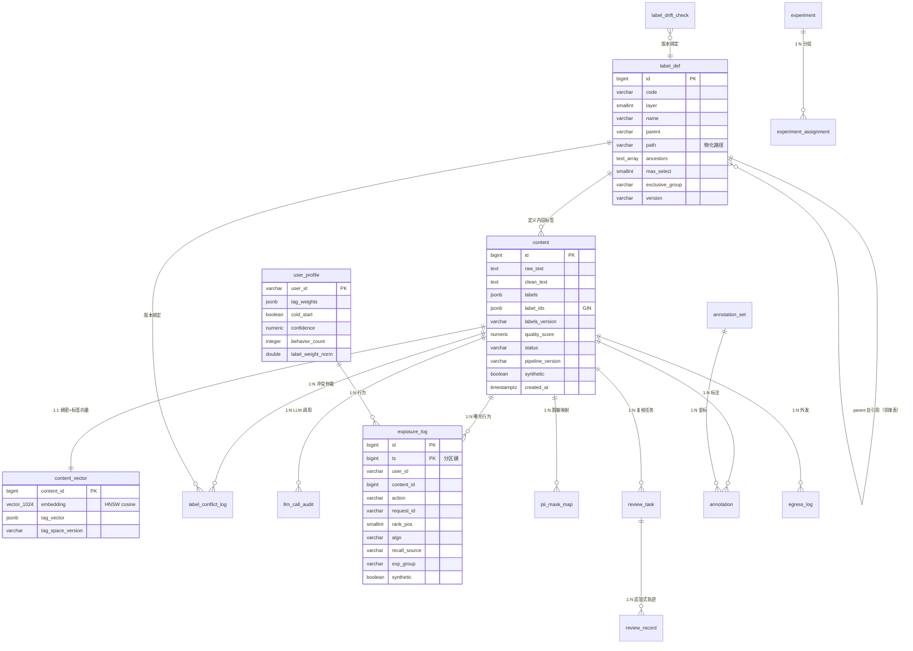

### 5.9 扩展列的必要性论证

| 扩展列 | 必要性 | 若不做的后果 |
| --- | --- | --- |
| `content.label_ids BIGINT[]` + GIN | 支撑 P4-REC-002 标签偏好召回的两段式检索（先 GIN 倒排筛候选，再 CSR 精确打分）与 P4-API-005 投放筛选 | 只能全表扫 JSONB，10 万行下推荐延迟不可达 P99 ≤ 100 ms |
| `content.layer_label_ids BIGINT[]` | 「同 L2 打散」（P4-REC-006）与「按类目过滤」需按层快速筛选 | 打散规则退化为逐条遍历 |
| `content.l1_code` / `l2_code` | 类目级统计、MQ 分层报表、`coverage` 统计 | 每次报表一次全表 JSONB 展开 |
| `content.synthetic` | Q10 要求种子日志标 synthetic；同样适用于合成内容 | 合成数据与真实数据混淆 → 违反 §7.5 |
| `content.media_refs` | P4-TAG-009 明确「content 表预留 media_refs 字段但不做处理逻辑」 | 与 PRD 冲突 |
| `label_def.path` / `path_prefix` / `ancestors` / `root_code` | §10 要求回答「树结构如何存」；物化路径让祖先闭包校验 O(1)、子树查询 O(索引前缀) | 每次祖先回溯都要递归查询 |
| `label_def.df_count` / `idf` | Q9 要求 IDF 归一化；把语料统计结果物化避免每次全量算 | 召回路径上做全局统计，不可接受 |
| `user_profile.label_weight_norm` / `tag_space_version` / `cold_start_threshold` | 余弦相似度需要模长；`tag_space_version` 保证画像与内容向量同空间（P4-USR-001「同一 label_id 空间」的工程保证） | 画像与内容向量口径漂移，相似度失真 |
| `exposure_log.synthetic` | Q10 强制 | 仿真结论被误读为线上数据 |

> 这些扩展列**不新增任何业务能力**，全部服务于 PRD 已有的 P4-REC-002 / P4-REC-006 / P4-API-005 / Q9 / Q10 / P4-TAG-009 要求。

---

## §6 标签计算与更新策略

### 6.1 12 层体系的装配算法（端到端）

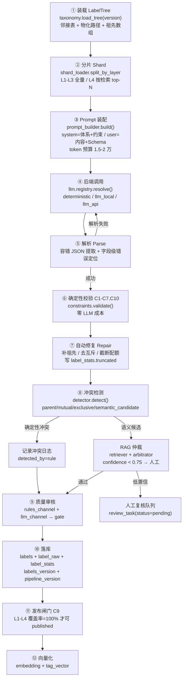

### 6.2 分片装载（Q2 的工程化）

**标签总量：1200–1800**（PRD §10-Q2 的拍板值），分布建议：

| 层 | 数量 | 是否进 system prompt | 说明 |
| --- | --- | --- | --- |
| L1 | 20 | ✅ 全量 | 顶层领域，单选 |
| L2 | 70 | ✅ 全量 | 一级类目，单选 |
| L3 | 200 | ✅ 全量 | 二级类目，≤3 |
| L4 | 550 | ⚠️ **按需 top-N 注入** | 深度标签，检索相关分支 |
| L5–L9 | 各 20–40（合计 ~140） | ⚠️ 按需 top-N | 事件/人物/机构/地理/商品 |
| L10 | 60 | ❌ 不进召回特征（PRD §4.1） | 仅进画像 |
| L11 | 40 | ✅ 全量 | 消费意图，强特征 |
| L12 | 40 | ✅ 全量（含互斥组） | 情感立场风险，强特征 |

**分片算法（伪代码）**

```
function load_shards(tree, content_text, budget_tokens=20000):
    L1_L2_L3_L11_L12 = tree.filter(layer in {1,2,3,11,12})   # 全量，常驻
    system_text = render_template(SYSTEM_TMPL, L1_L2_L3_L11_L12)

    # 用内容向量在 L4+ 标签定义上做 ANN，取 top-N 分支
    hits = vector_index.ann(topk=40, query=embed(content_text),
                             filter="layer >= 4 AND status='active'")
    branches = hits.groupBy(root(L1..L3 path)).take(top 3 branches)  # 最多 3 条 L1-L3 分支
    system_text += render_branch_defs(branches)   # 注入该分支下的 L4 及其子孙定义

    while token_count(system_text) > budget_tokens and branches.size > 1:
        branches.pop()          # 逐条收缩分支，直到落在预算内
    return system_text, hits
```

**预算与退让**

| 情形 | 处理 |
| --- | --- |
| 全量体系 ≤ 预算 | 直接全量注入（不走分片） |
| 分片后仍超预算 | 收缩分支数 → 收缩 L4 数量 → 记录 `prompt_budget_exceeded=true` 并告警 |
| 内容极长（分块 > 3） | 只取首块 + 摘要（PRD §5.2「上下文超长 → 二次尝试」） |
| 任何情况 | **绝不允许**因为超预算而静默截断约束段（C1/C2/C6 自然语言表述恒在 system prompt 中） |

### 6.3 版本管理：`pipeline_version` 如何贯穿

`pipeline_version` 是**六元组**的稳定指纹，任一要素变更即变更：

```
pipeline_version = f"{clean_rules_ver}|{label_def_ver}|{prompt_ver}|{model_ver}|{constraint_ver}|{tag_space_ver}"
```

| 要素 | 来源 | 变更触发 |
| --- | --- | --- |
| `clean_rules_ver` | `rules/*.txt` 内容 SHA-256 前 8 位 | 规则文件变更（热加载即变更） |
| `label_def_ver` | `label_def.version` | 标签体系发布/回滚 |
| `prompt_ver` | `config/prompt_templates.py` 中的模板版本常量 | 模板文本变更 |
| `model_ver` | `provider/model` + 日期（`glm-4-flash@2026-11-08`） | 模型或后端变更 |
| `constraint_ver` | `labeling/constraints.py` 的规则集版本 | C1–C10 判定逻辑变更 |
| `tag_space_ver` | 层权 + IDF 开关 + 归一化方式 | 特征空间变更 |

**贯穿规则**

1. `content.pipeline_version` NOT NULL，落库即写，永不改写。
2. `llm_call_audit.pipeline_version` 同值 → 可反查「这条内容是用哪套配置打的」。
3. `label_conflict_log.pipeline_version` 同值 → 仲裁结果可归因。
4. `exposure_log` 记录 `pipeline_version` → 推荐结果可归因（§5.6 已加列）。
5. `evaluation/report.py` 输出的每个指标必须带 `pipeline_version`（§7.5 声明 6）。

**版本查询**：任何历史内容都能用 `pipeline_version` 反查出当时的体系/提示/模型组合，这是 PRD §3.2 P4-EVA-006 版本差异分析的基础。

### 6.4 标签漂移检测机制

漂移分**三层**，各自独立触发：

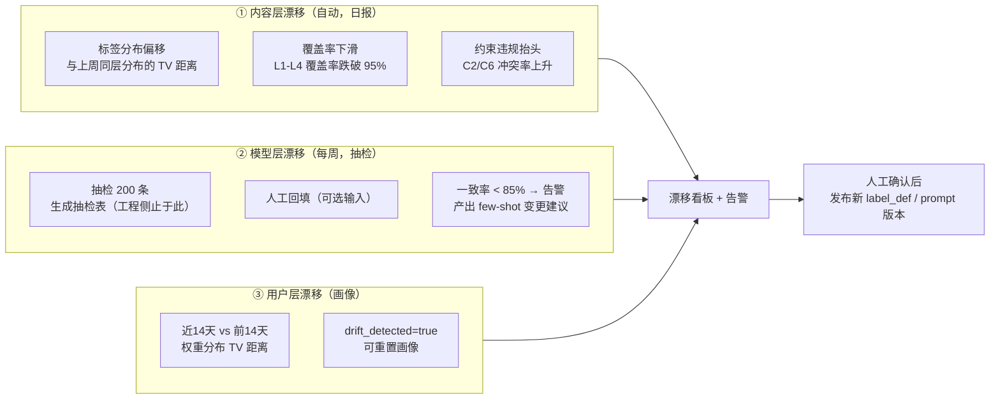

| 层 | 检测方法 | 阈值 | 产出 |
| --- | --- | --- | --- |
| 内容层 | 每日按 L1 聚合标签分布，与前 7 日分布算 TV 距离 | TV > 0.15 | `drift_report.content_layer` + 告警 |
| 内容层 | 打标冲突率（冲突内容/已打标内容）周环比 | 上升 > 50% | 告警 + 定位样本 |
| 模型层 | 每周抽检 200 条（分层随机：按 L1 分层） | 一致率 < 0.85 | `label_drift_check` 行 + 抽检表文件 + few-shot 建议 |
| 用户层 | 近 14 天 vs 前 14 天标签权重分布 TV 距离 | > 0.20 | `user_profile.drift_detected=true`, `drift_score` |

> **Q20 边界**：工程侧只做到「生成抽检表」。`label_drift_check.manual_filled=false` 表示本轮无人工回填，`consistency_rate` 为 NULL，**不得用模型自评代替人工一致率**。README 必须写明「抽检回填需业务方参与，工程侧不代劳也不伪造」。

### 6.5 打标幂等与状态机

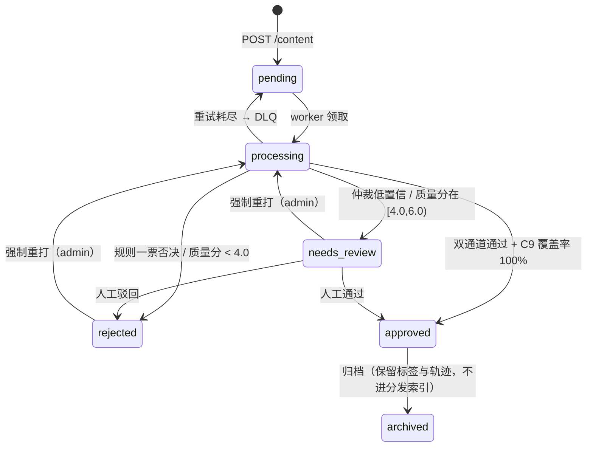

**幂等保证**（P4-OPS-003 / SP-09 / EE-08）

| 机制 | 实现 |
| --- | --- |
| 接入幂等 | `content.idempotency_key` UNIQUE；重复提交 `ON CONFLICT DO NOTHING` + `SELECT` 返回同一 `content_id` |
| 任务幂等 | Celery 任务以 `content_id` 为幂等键；写库前检查 `status` 与 `pipeline_version` 是否已是目标状态，是则直接返回 |
| 日志幂等 | `label_conflict_log` 以 `(content_id, pipeline_version, conflict_type)` 去重；`llm_call_audit.llm_call_id` 全局唯一 |
| 曝光幂等 | `ux_exposure_idem (request_id, content_id, action, ts)` |
| 重放安全 | 同一 `content_id` 重复执行 → `label_raw` 不覆盖，新结果写入新 `pipeline_version` 的记录，标签按 `pipeline_version` 分版本并存 |

---

## §7 特征与向量存储选型

### 7.1 选型结论（Q1）

| 维度 | pgvector（**默认**） | Chroma（开发态替代） |
| --- | --- | --- |
| 部署 | 与业务库同实例，零额外进程 | 单进程嵌入式，容器需额外服务 |
| JOIN | `content` ↔ `content_vector` 同库 JOIN，免双写 | 需跨库同步，产生一致性问题 |
| 并发写 | PostgreSQL MVCC，天然并发 | 单进程写并发弱 |
| 10 万 @1024 维 | HNSW p95 ≈ 20–35 ms | p95 ≈ 40–50 ms |
| 索引构建 | 慢于 Chroma，但 10 万级 < 30 min（NF-P07） | 快 |
| 运维 | 一套备份（NF-R09：向量可从 content 重建） | 需单独备份 |
| 结论 | **生产默认** | 仅 `TAGMIND_VECTOR_BACKEND=chroma` 时启用，供无 PG 的本地开发 |

**双写一致性问题的解法**：既然向量表与内容表**同库**，就不存在跨库双写。写路径在**同一个数据库事务**内完成 `content` 状态更新与 `content_vector` upsert。Chroma 模式下退化为「先写 content（`status=processing`）→ 后写向量 → 置 `approved`」，并由 `scripts/consistency_check.py` 对账。

### 7.2 pgvector 表结构与索引参数

已在 §5.7 给出 DDL，关键参数与取值理由：

| 参数 | 取值 | 理由 |
| --- | --- | --- |
| 维度 | `VECTOR(1024)` | `.env.example` 的 `TAGMIND_VECTOR_DIM=1024`（BGE-M3） |
| 距离度量 | `vector_cosine_ops` | 语义相似用余弦；且 `norm` 已存储，可做归一化后等价内积 |
| 索引类型 | HNSW | IVF 在 10 万级召回不稳定；HNSW 延迟可预测 |
| `m` | 16 | 1024 维 × 10 万行的标准起点；m↑ 召回↑ 内存↑ |
| `ef_construction` | 64 | 构建期召回优先，保证构建质量（构建窗口不敏感） |
| 查询 `hnsw.ef_search` | 60（可配） | 运行时 recall/延迟旋钮；基线 60 → p95 ≈ 25 ms |
| `ef_search` 下限 | 40 | 低于 40 召回率断崖式下降 |
| 内存占用 | ≈ 10 万 × (1024×4B + 图结构) ≈ 600 MB–1.2 GB | 满足 NF-P07「≤ 2 GB」 |

**存储量估算**：100 万行时 `embedding` 原始数据约 4 GB + HNSW 索引约 2.4 GB → 超 16 GB 内存舒适区，触发 §8.5.1 的扩容路径（切 Milvus/Qdrant 或 IVF-PQ）。10 万行无虞。

### 7.3 标签向量与稠密向量的关系

两者**并存但不同轴**，不互相替代：

| 向量 | 空间 | 维度 | 语义 | 用途 |
| --- | --- | --- | --- | --- |
| 稠密 `embedding` | 文本语义空间 | 1024 | 「这段话讲了什么」 | 语义泛化召回（找相似内容） |
| 标签 `tag_vector` | 12 层标签空间（稀疏） | 稀疏，12–40 个非零 | 「这篇内容属于哪些类目」 | 兴趣匹配召回（找用户想看的类目） |

**为什么不能只用一个**：
- 只有稠密 → 无法解释「为什么推这个」，也无法做 L2 打散（P4-REC-006）。
- 只有标签 → 无法泛化（新内容还没标签时被召回不了），冷启动无解。
- PRD §4.7 明确要求标签与画像同构，因此 `tag_vector` 与 `user_profile.tag_weights` 必须是**同一空间**（见 §11）。

**同空间的工程保证**

| 保证项 | 实现 |
| --- | --- |
| 标签 ID 空间一致 | `tag_vector` 的 key 就是 `label_def.id`（BIGINT），与 `tag_weights` 的 key 同域 |
| 权重口径一致 | 两侧都用 `vector/tag_space.py` 的同一函数计算层权与 IDF |
| 版本绑定 | 两侧都带 `tag_space_version`（`content_vector.tag_space_version` / `user_profile.tag_space_version`），不一致时**拒绝打分**并降级为召回 A |
| 增量同步 | 标签体系发布新版本 → 调度触发 `tag_vector` 全量重建（异步、不阻塞在线） |

### 7.4 Embedding 后端

| 档 | 实现 | 条件 | 备注 |
| --- | --- | --- | --- |
| `bge-m3` | `sentence-transformers` + `FlagEmbedding` | 装了 `[embeddings]` extra 且能下载模型 | 生产推荐，1024 维 |
| `hashing` | 纯 NumPy 确定性哈希 + 字符 n-gram 投影 | 无 GPU / 无模型 / 断网 | **确定性、可复现**，语义弱，仅保证链路可跑 |

`.env.example` 的 `TAGMIND_EMBEDDING_ENABLED=false` 即选 `hashing`。降级时 `content.embedding_version` 记为 `hashing-v1`，评测报告必须标注该口径（不与 BGE-M3 结果混算）。

---

## §8 召回与排序链路

### 8.1 四路召回总览

| 路 | 名称 | 触发条件 | 候选来源 | 目标占比 |
| --- | --- | --- | --- | --- |
| A | 标签偏好 `tag_preference` | 画像存在且 `cold_start=false` | `content_vector.tag_vector` CSR 矩阵 + `user_profile.tag_weights` 内积 | ≥ 10%（P4-REC-002） |
| B | 稠密向量 `vector_similarity` | 同上 | pgvector HNSW ANN | ≥ 10%（P4-REC-002） |
| C | 协同过滤 `collaborative` | 有效曝光 ≥ 20 条 | LightFM 或 `fallback_cf` | 其余 |
| D | 热门+最新 `hot`/`latest` | 冷启动 **或** 候选池 < 10 | 近 7 天窗口重算 + 最新池 | 兜底 100% |

**A 路的两段式检索**（保证 100 ms 预算内精确）

```
段 1（召回候选集）：
  top_tags = user_profile.tag_weights 中权重 Top-30 的 label_id
  candidate_ids = SELECT id FROM content
                  WHERE label_ids && top_tags
                    AND status='approved' AND quality_status='approved'
                  LIMIT 2000
段 2（CSR 精确打分）：
  score(c) = cosine(tag_vector(c), user_tag_weights)
  top 200 by score
```

段 2 在进程内 CSR 稀疏矩阵上用 NumPy 批量点积完成：10 万行 × 约 20 非零/行，`float32` CSR 约 8 MB，单次点积 < 5 ms。

### 8.2 从请求到响应的完整时序图

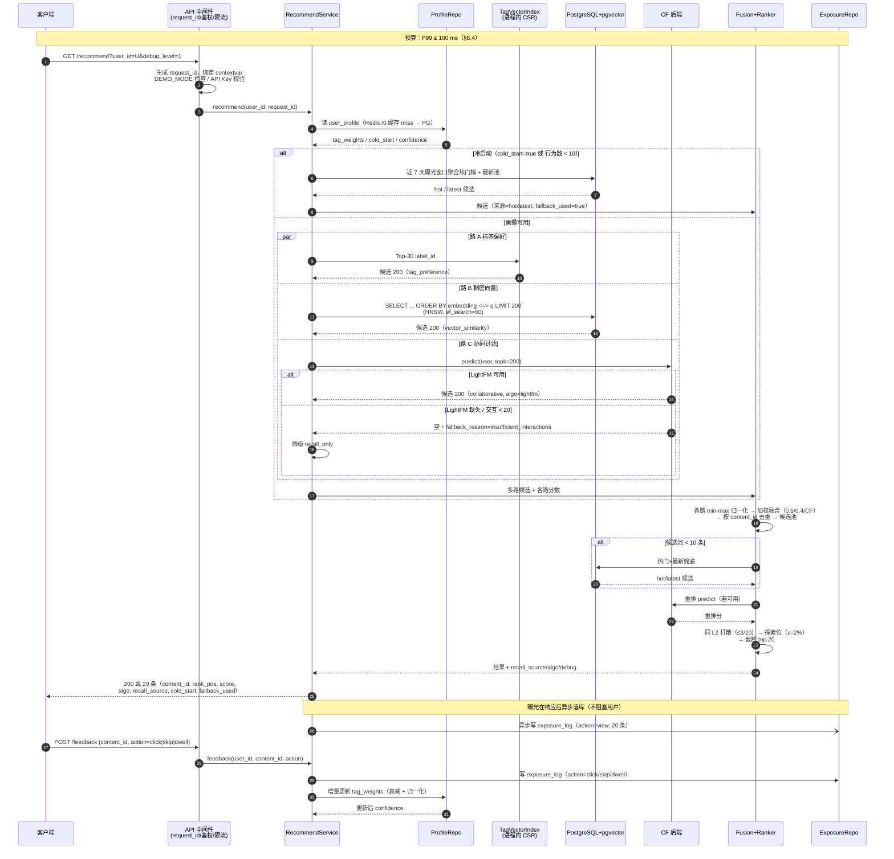

### 8.3 融合与重排的数学与口径

**融合（§11 有完整公式）**

- 各路分数先 **min-max 归一化**到 `[0,1]`（单路内归一化，避免量纲不可比）。
- 加权：`0.6 × tag + 0.4 × vector`（P4-REC-002 默认），CF 路以 `algo` 维度参与重排而非融合（口径分开，避免与 LightFM 混算）。
- 去重：按 `content_id` 去重，保留最高融合分，但**记录它来自哪几路**（用于 BE-05 召回源多样性）。

**重排**

| 步骤 | 规则 | 可配置 |
| --- | --- | --- |
| CF 重排 | `LightFM.predict` 或 `fallback_cf.predict`；交互不足 → `recall_only` | `TAGMIND_REC_ALGO` |
| 同标签打散 | 前 10 位中同 L2 最多 3 条 | 打散强度 |
| 探索位 | 约 2% 的位来自热门/最新探索池，`algo=explore` | `ε` |
| 截断 | `TAGMIND_REC_TOP_K`（默认 20） | — |

### 8.4 延迟预算（P99 ≤ 100 ms，基准：8 核 CPU / 16 GB / 无独显 / PCIe SSD）

| 步骤 | 预算 (ms) | 累计 | 优化手段 |
| --- | --- | --- | --- |
| 中间件（鉴权/限流/request_id） | 1.5 | 1.5 | — |
| 读画像（Redis 命中） | 1.0 | 2.5 | Redis `/0` 缓存画像，TTL 60 s |
| 读画像（PG 回源，缓存未命中） | 6.0 | 8.5 | `ix_profile_tag_weights` GIN + 行级 JSONB |
| 路 A：GIN 倒排筛候选 | 8.0 | 16.5 | `label_ids` GIN，`LIMIT 2000` |
| 路 A：CSR 精确打分 | 4.0 | 20.5 | 进程内 `float32` CSR 矩阵，周期刷新 |
| 路 B：pgvector ANN | 25.0 | 45.5 | `hnsw.ef_search=60`，`ef_construction=64` |
| 路 C：CF 预测 | 8.0 | 53.5 | LightFM 内存模型；fallback_cf 用预计算 item-item 相似度 |
| 融合 + 去重 | 3.0 | 56.5 | NumPy 向量化 |
| 重排 + 打散 + 探索位 | 6.0 | 62.5 | 纯 Python，候选 ≤ 600 |
| 结果装配 + 序列化 | 3.0 | 65.5 | pydantic 序列化 |
| **合计（P99 目标）** | | **~66 ms** | **留 34 ms 余量给 GC / 网络 / 并发排队** |

**并发与吞吐（SP-05：≥ 200 QPS，错误率 < 0.1%）**

| 项 | 设计 |
| --- | --- |
| 进程模型 | uvicorn 4 workers（`TAGMIND_WORKERS=4`），每 worker 独立 CSR 索引 |
| 索引刷新 | 每 worker 每 30 s 从 Redis `/2` 拉取 CSR 快照；写路径通过 Redis pub/sub 通知失效 |
| DB 连接池 | `pool_size=10, max_overflow=10`，4 worker 共 ≤ 80 连接 |
| 背压 | 队列深度 > `TAGMIND_RECV_MAX_QUEUE` → 接入接口返回 429（NF-P08） |
| 缓存 | 热门榜 Redis `/2`，TTL ≤ 60 s（P4-REC-004） |

> **P99 ≤ 100 ms 的诚实说明**：以上是**单机 8 核、10 万内容、候选 k=200、并发 50** 的预算。压测必须由 `scripts/bench_recall.py` 产出真实分位数，报告标注 `evidence_type=load_test`。若实测超标，优先降 `ef_search` 与路 A 候选上限（`LIMIT 2000 → 500`），并如实报告调整后的口径。

---

## §9 离线/在线数据流与调度

### 9.1 总体数据流图

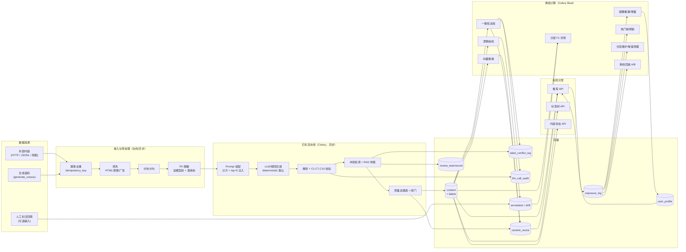

### 9.2 Celery 任务划分

| 任务 | 队列 | 触发 | 幂等键 | 重试 | 死信 |
| --- | --- | --- | --- | --- | --- |
| `tag_content` | `labeling` | API 提交 / Beat 批量 | `content_id` | 指数退避 3 次 | `dlq.labeling` |
| `arbitrate_conflict` | `labeling` | `tag_content` 检出语义候选后 | `(content_id, pipeline_version)` | 3 次 | `dlq.labeling` |
| `score_quality` | `labeling` | `arbitrate` 结束 | `content_id` | 3 次 | `dlq.labeling` |
| `embed_content` | `indexing` | `score_quality` 通过 | `content_id` | 5 次 | `dlq.indexing` |
| `rebuild_tag_vectors` | `indexing` | Beat 每周 / 体系发布后 | `tag_space_version` | 1 次 | `dlq.indexing` |
| `update_profile` | `profile` | 曝光回流 | `user_id` + `ts_bucket` | 3 次 | `dlq.profile` |
| `refresh_hot_list` | `profile` | Beat 每 5 分钟 | `window` | 2 次 | `dlq.profile` |
| `weekly_drift_check` | `maintenance` | Beat 周一 03:00 | `iso_week` | 1 次 | `dlq.maintenance` |
| `maintain_partitions` | `maintenance` | Beat 每日 03:30 | `date` | 1 次 | `dlq.maintenance` |
| `cleanup_expired` | `maintenance` | Beat 每日 04:00 | `date` | 1 次 | `dlq.maintenance` |
| `run_evaluation` | `eval` | CLI / Nightly CI | `gold_version`+`pipeline_version` | 1 次 | `dlq.eval` |
| `run_replay` | `eval` | CLI / Nightly CI | `window`+`baseline_set` | 1 次 | `dlq.eval` |

### 9.3 调度周期表

| 任务 | Cron（`TAGMIND_JOB_*`） | 默认 | 依据 |
| --- | --- | --- | --- |
| 标签批处理 | `*/5 * * * *` | 每 5 分钟拉取待处理内容 | `.env.example` |
| 画像增量 | `0 * * * *` | 每小时 | `.env.example` |
| 漂移检查 | `0 3 * * 1` | 每周一 03:00 | `.env.example` |
| 清理 | `0 4 * * *` | 每日 04:00 | `.env.example` |
| 热门榜刷新 | `*/5 * * * *` | 每 5 分钟（TTL ≤ 60 s） | P4-REC-004 |
| 分区维护 | `30 3 * * *` | 每日 03:30 | Q10 |
| 向量重建 | `0 4 * * 0` | 每周日 04:00 | NF-E05 |
| 评测 | 手工 + Nightly CI | 每日 02:00（CI） | P4-EVA-002 |

> 全部时区由 `TAGMIND_SCHEDULER_TIMEZONE=Asia/Shanghai` 控制，**存储层仍为 UTC**。

### 9.4 幂等、重试与 checkpoint

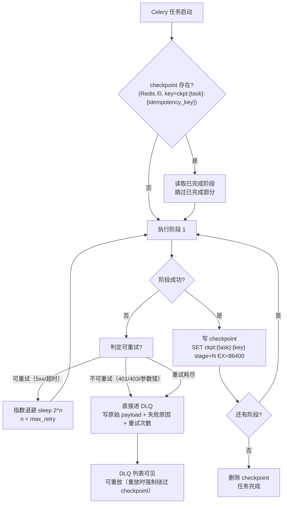

**checkpoint 规范**

| 项 | 规定 |
| --- | --- |
| Key | `ckpt:{task_name}:{idempotency_key}`，存 Redis `/0` |
| Value | JSON `{"stage": "tagged", "pipeline_version": "...", "at": "..."}` |
| TTL | 86400 s（1 天），任务完成即删 |
| 语义 | 「至少一次投递 + 幂等消费」；checkpoint 只是**加速**，正确性由 DB 唯一约束保证 |
| DLQ 重放 | 重放入口 `tagmind dlq replay --task X --ids ...`，**强制绕过 checkpoint**，靠幂等键防重复 |

### 9.5 Redis DB 分离（Q8）

| DB | 用途 | 关键 Key | TTL |
| --- | --- | --- | --- |
| `/0` | 应用缓存 | `profile:{user_id}`、`hot:{window}`、`ckpt:*`、`rate:*` | profile 60 s / hot ≤ 60 s |
| `/1` | Celery broker + result backend | Celery 默认队列与结果 | 按 Celery 配置 |
| `/2` | 结果缓存 + 特征快照 | `rec:{user_id}:{ver}`、`csr_snapshot:{ts}`、`tagdef:{ver}` | 结果 30 s / 快照 30 s |

> **离线回放不读缓存**：`evaluation/replay.py` 强制以 `cache_bypass=True` 构造服务实例，热��榜按回放时间窗从 `exposure_log` 重算（`hot_latest.recall(replay_ts=...)`），保证仿真可复现。这是 Q8 的硬要求。

---

## §10 标签体系建模与 C1–C10 校验器

### 10.1 树结构存储：邻接表 + 物化路径

**双写结构**（`label_def` 表内同时存两者）

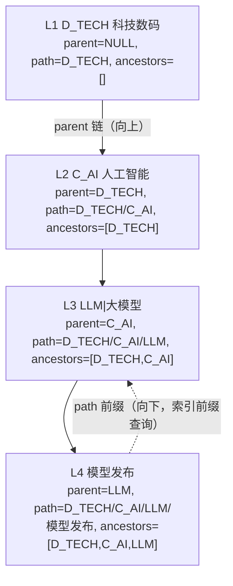

| 结构 | 字段 | 用途 | 复杂度 |
| --- | --- | --- | --- |
| 邻接表 | `parent` (code) | 向上回溯祖先、兄弟互斥检查 | 每跳 1 次索引查找 |
| 物化路径 | `path` (`D_TECH/C_AI/LLM/模型发布`) | 一次查询取全路径、字符串前缀即子树 | O(1) 读取 |
| 祖先数组 | `ancestors TEXT[]` | C3 祖先闭包校验：直接判包含 | O(1) `GIN` 包含查询 |
| 路径前缀 | `path_prefix` | 子树查询 `WHERE path_prefix LIKE 'D_TECH/C_AI/%'` | 索引前缀扫描 |

**为什么三者并存**：仅邻接表 → 祖先回溯需递归查询（N 次 IO），C3 校验在批量打标时成为瓶颈；仅物化路径 → 同层兄弟互斥（C2）判断需要拆路径，逻辑易错。三者组合后，C1/C2/C3 的校验全部是**单表 O(1) 判定**，符合 §4.5「80% 约束用规则解决」的成本原则。

### 10.2 祖先闭包校验（C3）

```
function check_ancestor_closure(label_ids):
    for lid in label_ids:
        node = label_def[lid]
        # C3：命中第 k 层，必须携带 L1..L(k-1) 全部祖先
        for anc_code in node.ancestors:          # 已按 L1..L(k-1) 顺序
            if anc_code not in label_ids:
                emit VIOLATION(C3, lid, anc_code, missing_ancestor)
                auto_fix: append ancestor with source='derived', confidence=1.0
```

**修复语义**（§4.5 C3 明确）：自动补齐缺失祖先，并标记 `labels[].source = 'derived'`（区别于 `llm`）。补齐的祖先**不占用该层配额**（配额统计只算 `source != 'derived'` 的标签）。

### 10.3 C1–C10 校验器设计

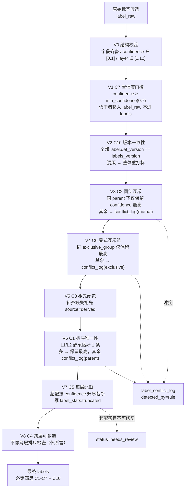

**校验器签名**

```
class ConstraintValidator:
    def validate(self, candidates: list[LabelCandidate],
                 tree: LabelTree,
                 ctx: LabelContext) -> ValidationResult
    # ValidationResult:
    #   .labels        : list[LabelCandidate]   # 修复后的最终标签
    #   .violations    : list[Violation]        # {rule, level, detail, auto_fixed}
    #   .conflicts     : list[ConflictCandidate]# 需进冲突日志的
    #   .truncated     : list[Truncation]       # 配额截断记录
    #   .needs_review  : bool
```

**逐条规则落地**

| 规则 | 判定 | 违反处理 | 成本 |
| --- | --- | --- | --- |
| **C1** 树层唯一性 | 按 `parent` 链自上而下核对 | 缺父 → 补最近祖先；多同级 → 保留置信度最高，其余记 `conflict_type=parent` | 规则 |
| **C2** 同父互斥 | 同 `parent` 的兄弟标签集合求交 | 保留最高，其余 → 冲突日志 `mutual` | 规则 |
| **C3** 祖先闭包 | 自底向上回溯 `ancestors` | 自动补齐，标 `source=derived` | 规则 |
| **C4** 跨层可多选 | 不做排斥，仅断言无跨层去重 | — | 规则 |
| **C5** 每层配额 | 按层计数 | 超配按置信度**升序**截断（保留高者），写 `label_stats.truncated` | 规则 |
| **C6** 显式互斥组 | 查 `exclusive_group` | 保留最高，其余 → 冲突日志 `exclusive` | 规则 |
| **C7** 置信度门槛 | `confidence ≥ min_confidence`（默认 0.7） | 低于者**保留在 `label_raw`**，不进 `labels` | 规则 |
| **C8** 语义冲突仲裁 | 跨层语义矛盾检测 + LLM 仲裁 | 仲裁置信度 < 0.75 → 转人工，`status=needs_review` | **LLM** |
| **C9** 覆盖率闸门 | 已发布内容 L1–L4 覆盖率 = 100% | 阻断发布，回退重打标 | 规则 |
| **C10** 版本一致性 | `content.labels_version` == 各标签 `def_version` | 视为脏数据，重新打标 | 规则 |

> **成本控制的关键**：C1–C7、C10 全部在**确定性后处理层**完成，零 LLM 参与、零额外延迟、完全可解释。只有 C8 需要 LLM 仲裁，且只在「确定性检测器判定为语义候选」时才触发。这正是 PRD §4.5 结尾所说的成本控制要点。

### 10.4 C9 发布闸门

```
function publish_gate(content):
    l1l4 = [l for l in content.labels if 1 <= l.layer <= 4]
    if len(l1l4) == 0:                    return BLOCK("no_l1l4_label")
    for layer in {1,2,3,4}:
        required = 1 if layer in {1,2} else tree.quota[layer]
        actual   = len([l for l in l1l4 if l.layer == layer and l.source != 'derived'])
        if actual < required:             return BLOCK(f"layer_{layer}_under_quota")
    if not check_ancestor_closure(l1l4):  return BLOCK("ancestor_closure_broken")
    if mixed_version(content.labels):     return BLOCK("version_mismatch")
    return PASS()
```

闸门失败 → 内容置 `needs_review`，**不进入分发索引**（`ix_content_dispatchable` 只索引 `status='approved'`），并在 `reject_reason` 记录结构化原因。

### 10.5 标签体系发布与灰度

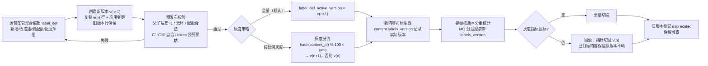

> **US-03 的保证**：修改某个标签的描述/示例后，**对新进内容生效而不影响已发布内容**。机制：`content.labels_version` + `label_def.version` 双版本并存，已发布内容引用的旧版本行永不删除，因此历史内容展示不变。

---

## §11 向量/标签召回的数学定义

### 11.1 符号

| 符号 | 含义 | 取值/维度 |
| --- | --- | --- |
| $\mathcal{L}$ | 标签全集 | $\|\mathcal{L}\| \in [1200, 1800]$ |
| $\ell$ | 单个标签 | $\ell = (id, code, layer, \text{parent}, \text{eg}, df)$ |
| $layer(\ell)$ | 标签所在层 | $1..12$ |
| $w_{layer}$ | **层权** | 见 §11.2 |
| $idf(\ell)$ | 标签的逆文档频率 | 见 §11.3 |
| $c$ | 一条内容 | $c = (raw, clean, labels, chunks)$ |
| $q(c) \in \mathbb{R}^{1024}$ | 内容稠密向量 | 已 L2 归一化 |
| $v(c) \in \mathbb{R}^{|\mathcal{L}|}$ | 内容标签稀疏向量 | 稀疏，非零元约 12–40 |
| $u(z) \in \mathbb{R}^{|\mathcal{L}|}$ | 用户标签权重向量 | 稀疏，非零元约 20–200 |
| $N$ | 语料内容数 | 目标 10 万 |
| $df(\ell)$ | 标签 $\ell$ 的文档频次 | 含 $\ell$ 的内容数 |

### 11.2 层权（Q9）

层权是**按层递减**的固定权重表，体现「层级越浅，语义越强」的先验：

$$
w_{layer} = \begin{cases}
1.00 & layer \in \{1,2\} \quad \text{（顶层领域与类目，强区分）}\\
0.80 & layer \in \{3,4\} \quad \text{（细分类目与主题簇）}\\
0.55 & layer \in \{5,6,7,8,9\} \quad \text{（事件/人物/机构/地理/商品）}\\
0.30 & layer = 10 \quad \text{（属性与量化，PRD §4.1 不入召回特征）}\\
0.75 & layer \in \{11,12\} \quad \text{（消费意图与情感风险，强特征）}
\end{cases}
$$

**可配置项**（写在 `config/thresholds.py`，并计入 `tag_space_version`）：

```
TAGMIND_TAG_LAYER_WEIGHTS = {
  "1": 1.00, "2": 1.00, "3": 0.80, "4": 0.80,
  "5": 0.55, "6": 0.55, "7": 0.55, "8": 0.55, "9": 0.55,
  "10": 0.30, "11": 0.75, "12": 0.75
}
TAGMIND_TAG_IDF_ENABLED = true
TAGMIND_TAG_VECTOR_NORM = "l2"      # l2 | none
```

> 变更层权会改变 `tag_space_version` → 触发全量 `tag_vector` 重建 → **必须走灰度**（§10.5），否则线上召回分数漂移不可解释。

### 11.3 IDF 归一化（Q9）

$$
idf(\ell) = \ln\left(\frac{N + 1}{df(\ell) + 1}\right) + 1
$$

- 平滑项 `+1` 防止 `df = N` 时为 0。
- `$+1$` 保证最小 IDF 为 1（当 $\ell$ 出现在几乎所有内容中）。
- `df(\ell)` 由 `label_def.df_count` 物化，由 `scheduler/tasks/maintenance.py` 每日刷新（`REFRESH label_def df FROM content` 全量扫描 10 万行，< 5 s）。

**IDF 的作用**：抑制「财经/生活」这类高频泛标签的支配作用，让「AI 芯片」「新能源车」这类低频高区分标签在相似度中获得应有权重。

### 11.4 内容标签向量

对内容 $c$，其每个标签 $\ell$ 携带置信度 $p(c,\ell) \in [0,1]$（来自 LLM/规则/仲裁）。构造：

$$
v(c)[\ell] = w_{layer(\ell)} \cdot idf(\ell) \cdot p(c,\ell), \quad \ell \notin labels(c) \Rightarrow 0
$$

再做 L2 归一化：

$$
\hat{v}(c) = \frac{v(c)}{\|v(c)\|_2}, \qquad \|v(c)\|_2 = \sqrt{\sum_{\ell} v(c)[\ell]^2}
$$

- `content_vector.tag_vector` 存**未归一化**的 $v(c)$（JSONB `{label_id: value}`），`tag_vector_norm` 存 $\|v(c)\|_2$。
- 归一化在读取时计算（`v/‖v‖`），避免存储冗余精度损失，也便于调参后重算。
- 稀疏度：每条内容 12–40 个非零元（L1–L4 必有 1/1/≤3/≤3，L5–L12 按需）。

**`source=derived` 的处理**：自动补齐的祖先标签**不参与**标签向量计算（否则会人为抬高祖先层权重）。只有 `source ∈ {llm, rule, rag, manual}` 的标签进入 $v(c)$。

### 11.5 用户标签权重向量

**更新规则**（PRD §5.6 状态机 + P4-USR-002）：

对用户 $z$ 的一次行为事件 $e$（点击 / 停留超阈值 / 跳过），其行为类型权重 $\beta(e)$：

$$
\beta(e) = \begin{cases}
+1.0 & e = \text{click} \\
+0.6 & e = \text{dwell} \wedge dwell\_ms > T \quad (T = 3000\text{ms}) \\
-0.3 & e = \text{skip} \\
0.0 & e = \text{view} \text{（仅曝光不计权重，但计入 behavior\_count 的一半）}
\end{cases}
$$

**时间衰减**（半衰期 14 天，Q9 要求的可配置项）：

$$
\lambda = \ln 2 / (14 \times 86400 \text{ s})
$$

$$
w_{raw}(z)[\ell] \leftarrow w_{raw}(z)[\ell] + \beta(e)\cdot e^{-\lambda (t_{now} - t_e)} \cdot p(c_e, \ell)
$$

其中 $c_e$ 是事件 $e$ 关联的内容，$p(c_e,\ell)$ 用该内容的标签置信度。

**归一化**（P4-USR-001：归一化后总和为 1，误差 ≤ 1e-6）：

$$
u(z)[\ell] = \frac{\max(w_{raw}(z)[\ell],\, 0)}{\sum_{\ell' \in \mathcal{L}} \max(w_{raw}(z)[\ell'],\, 0)}
$$

> **注意**：PRD 要求「被 skip 的内容标签权重 ≤ 0」与「归一化后总和为 1」并存。工程上采取**双字段**方案解决这一张力（见 §16.2 歧义 A-02）：
> - `user_profile.tag_weights` 存**归一化后的非负权重**（和为 1），用于召回打分；
> - `user_profile.label_affinity`（新增扩展列）存**带符号原始分**（可负），用于解释与漂移分析。
>
> 因此「skip 权重 ≤ 0」在 `label_affinity` 中成立，「总和为 1」在 `tag_weights` 中成立，两者不冲突。

**置信度**（P4-USR-003）：

$$
confidence(z) = \min\left(1,\ \frac{n_{eff}(z)}{n_{eff}(z) + \kappa}\right) \cdot \left(1 - \frac{H(u(z))}{\ln |\mathcal{L}_{active}|}\right)
$$

- $n_{eff}(z)$：有效行为数（`click` + `dwell` 超阈 + `skip`，`view` 计 0.5）。
- $\kappa = 10$：冷启动阈值（`cold_start_threshold`，P4-USR-003 要求可配）。
- $H(\cdot)$：香农熵，衡量偏好集中度（越集中越可信）。
- $confidence = 0 \Leftrightarrow n_{eff} = 0 \Leftrightarrow cold\_start = true$。

### 11.6 标签偏好相似度（路 A）

$$
sim_{tag}(z, c) = \cos\big(\hat{v}(c),\ u(z)\big)
= \frac{\sum_{\ell \in \mathcal{L}} v(c)[\ell]\cdot u(z)[\ell]}{\|v(c)\|_2 \cdot \|u(z)\|_2}
$$

因为 $u(z)$ 已归一化且非负，$\|u(z)\|_2$ 需单独存（`label_weight_norm`）。

**打分等价形式**（CSR 矩阵上的批量实现）：

$$
\hat{v}(c)^\top u(z) = \frac{1}{\|v(c)\|_2 \cdot \|u(z)\|_2}\sum_{\ell \in labels(c) \cap support(z)} v(c)[\ell]\cdot u(z)[\ell]
$$

只有**交集标签**参与计算 → 稀疏矩阵点积，10 万 × 稀疏度 20 → 单用户一次点积约 0.2 ms。

### 11.7 稠密向量相似度（路 B）

$$
sim_{vec}(z, c) = \cos\big(q(c),\ q(z)\big) = \frac{q(c)^\top q(z)}{\|q(c)\|_2 \|q(z)\|_2}
$$

- $q(c)$ 来自 BGE-M3（1024 维），已 L2 归一化（`content_vector.norm` 存储模长）。
- $q(z)$：由用户标签生成的「伪查询向量」：

$$
q(z) = \frac{1}{\|t(z)\|_2}\sum_{\ell \in support(z)} u(z)[\ell]\cdot \bar{q}(\ell)
$$

其中 $\bar{q}(\ell)$ 是标签 $\ell$ 的**标签中心向量**（对该标签下所有内容的稠密向量求均值后归一化），由 `vector/indexer.py` 在标签体系发布/重建时离线计算并缓存（1200–1800 个 1024 维向量 ≈ 7 MB）。

> 这是路 B 与路 A 的**关键区别**：路 A 用标签 ID 空间精确匹配，路 B 用语义空间泛化（用户喜欢「大模型」标签，也能召回语义相近但标签未命中的内容）。

### 11.8 多路融合

**单路归一化**（min-max，作用在同一路内部）：

$$
\tilde{s}_k(c) = \frac{s_k(c) - \min_{c' \in C_k} s_k(c')}{\max_{c' \in C_k} s_k(c') - \min_{c' \in C_k} s_k(c') + \varepsilon}, \quad \varepsilon = 10^{-9}
$$

**融合**（P4-REC-002 默认 0.6 / 0.4）：

$$
s_{fuse}(c) = \alpha_{tag}\cdot \tilde{s}_{tag}(c) + \alpha_{vec}\cdot \tilde{s}_{vec}(c)
$$

$$
\alpha_{tag} = 0.6,\quad \alpha_{vec} = 0.4 \quad (\text{可配，}\alpha_{tag}+\alpha_{vec}=1)
$$

CF 路（`collaborative`）**不进入融合公式**，而是作为重排信号（口径与融合分开，避免与 LightFM 结果混算，见 Q7）。

**多路命中加成**（可选，默认开启）：

$$
s_{fuse}(c) \leftarrow s_{fuse}(c) + \lambda_{multi} \cdot \big(\mathbb{1}[c \in C_{tag}] + \mathbb{1}[c \in C_{vec}] - 1\big), \quad \lambda_{multi} = 0.05
$$

被两路同时命中的内容小幅上浮，提升 BE-05 召回源多样性的同时提升精度。

### 11.9 协同过滤目标函数

**（a）`fallback_cf` — Item-based 标签共现相似度**

用户 $z$ 的交互集合 $I_z$，内容 $c$ 的标签集合 $L(c)$。先算内容-内容相似度：

$$
sim(c_1, c_2) = \frac{\big|\{(z, c_1, c_2) : c_1, c_2 \in I_z\}\big|}{\sqrt{|I_{c_1}| \cdot |I_{c_2}|}}
$$

这是**归一化共现**（等价于 cosine of 二元交互矩阵的行向量），取值 $[0,1]$。

推荐分：

$$
s_{item}(z, c) = \sum_{c' \in I_z^{recent}} sim(c, c') \cdot decay(c')
$$

其中 $decay(c') = e^{-\lambda(t_{now} - t_{c'})}$，$I_z^{recent}$ 取最近 $K=50$ 条交互。

**（b）`fallback_cf` — 隐式反馈 ALS**

目标函数：

$$
\min_{\mathbf{P}, \mathbf{Q}} \sum_{(z,c) \in \Omega} c_{zc}\big(r_{zc} - \mathbf{p}_z^\top \mathbf{q}_c\big)^2 + \lambda\big(\|\mathbf{P}\|_F^2 + \|\mathbf{Q}\|_F^2\big)
$$

- $\Omega$：观测到的交互集合；$r_{zc} = 1$（隐式）。
- $c_{zc}$：置信度权重，$c_{zc} = 1 + \alpha \cdot r_{zc}$，$\alpha = 10$。
- $\lambda = 0.05$：正则强度。
- 因子维度 $d = 32$。
- 交替最小二乘求解：固定 $\mathbf{Q}$ 时

$$
\mathbf{p}_z = \big(\mathbf{Q}^\top \mathbf{C}^{z} \mathbf{Q} + \lambda \mathbf{I}\big)^{-1} \mathbf{Q}^\top \mathbf{C}^{z} \mathbf{r}^z
$$

纯 NumPy 实现（`np.linalg.solve`，$d=32$ 时 $32\times32$ 求逆约 0.05 ms）。迭代 10 轮收敛（相对变化 < 1e-4）。

**（c）BPR（可选，作为 `fallback_cf` 的第二种口味）**

$$
\min_{\mathbf{P}, \mathbf{Q}, \mathbf{b}} \sum_{(z,c,c') \in \Omega_B} -\log \sigma\big(\mathbf{p}_z^\top \mathbf{q}_c + b_c - \mathbf{p}_z^\top \mathbf{q}_{c'} - b_{c'}\big) + \lambda \|\Theta\|^2
$$

- $\Omega_B$：$(z, c, c')$ 三元组，$c$ 为正样本、$c'$ 为负样本（从未交互内容随机采样）。
- 用 SGD 训练，$d=32$，学习率 0.05，$L=2$ 正则。

> **口径隔离（Q7 硬要求）**：`fallback_cf` 的输出**必须**带 `algo='fallback_cf'` 标签，LightFM 带 `algo='lightfm'`。二者在 `exposure_log.algo` 分列统计，**任何报表不得把两者平均**。评测报告中亦分列。

### 11.10 质量评分融合

PRD §5.4 定义 `final = min(rule_score, llm_score)`（取保守值）。规则通道把命中折算为分：

$$
s_{rule} = \min\Big(10,\ \max_{h \in hits}\big(10 - \eta_h\big)\Big)
$$

其中每条命中 $h$ 有惩罚 $\eta_h$（敏感词 8.0 / 广告残留 6.0 / 长度不足 5.0，可配）。

$$
s_{final} = \min(s_{rule}, s_{llm})
$$

判定：

$$
status = \begin{cases}
\text{rejected} & \text{规则一票否决（命中敏感词/广告）}\ \lor\ s_{final} < 4.0 \\
\text{needs\_review} & 4.0 \le s_{final} < 6.0 \\
\text{approved} & s_{final} \ge 6.0
\end{cases}
$$

**双通道均不可用** → `degraded = true`，仅用规则分，低于 `review_below` → `needs_review`，**不得默认放行**（P4-QA-003）。

### 11.11 兴趣漂移（TV 距离）

近 14 天窗口 $W_1$ 与前 14 天窗口 $W_0$ 的标签权重分布：

$$
TV(P, Q) = \frac{1}{2}\sum_{\ell \in \mathcal{L}} \left| P(\ell) - Q(\ell) \right|
$$

其中 $P(\ell) = \sum_{e \in W_1, c_e \ni \ell} \beta(e)$ 归一化后的概率分布。$TV > 0.20$ → `drift_detected = true`。

---

## §12 可回滚设计

**总原则**：任何一次「发布」都必须可退回上一版，且退回不丢数据、不需要停机。

### 12.1 五类回滚

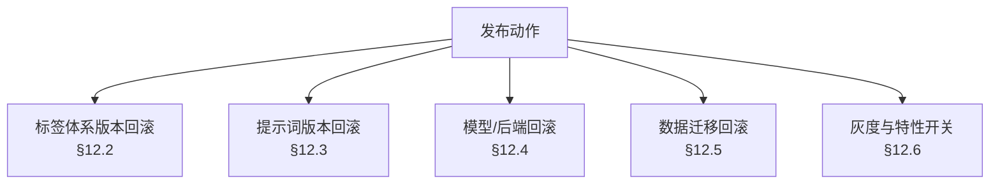

### 12.2 标签体系版本回滚

| 项 | 设计 |
| --- | --- |
| 机制 | `label_def` 多版本并存；生效版本由 `label_def_active_version` 指针（存在 `config/thresholds.py` 的运行时状态 + `scripts/seed_demo.py` 写入的 `label_def` 元数据）决定 |
| 回滚动作 | 把指针切回旧版本 → 新进内容用旧体系打标 |
| 已打标内容 | **不动**。每条内容的 `labels_version` 记录当时版本，旧版本行永不删除 → 历史内容展示与召回特征不变 |
| 冲突消解 | 冲突日志、审计记录全部保留原 `label_def_version`，可完整回放 |
| 验证 | `tagmind labels diff --from v3 --to v2` 输出受影响标签清单；`tagmind labels activate --version v2` 切换 |

### 12.3 提示词版本回滚

| 项 | 设计 |
| --- | --- |
| 机制 | `config/prompt_templates.py` 中每个模板带 `PROMPT_VERSION` 常量；模板历史保留在 git 中，运行时也可由 `label_def`-like 的 `prompt_versions` 表管理（本期用 git + 版本常量，实施成本最低） |
| 回滚动作 | 改回旧 `PROMPT_VERSION` 常量 → 重启 worker（≤ 10 s） |
| 已产出内容 | 不动（`content.prompt_version` 记录当时版本） |
| 验证 | `llm_call_audit.prompt_hash` 校验：给定 `prompt_version + prompt_hash`，若与当前模板渲染结果哈希不符 → **报错**，绝不返回错版本提示词（P4-LLM-AUDIT-001 硬要求） |

### 12.4 模型/后端回滚

| 场景 | 动作 | 效果 |
| --- | --- | --- |
| `llm_api` 故障（401/5xx 超限） | `llm.registry` 自动降级到 `llm_local`；再失败降级 `deterministic` | 全部结果带 `degraded=true`，指标标记 `degraded_backend`（MQ-15 不计入正式准确率） |
| 模型版本效果不佳 | `TAGMIND_LLM_MODEL` 改回旧版本 → 重启 worker | 新内容用旧模型；历史内容不变 |
| LightFM 编译失败/加载失败 | `recommendation/cf/lightfm_backend.py` 抛 `CFBackendUnavailable` → `collaborative.py` 捕获 → `fallback_cf` 或 `recall_only` | `algo='fallback_cf'` / `'recall_only'`，**不报错、不返回空** |

**降级链（单向，无回环）**

```
llm_api  →  llm_local  →  deterministic
lightfm  →  fallback_cf  →  recall_only
hashing  →  （无更底层，标记 embedding_version=hashing-v1）
```

每一跳都记录 `degraded=true` 与 `fallback_reason`，并在 `llm_call_audit.degraded` 落库。

### 12.5 数据迁移回滚

| 项 | 设计 |
| --- | --- |
| 迁移工具 | Alembic，`migrations/versions/000X_*.py`，每个迁移含 `upgrade()` 与 `downgrade()` |
| 破坏性迁移规则 | **禁止**在迁移中 `DROP COLUMN` / `DROP TABLE` 数据列。破坏性变更一律拆成两版：① 加新列 + 双写 → ② （下个版本）删旧列，且删列前必须有数据迁移验证脚本通过 |
| 回滚方式 | `alembic downgrade -1`；跨多版本用 `alembic downgrade <rev>` |
| 数据迁移验证 | 每个迁移附带 `scripts/consistency_check.py --after-migration <rev>`，检查行数、关键约束、非空率 |
| 备份 | 迁移前由 `make backup` 执行 `pg_dump`；`docker-compose` 里 postgres 挂载持久卷 |
| 向量索引 | NF-R09：向量可从 `content` 重建 → HNSW 重建失败时 `REINDEX` 即可，无需备份索引 |

### 12.6 灰度与特性开关

| 开关 | 配置项 | 默认 | 作用 |
| --- | --- | --- | --- |
| 标签体系灰度 | `TAGMIND_LABEL_CANARY_RATIO` + `TAGMIND_LABEL_CANARY_VERSION` | `0.0` | 灰度比例与版本；按 `hash(content_id) % 100 < ratio` 分流 |
| 召回融合权重 | `TAGMIND_REC_FUSION_WEIGHTS` | `{"tag":0.6,"vector":0.4}` | 线上可改，无需发版（热加载） |
| CF 后端 | `TAGMIND_REC_CF_BACKEND` | `auto` | `auto` / `lightfm` / `fallback_cf` / `recall_only` |
| 向量后端 | `TAGMIND_VECTOR_BACKEND` | `pgvector` | `pgvector` / `chroma` |
| LLM 后端 | `TAGMIND_LLM_BACKEND` | `deterministic` | `deterministic` / `llm_local` / `llm_api` |
| 打标约束开关 | `TAGMIND_CONSTRAINT_AUTOFIX` | `true` | 关掉后只报告不修复，产出 `needs_review` |
| 演示模式 | `TAGMIND_DEMO_MODE` | `false` | `true` 时管理接口免鉴权（启动日志显式披露） |
| 探索位比例 | `TAGMIND_REC_EXPLORE_RATIO` | `0.02` | 探索位占比 |
| 打散强度 | `TAGMIND_REC_DIVERSITY_MAX_PER_L2` | `3` | 前 10 位同 L2 上限 |

**开关生效方式**

| 开关 | 生效时机 | 实现 |
| --- | --- | --- |
| 灰度、融合权重、CF 后端、探索位、打散 | **热生效**（无需重启） | `config/thresholds.py` 从 Redis `/2` 的 `config:live` 读取，TTL 5 s，缺失时回落到文件默认值 |
| 向量后端、LLM 后端 | 重启生效 | 构造期依赖注入（`llm/registry.py`、`vector/indexer.py`） |
| 演示模式、约束自动修复 | 重启生效 | 影响中间件与校验器行为 |
| `TAGMIND_LABEL_CANARY_VERSION` | 重启生效 | 影响体系装载 |

> **灰度纪律**：所有灰度必须能在 5 分钟内关闭（切开关，不发版），且关闭后**已按新版本打标的内容保留原版本标记**，不会产生口径断裂。

### 12.7 回滚演练清单（阶段 4 验收项）

| 演练 | 操作 | 期望 |
| --- | --- | --- |
| 体系回滚 | `labels activate --version v1` → 打标 10 条 | `content.labels_version = v1`；此前 v2 打标的内容展示不变 |
| 提示词回滚 | 改回旧 `PROMPT_VERSION` → 重启 worker → 打标 | `llm_call_audit.prompt_hash` 与旧版本一致；哈希校验通过 |
| 后端降级 | 断网 → 打标 10 条 | 全部 `degraded=true`，`provider='deterministic'`；无异常抛出 |
| LightFM 缺失 | `pip uninstall lightfm` → 推荐请求 | `algo='recall_only'` 或 `'fallback_cf'`，返回 ≥ 10 条，无 5xx |
| 迁移回滚 | `alembic downgrade -1` → 检查 schema | 与上一版本一致；`consistency_check` 通过 |
| 灰度关闭 | 灰度中 → 关闭开关 → 打标 100 条 | 100% 走旧版本，无中间态混合 |

---

## §13 数据一致性校验

### 13.1 四类一致性校验

```mermaid
flowchart TD
    A["scripts/consistency_check.py<br/>（每日 05:00 + 手动 + CI）"] --> B["C1 向量 ↔ 标签一致性"]
    A --> C["C2 画像 ↔ 曝光对账"]
    A --> D["C3 冲突日志 7 要素完整性"]
    A --> E["C4 迁移后结构校验"]

    B --> B1["approved 内容必须有 content_vector 行"]
    B --> B2["tag_vector 的 label_id ⊆ content.labels 的 label_id"]
    B --> B3["tag_vector_norm ≈ ‖tag_vector‖₂"]
    B --> B4["孤儿向量（content 不存在）= 0"]
    B --> B5["tag_space_version 与 user_profile 一致"]

    C --> C1["Σ tag_weights ≈ 1（误差 ≤ 1e-6）"]
    C --> C2["behavior_count 与 exposure_log 有效行为数一致"]
    C --> C3["confidence ∈ [0,1] 且 cold_start ⟺ confidence == 0"]
    C --> C4["label_dims == tag_weights 非零元数"]

    D --> D1["7 要素非空率 = 100%"]
    D --> D2["conflict 总数 == 检测日志条数（无丢失）"]

    E --> E1["information_schema 与 §5 DDL 逐项一致"]
    E --> E2["索引/唯一约束/分区存在"]
    E --> E3["迁移幂等：重跑不报错、不重复建对象"]
```

### 13.2 校验清单与阈值

| 编号 | 校验项 | 方法 | 阈值 | 失败处置 |
| --- | --- | --- | --- | --- |
| V1 | 已发布内容的向量覆盖率 | `count(content approved) == count(content_vector)` | 差值 = 0 | 告警 + 触发 `embed_content` 重跑 |
| V2 | 标签向量与标签集合一致 | `tag_vector` keys ⊆ `labels[].label_id` | 违规 = 0 | 告警 + 重建该内容向量 |
| V3 | 向量归一化自洽 | `abs(tag_vector_norm - ‖v‖₂) < 1e-6` | 违规 = 0 | 告警 |
| V4 | 孤儿向量 / 孤儿内容 | 双向 LEFT JOIN | 均为 0 | 清理 |
| V5 | 特征空间版本一致 | `content_vector.tag_space_version` == `user_profile.tag_space_version`（活跃集） | 不一致数 = 0 | 触发全量重建 |
| V6 | 画像归一化 | `abs(Σ tag_weights - 1) ≤ 1e-6`（非冷启动用户） | 违规 = 0 | 重算该用户画像 |
| V7 | 画像行为数对账 | `user_profile.behavior_count` vs `exposure_log` 有效行为数 | 差值 = 0 | 重算 |
| V8 | 冷启动一致性 | `cold_start == (confidence == 0)` | 违规 = 0 | 修正 |
| V9 | 画像维度 | `label_dims == len(tag_weights)` | 差值 = 0 | 重算 |
| V10 | 冲突 7 要素完整 | 逐条检查 7 个字段非空 | 完整率 = 100%（EE-06 硬约束） | 阻断发布 + 告警 |
| V11 | 冲突无丢失 | `count(label_conflict_log)` == 检测器输出计数 | 差值 = 0 | 告警 |
| V12 | 审核轨迹不可改写 | 触发器存在 + 尝试 UPDATE 应报错 | 必须报错 | 阻断发布 |
| V13 | 迁移幂等 | 重跑 `alembic upgrade head` | 无报错、无重复对象 | 阻断 CI |
| V14 | 结构一致性 | `information_schema.columns` 与 §5 清单逐项比对（名/型/可空/默认） | 差异 = 0 | 阻断 CI |
| V15 | LLM 审计完整率 | 有 LLM 调用的内容必有对应 `llm_call_audit` | = 100%（EE-09 硬约束） | 告警 |
| V16 | 分区完整性 | 分区行数合计 == 父表统计 | 差值 = 0 | 重建缺失分区 |
| V17 | 金标集结构 | 恰好 500 条、`content_id` 唯一、≥6 个 L1、每 L1 ≥ 30 | 必须满足 | 阻断评测 |
| V18 | `pipeline_version` 非空 | 所有 `approved` 内容 | 100% | 阻断发布 |

### 13.3 迁移后校验脚本

`scripts/consistency_check.py --after-migration <revision>` 执行顺序：

```
1. alembic current 与目标 revision 一致？
2. information_schema 比对：表/列/类型/可空/默认值（对照 §5 DDL 清单）
3. 索引存在性：ix_* / ux_* / pgvector HNSW
4. 唯一约束存在性：content.idempotency_key, label_def(version,code),
   label_def(version,path), llm_call_audit.llm_call_id,
   review_task(task_type,target_type,target_id),
   annotation(set_id,content_id,annotator), exposure_log(request_id,content_id,action,ts)
5. 分区存在性：exposure_log 的父表 + 至少 1 个分区 + DEFAULT 分区
6. 触发器存在性：fn_set_updated_at / fn_forbid_mutation
7. 数据行数快照比对（迁移前后各表的 count）
8. 幂等复跑：再次 alembic upgrade head，断言无新对象
```

退出码：0 = 全通过；1 = 有阻断项（CI 红）；2 = 有告警项（CI 黄，不阻断）。

---

## §14 共享知识（跨文件契约）

> 本节是工程师在写第一行代码前**必须**读完的约定。任何与本节冲突的实现都算缺陷。

### 14.1 配置类命名与 `.env.example` 的对应

**规则**：`.env.example` 是环境变量的**唯一真源**，配置类字段名必须与之**逐项同名**（大小写与下划线完全一致），只做 `TAGMIND_` 前缀剥离后转小写。

```python
# config/settings.py 的唯一合法形态
class Settings(BaseSettings):
    model_config = SettingsConfigDict(
        env_prefix="TAGMIND_", env_file=".env", extra="ignore",
        case_sensitive=False,
    )

    # TAGMIND_POSTGRES_HOST → postgres_host
    postgres_host: str = "localhost"
    postgres_port: int = 5432
    postgres_db: str = "tagmind"
    postgres_user: str = "tagmind"
    postgres_password: SecretStr = SecretStr("")
    database_url: str = ""      # 空则由上面五项派生

    # TAGMIND_VECTOR_BACKEND → vector_backend
    vector_backend: Literal["pgvector", "chroma"] = "pgvector"
    ...
```

| 规则 | 说明 |
| --- | --- |
| **不重命名** | 已有的 `TAGMIND_*` 键名**一律不改**。`TAGMIND_REC_CANDIDATE_SIZE`、`TAGMIND_LABEL_BATCH_SIZE` 等原样保留 |
| **新增需登记** | 本次仅新增 3 个键（见下表），其余复用现有键 |
| **必填校验** | `production` 环境缺 `TAGMIND_POSTGRES_PASSWORD` → **启动失败**并给出明确错误（NF-S05），不得以空密钥静默启动 |
| **派生字段** | `database_url` 为空时由 `postgres_*` 拼装；`redis_broker_url` 由 `redis_url` 的 db 改为 1；`redis_cache_url` 改为 2（Q8） |
| **不落盘密钥** | 所有密钥字段用 `pydantic.SecretStr`，日志中自动渲染为 `***` |
| **单一实例** | `Settings` 用 `@lru_cache` 单例，通过 `config.settings.get_settings()` 获取 |

**本次新增的 4 个环境变量**（需同步写入 `.env.example`）

| 变量 | 默认 | 用途 | 对应决策 |
| --- | --- | --- | --- |
| `TAGMIND_LLM_BACKEND` | `deterministic` | 三档后端选择：`deterministic` / `llm_local` / `llm_api` | Q3 |
| `TAGMIND_LABEL_CANARY_RATIO` | `0.0` | 标签体系灰度比例（0–100） | §12.6 |
| `TAGMIND_LABEL_CANARY_VERSION` | 空 | 灰度用的标签体系版本；空=不启用灰度 | §12.6 |
| `TAGMIND_ROLE` | `api` | 容器角色：`api` / `worker` / `beat`，单镜像分派（既有 Dockerfile 需要） | 附录 A.4 |

> `TAGMIND_LLM_ENABLED` 已存在，语义为「是否启用真实 LLM」。当 `TAGMIND_LLM_BACKEND=deterministic` 时 `LLM_ENABLED` 被忽略；当 `LLM_ENABLED=false` 且 backend 非 deterministic 时**启动报错**（避免误配导致外发请求）。

### 14.2 领域模型的 dataclass / pydantic 划分边界

**铁律：`domain/` 层零框架依赖。**

| 层 | 载体 | 理由 |
| --- | --- | --- |
| `domain/` | **标准库 `dataclass`（`frozen=True`）+ `Enum` + `TypeAlias`** | 领域模型是最稳定的契约，不应被任何框架的版本变更绑架 |
| `api/schemas/` | **pydantic v2 `BaseModel`** | 需要 JSON Schema 生成、字段校验、OpenAPI 文档 |
| `db/models/` | **SQLAlchemy 2.0 `DeclarativeBase` + `Mapped[...]`** | 需要 ORM 能力 |
| `db/repositories/` | 内部使用 ORM 对象，**对外返回 domain 对象** | 防止 ORM 细节泄漏到编排层 |

**转换边界规则**

```
ORM Row  --(repo.map)-->  domain dataclass  --(schema.from_domain)-->  pydantic model
         --(repo.save)--> ORM Row
```

- `db/repositories/*` 必须提供 `map_row_to_domain()` / `map_domain_to_values()` 两个私有函数，**domain 对象不得直接暴露给 api 层**。
- `domain` 层**不得** import `fastapi` / `sqlalchemy` / `pydantic` / `numpy` / `celery` / `psycopg`。CI 用一条 `ruff` 自定义检查 + 一条 AST 扫描脚本强制。

**`domain` 层的字段与 `db` 的映射约定**

| domain 字段 | DB 列 | 转换 |
| --- | --- | --- |
| `labels: tuple[LabelCandidate, ...]` | `content.labels` JSONB | `asdict()` + `json.dumps` |
| `tag_weights: dict[int, float]` | `user_profile.tag_weights` JSONB | key `int` → `str` |
| `confidence: float` | `NUMERIC(4,3)` | `float(Decimal)` |

### 14.3 异常体系

```python
class TagmindError(Exception):            # 基类，带 code / http_status / details
    code: str = "TM_0000"
    http_status: int = 500

# ── 输入与资源 ─────────────────────────────
class ValidationError(TagmindError):      # 400  TM_1000
class NotFoundError(TagmindError):        # 404  TM_1001
class IdempotencyConflict(TagmindError):  # 409  TM_1002  (同 key 不同 payload)

# ── 认证与限流 ─────────────────────────────
class AuthError(TagmindError):            # 401  TM_2000
class PermissionError(TagmindError):      # 403  TM_2001
class RateLimitError(TagmindError):       # 429  TM_2002

# ── 外部依赖 ───────────────────────────────
class DependencyUnavailable(TagmindError):# 503  TM_3000  (可重试)
class LLMBackendError(TagmindError):      # 502  TM_3001
class LLMFatalError(LLMBackendError):     # 502  TM_3002  (401/403 不可重试)
class VectorStoreError(TagmindError):     # 502  TM_3003
class DatabaseError(TagmindError):        # 503  TM_3004

# ── 领域语义 ───────────────────────────────
class ConstraintViolation(TagmindError):  # 422  TM_4000  (C1-C10 无法自动修复)
class ConflictArbitrationError(TagmindError): # 422 TM_4001 (仲裁低置信)
class QualityRejected(TagmindError):      # 422  TM_4002
class ReviewRequired(TagmindError):       # 202  TM_4003  (转人工)

# ── 配置与内部 ─────────────────────────────
class ConfigError(TagmindError):          # 500  TM_5000  (启动即失败)
class BackendUnavailable(TagmindError):   # 503  TM_5001  (CF/Embedding 不可用)
class InternalError(TagmindError):        # 500  TM_5002
```

**错误码规范**

| 段位 | 含义 | 稳定性 |
| --- | --- | --- |
| `TM_1xxx` | 输入/资源 | 稳定，客户端可依赖 |
| `TM_2xxx` | 认证/限流 | 稳定 |
| `TM_3xxx` | 外部依赖 | 稳定，但**可重试性**由异常类型决定，不靠客户端猜 |
| `TM_4xxx` | 领域语义 | 稳定，客户端可据此做业务分支 |
| `TM_5xxx` | 配置/内部 | 不稳定，仅记录 |

**API 映射规则**

| 异常 | HTTP | 响应体 |
| --- | --- | --- |
| `ValidationError` | 400 | `{"error":{"code":"TM_1000","message":"...","details":{"field":"raw_text","reason":"empty"}}}` |
| `NotFoundError` | 404 | 同上结构 |
| `AuthError` / `PermissionError` | 401 / 403 | 同上，**不回显密钥内容** |
| `RateLimitError` | 429 | 带 `Retry-After` 头 |
| `DependencyUnavailable` | 503 | 带 `Retry-After`，`degraded` 标记 |
| `ConstraintViolation` / `QualityRejected` | 422 | `details` 携带结构化违规明细 |
| `ReviewRequired` | 202 | 正常返回 + `review_task_id` |
| `TagmindError`（基类） | 500 | `{"error":{"code":"TM_5002","message":"internal error","trace_id":"..."}}`，**不泄漏堆栈** |
| 未捕获异常 | 500 | 同上；`trace_id` 必带，且日志中记录完整堆栈 |

**统一错误体**

```json
{
  "error": {
    "code": "TM_1000",
    "message": "raw_text must not be empty",
    "details": { "field": "raw_text", "reason": "empty_or_whitespace" },
    "trace_id": "01J8X9K2M7QWERTY1234567890"
  }
}
```

### 14.4 日志规范（structlog）

**字段约定（每条日志必须有）**

| 字段 | 类型 | 说明 |
| --- | --- | --- |
| `ts` | ISO8601 UTC | 由 structlog 时间处理器生成 |
| `level` | str | `debug` / `info` / `warning` / `error` / `critical` |
| `event` | str | 事件名，**蛇形点分**：`pipeline.content.cleaned` |
| `logger` | str | 模块名 |
| `trace_id` | str | 全链路 ID（= Celery task id 或 HTTP request_id） |
| `request_id` | str | HTTP 请求 ID（API 场景） |
| `content_id` | int | 内容 ID（内容处理场景） |
| `user_id` | str | 用户 ID（分发场景，**须哈希**：`sha256[:16]`） |
| `stage` | str | 阶段：`ingest` / `clean` / `tag` / `parse` / `validate` / `arbitrate` / `audit` / `embed` / `recall` / `rank` / `profile` / `feedback` |
| `duration_ms` | float | 该阶段耗时 |
| `pipeline_version` | str | 流水线版本（六元组） |

**事件命名规范**

```
<pipeline>.<object>.<action>

示例：
  pipeline.content.ingested
  pipeline.content.cleaned
  pipeline.label.tagged
  pipeline.label.constraint_violated
  pipeline.conflict.arbitrated
  pipeline.quality.scored
  service.recommend.served
  service.feedback.received
  ops.health.checked
  ops.dlq.replayed
```

**敏感字段脱敏（NF-O03）**

| 类别 | 处理 |
| --- | --- |
| API Key / token / password / secret | 一律替换为 `***`，且**键名**包含 `key`/`token`/`secret`/`password`/`authorization` 时整值抹除 |
| 手机号 / 身份证 / 银行卡 | 正则识别后替换为 `[PHONE_1]` / `[ID_CARD_1]` / `[BANK_CARD_1]` |
| 邮箱 | `a***@example.com` |
| `user_id` | `sha256(user_id)[:16]`，除非 DEBUG 且显式开 `TAGMIND_LOG_RAW_USER=true` |
| `raw_text` / `clean_text` / prompt 正文 | **默认不落日志**；只记长度与哈希（`text_sha256[:12]`） |
| `tags` / `tag_weights` | 只记数量与层分布，不记完整列表（防日志膨胀） |
| `error` | 截断至 2 KB |

**request_id 贯穿**

- HTTP：中间件生成 `request_id`（`uuid4().hex` 或 ULID），写入 contextvar → 绑定 structlog → 响应头 `X-Request-ID` → `exposure_log.request_id`。
- Celery：`trace_id` = 提交时生成的 ULID，通过任务参数透传，**worker 全程携带**；`request_id` 在 Celery 场景退化为 `trace_id`。
- 跨表关联：`exposure_log.request_id` ↔ `llm_call_audit.trace_id` ↔ `label_conflict_log.trace_id` 构成一条链。

**日志级别**

| 场景 | 级别 |
| --- | --- |
| 请求进入/退出 | `info` |
| 阶段成功 | `info`（带 `duration_ms`） |
| 降级 / 兜底触发 | `warning`（带 `degraded=true`, `fallback_reason`） |
| 重试 | `warning`（带 `retry_count`） |
| 冲突检出 | `info` |
| 进入人工复核 | `warning` |
| 规则一票否决 | `warning` |
| 依赖不可用 | `error` |
| 未捕获异常 | `error`（带堆栈） |

### 14.5 仓储层接口约定与事务边界

**接口约定**

```python
class Repository(Protocol, Generic[M]):
    """所有仓储的统一约定。"""

    def get(self, entity_id: int) -> M | None: ...
    def list(self, filters: FilterSpec, *, limit: int, offset: int) -> Sequence[M]: ...
    def upsert(self, entity: M) -> M: ...
    def delete(self, entity_id: int) -> bool: ...
```

**具体仓储额外约定**

| 仓储 | 关键方法 | 事务语义 |
| --- | --- | --- |
| `content_repo` | `get_by_idempotency_key()` / `upsert_labels()` / `mark_status()` / `search_by_labels()` | `upsert_labels` 必须在**单事务**内写 `labels` + `label_raw` + `label_stats` + `labels_version` + `pipeline_version` |
| `taxonomy_repo` | `load_tree(version)` / `activate_version(v)` / `refresh_df()` | `load_tree` 为**只读快照**，一次查询取全量（≤1800 行），进程内缓存 |
| `interaction_repo` | `bulk_insert_exposures()` / `get_profile()` / `save_profile()` / `hot_items(window)` | `bulk_insert_exposures` 单事务批量写，`ON CONFLICT DO NOTHING` |
| `vector_repo` | `upsert_many()` / `search()` / `delete_many()` / `rebuild_index()` | `upsert_many` 与 `content` 状态更新**同事务**（pgvector 模式下） |
| `workflow_repo` | `insert_conflict()` / `create_review_task()` / `append_review_record()` | `review_record` 只 `INSERT`，`UPDATE`/`DELETE` 被触发器拒绝 |
| `audit_repo` | `insert_llm_call()` / `insert_egress()` / `upsert_assignment()` | `llm_call_id` 唯一冲突 → 视为重试，忽略 |

**事务边界（硬性）**

| 规则 | 说明 |
| --- | --- |
| **单职责事务** | 一个仓储方法 = 一个事务。禁止在一个事务里做 LLM/HTTP 调用 |
| **编排层持有事务** | 跨多个仓储的业务操作，由编排层用 `Session` 上下文管理器显式包裹 |
| **LLM 在事务外** | 打标流程中，LLM 调用**必须在事务外**，否则长事务锁行、连接池耗尽 |
| **批处理提交粒度** | 批量打标以 **batch_size=50**（`TAGMIND_LABEL_BATCH_SIZE`）为提交粒度，单条失败不阻断整批（NF-R06） |
| **只读快路径** | 推荐链路使用**独立只读 Session**（`session_factory_readonly`），避免与写事务争用 |
| **重试** | 唯一约束冲突（`IntegrityError`）→ 视为幂等重放，**不重试**直接返回既有行 |
| **死锁** | `OperationalError` deadlock → 指数退避重试 ≤ 3 次 |
| **显式回滚** | 任何异常路径必须 `rollback()`，用 `with session.begin():` 保证 |

**会话工厂**

```python
engine = create_engine(url, pool_size=10, max_overflow=10,
                       pool_pre_ping=True, pool_recycle=1800,
                       connect_args={"options": "-c timezone=UTC"})
SessionLocal = sessionmaker(engine, expire_on_commit=False)
```

`timezone=UTC` 在连接级强制，避免容器时区影响。

### 14.6 向量后端 SPI 接口签名

```python
# vector/base.py
@dataclass(frozen=True, slots=True)
class VectorRecord:
    content_id: int
    embedding: tuple[float, ...]      # 长度 = dim
    tag_vector: dict[int, float]      # {label_id: 加权值}
    embedding_version: str
    tag_space_version: str

@dataclass(frozen=True, slots=True)
class VectorHit:
    content_id: int
    score: float                      # 越大越相似（已统一为余弦）
    recall_source: str

@dataclass(frozen=True, slots=True)
class VectorFilter:
    label_ids: tuple[int, ...] = ()          # 标签倒排过滤
    layer_label_ids: tuple[int, ...] = ()
    status: str = "approved"
    published_after: datetime | None = None

class VectorStore(Protocol):
    name: str                                   # "pgvector" | "chroma"

    def upsert(self, records: Sequence[VectorRecord], *, batch_size: int = 200) -> int: ...
    def search(self, query: tuple[float, ...], *, top_k: int,
               filters: VectorFilter | None = None) -> list[VectorHit]: ...
    def search_by_tags(self, label_ids: Sequence[int], *, top_k: int,
                       filters: VectorFilter | None = None) -> list[VectorHit]: ...
    def delete(self, content_ids: Sequence[int]) -> int: ...
    def count(self) -> int: ...
    def rebuild_index(self) -> None: ...
    def health(self) -> BackendHealth: ...      # up/down + 延迟 + 错误摘要
```

**两个实现的差异与统一约定**

| 能力 | `pgvector_store` | `chroma_store` |
| --- | --- | --- |
| `search` | SQL `ORDER BY embedding <=> :q LIMIT :k` + HNSW | `collection.query(query_embeddings=[q], n_results=k)` |
| `search_by_tags` | GIN 倒排 SQL + CSR 精确打分（§8.1） | 倒排结果拉回 Python 后精确打分 |
| `upsert` | 同事务 `INSERT ... ON CONFLICT (content_id) DO UPDATE` | `collection.upsert` |
| `delete` | `DELETE FROM content_vector WHERE content_id = ANY(:ids)` | `collection.delete(ids=[...])` |
| 距离度量 | `vector_cosine_ops` | `hnsw:space="cosine"` |
| 一致性 | 与 `content` 同库同事务 | 跨存储，**需 `scripts/consistency_check.py` 对账**（V1–V4） |

> **`score` 方向统一**：两个实现都返回「越大越相似」的余弦值（`pgvector` 的 `<=>` 返回距离，适配层做 `1 - distance`）。调用方无需感知实现差异。

### 14.7 LLM 后端 SPI 接口签名

```python
# llm/base.py
class LLMErrorKind(StrEnum):
    RETRYABLE = "retryable"      # 5xx / 超时 / 连接错误
    FATAL = "fatal"              # 401 / 403 / 参数错 / 上下文超长
    PARSE = "parse"              # 响应可解析性错误（可降级解析）

@dataclass(frozen=True, slots=True)
class LLMMessage:
    role: Literal["system", "user", "assistant"]
    content: str

@dataclass(frozen=True, slots=True)
class LLMRequest:
    messages: tuple[LLMMessage, ...]
    purpose: Literal["tagging", "arbiter", "scoring", "fewshot_mining"]
    system_prompt_version: str
    user_prompt_version: str
    label_def_version: str
    temperature: float = 0.0          # 强制 0
    max_tokens: int = 2048
    timeout_s: float = 60.0
    response_schema: dict | None = None   # JSON Schema
    content_id: int | None = None
    trace_id: str | None = None

@dataclass(frozen=True, slots=True)
class LLMResponse:
    text: str
    tokens_in: int
    tokens_out: int
    latency_ms: int
    http_status: int | None
    model: str
    provider: str
    degraded: bool = False
    finish_reason: str | None = None

class LLMBackend(Protocol):
    name: str                              # "deterministic" | "openai_compat"
    provider: str                          # "deterministic" | "ollama" | "zhipu"

    def chat(self, request: LLMRequest) -> LLMResponse: ...
    def embed(self, texts: Sequence[str]) -> list[tuple[float, ...]]: ...
    def health(self) -> BackendHealth: ...
```

**三个实现的说明**

| 后端 | 实现 | `provider` | 降级行为 |
| --- | --- | --- | --- |
| `deterministic` | `llm/deterministic.py`：规则 + 词典 + 启发式 | `deterministic` | **不是降级产物**，是一等公民；`degraded=false`（除非因上层显式降级才置 true） |
| `llm_local` | `llm/openai_compat.py`，`base_url=http://localhost:11434/v1` | `ollama` | 失败 → 下一档 |
| `llm_api` | `llm/openai_compat.py`，`base_url=https://open.bigmodel.cn/api/paas/v4` | `zhipu` | 失败 → 下一档 |

**`deterministic` 后端的设计（Q3 硬要求：一等公民，不是占位符）**

| 能力 | 实现方式 |
| --- | --- |
| 标签输出 | 关键词/词典匹配（`label_def.examples` 与 `description` 中的关键词抽取）+ 层配额约束，输出**结构合法**的标签树（含 `label_id`/`confidence`/`source='rule'`） |
| 置信度 | 规则匹配强度（精确词命中 0.9 / 词典命中 0.8 / 启发式 0.72），恒 ≥ `min_confidence` 的部分才进入 `labels` |
| 仲裁 | 对语义候选冲突，用**规则化打分**（标签语义关键词重合度 + 层距离 + IDF 相似度）代替 LLM，输出 `confidence` 与模板化 `reason` |
| 质量评分 | 由可解释的信号合成（长度、标点密度、重复度、广告词命中、敏感词命中），映射到 0–10 并生成模板化理由 |
| **可复现性** | **完全确定性**：同输入 → 同输出（无随机数，排序稳定），这是 CI 能跑评测的前提 |
| **诚实标记** | `provider='deterministic'`、`degraded` 取决于是否由降级链进入；评测报告对 `provider='deterministic'` 的结果单列，**不与真实 LLM 结果混算** |

### 14.8 测试约定

**目录与文件命名**

```
tests/
  conftest.py                  # 全局 fixtures
  unit/
    test_<模块>_<场景>.py       # 单元测试
  integration/
    test_<模块>_<场景>.py       # 集成测试（需 DB / Redis）
  fixtures/
    <name>.json                # 数据夹具
```

**pytest marker 用法**

| Marker | 用途 | 运行要求 |
| --- | --- | --- |
| `@pytest.mark.unit` | 纯函数/纯算法，无 IO | 无 |
| `@pytest.mark.integration` | 需要 PostgreSQL / Redis | 需要 `TAGMIND_TEST_DATABASE_URL` 或本地默认 |
| `@pytest.mark.slow` | 压测/全量重建/回放 | 显式 `-m slow` 才跑 |

**集成测试在无 DB 时如何 skip（硬性）**

`tests/conftest.py` 提供：

```python
@pytest.fixture(scope="session")
def db_url() -> str:
    url = os.getenv("TAGMIND_TEST_DATABASE_URL")
    if not url:
        pytest.skip("需要 TAGMIND_TEST_DATABASE_URL，未提供则跳过集成测试")
    try:
        with psycopg.connect(url, connect_timeout=2) as conn:
            conn.execute("SELECT 1")
    except Exception as exc:
        pytest.skip(f"PostgreSQL 不可用：{exc}")
    return url

@pytest.fixture(scope="session")
def redis_client() -> Redis:
    url = os.getenv("TAGMIND_TEST_REDIS_URL")
    if not url:
        pytest.skip("需要 TAGMIND_TEST_REDIS_URL")
    try:
        client = Redis.from_url(url, socket_connect_timeout=2)
        client.ping()
    except Exception as exc:
        pytest.skip(f"Redis 不可用：{exc}")
    return client
```

**规则**

| 规则 | 说明 |
| --- | --- |
| 集成测试**不得**在无 DB 时报错 | 只能 `skip`，绝不允许 `Error`（否则 CI 在无服务环境红） |
| skip 必须有原因 | `pytest.skip("...")` 必须带可读原因 |
| 单元测试**禁止**碰 DB/Redis/网络 | 用 `faker`/工厂函数造数据 |
| 外部依赖必须可注入 | 所有端口都接受参数化实例，测试用假实现 |
| 覆盖率门禁 | `--cov-fail-under=70`（已在 `pyproject.toml`），**`domain/`、`labeling/constraints.py`、`recommendation/cf/fallback_cf.py` 目标 ≥ 90%** |
| 确定性断言 | 涉及 `deterministic` 后端、标签向量、融合、F1、κ 的断言必须**逐位一致**（PRD P4-EVA-002 要求） |
| 测试数据隔离 | 每个集成测试用独立 schema 或事务回滚；禁止跨测试污染 |
| 幂等测试 | 必须存在「同 key 提交 10 次 → 1 条内容」「同 content_id 重复打标 → 无重复标签/日志」的显式测试（SP-09 / EE-08） |

**必须存在的测试清单**（对齐 PRD 验收断言）

| 测试 | 对应验收 |
| --- | --- |
| `test_cleaner_removes_html_emoji_ads` | P4-PRE-001 |
| `test_chunker_coverage_ge_99pct` | P4-PRE-003 |
| `test_constraints_c1_to_c10` | P4-TAG-003 |
| `test_min_confidence_filters_labels` | P4-TAG-005 |
| `test_llm_backend_failure_goes_to_dlq` | P4-TAG-004 / P4-OPS-003 |
| `test_idempotency_same_key_same_content_id` | P4-API-001 / SP-09 |
| `test_conflict_4_types_detected` | P4-RAG-002 |
| `test_conflict_log_7_elements_complete` | P4-RAG-003/004 / EE-06 |
| `test_quality_thresholds_2_5_8` | P4-QA-003 |
| `test_rule_veto_not_overridden` | P4-QA-003 |
| `test_cold_start_returns_10_items` | P4-REC-004 |
| `test_recall_sources_both_present` | P4-REC-002 |
| `test_profile_decay_recent_beats_old` | P4-USR-002 |
| `test_layered_macro_f1_low_support_excluded` | P4-EVA-002 |
| `test_replay_reports_offline_simulation` | P4-EVA-003 / §7.5 |
| `test_no_secret_in_logs` | NF-O03 / NF-S04 |
| `test_pii_masked_before_llm` | P4-SEC-001 |
| `test_health_reports_each_component` | P4-OPS-002 |
| `test_deterministic_backend_reproducible` | Q3 |
| `test_fallback_cf_matches_lightfm_shape` | Q7 |

---

## §15 任务分解

### 15.1 依赖包清单

**已在 `pyproject.toml` 中（沿用，不重复声明）**

```
pydantic>=2.6,<3                 # 配置与 API schema
pydantic-settings>=2.2,<3        # 环境变量映射
fastapi>=0.110,<1                # 在线服务层
uvicorn[standard]>=0.27,<1       # ASGI 服务器
sqlalchemy>=2.0,<3               # ORM
alembic>=1.13,<2                 # 迁移
psycopg[binary]>=3.1,<4          # PostgreSQL 驱动
redis>=5.0,<6                    # 缓存与 Celery broker
celery>=5.3,<6                   # 异步任务队列
numpy>=1.26,<3                   # 向量与矩阵计算
httpx>=0.27,<1                   # LLM/嵌入 HTTP 客户端
prometheus-client>=0.20,<1      # 指标
python-multipart>=0.0.9          # 文件上传（JSONL 批量导入）
PyYAML>=6.0,<7                   # 规则与配置解析
tenacity>=8.2,<9                 # 重试退避
structlog>=24.1,<26              # 结构化日志
typer>=0.12,<1                   # CLI
```

**可选 extras（沿用）**

```
[embeddings]  sentence-transformers>=3.0,<4 · FlagEmbedding>=1.2,<2
[rec]         lightfm>=1.17,<2 · scipy>=1.11,<2
[pgvector]    pgvector>=0.3,<1
[llm]         openai>=1.30,<2 · tiktoken>=0.7,<1
[dev]         pytest>=8 · pytest-cov · pytest-asyncio · httpx · ruff · mypy · types-PyYAML · types-redis · faker
```

**本次需要新增的依赖**

| 包 | 版本 | 用途 | 必需性 | 说明 |
| --- | --- | --- | --- | --- |
| `scikit-learn` | `>=1.3,<2` | `fallback_cf` 的 ALS 求解器与余弦工具 | **建议** | 纯 NumPy 也能实现 ALS（§11.9 给了闭式解）；若担心依赖面，可只用 NumPy，`scikit-learn` 降为可选 |
| `chromadb` | `>=0.5,<1` | Chroma 向量后端 | **可选** | 仅 `TAGMIND_VECTOR_BACKEND=chroma` 时需要；不进默认安装 |
| `python-magic` | 不引入 | — | 否 | 内容类型嗅探用标准库 `mimetypes` 即可 |

> **决策**：为最小化依赖面，`fallback_cf` **只用 NumPy** 实现 ALS（闭式解已在 §11.9 给出），`scikit-learn` 列为可选而非必需。`chromadb` 同样不进默认安装。这样默认 `pip install -e .` 就能跑通全部 CI 与演示。

### 15.2 任务列表（按 PRD §9 阶段）

> **依赖图**：见 §15.3。标记 🟢 的任务在同阶段内**可并行**。

---

#### 阶段 0：工程地基

##### T01 · 配置、日志、异常与领域模型骨架

| 项 | 内容 |
| --- | --- |
| **产出文件** | `src/tagmind/__init__.py`、`src/tagmind/py.typed`、`src/tagmind/config/{__init__,settings,constants,thresholds,prompt_templates}.py`、`src/tagmind/core/{__init__,errors,logging,context,security}.py`、`src/tagmind/domain/{__init__,base,content,label,conflict,quality,profile,interaction,vector,versioning}.py`、`tests/unit/test_settings.py`、`tests/unit/test_errors.py`、`tests/unit/test_logging_redaction.py` |
| **依赖任务** | 无 |
| **验收方式** | ① `Settings` 字段与 `.env.example` **逐项对齐**（写一个测试断言字段名集合 ⊇ `.env.example` 键名集合）；② `production` 缺 `TAGMIND_POSTGRES_PASSWORD` → `ConfigError`；③ `core.errors` 覆盖 §14.3 全部异常类，错误码唯一；④ 日志脱敏测试：`log.info(api_key="sk-xxx")` 输出中不含 `sk-xxx`；⑤ `domain/` 目录 AST 扫描确认无框架 import |
| **规模** | **M** |

##### T02 · 数据库层与 16 张表迁移

| 项 | 内容 |
| --- | --- |
| **产出文件** | `src/tagmind/db/{__init__,base,session}.py`、`src/tagmind/db/models/{__init__,content,taxonomy,workflow,interaction,vector,audit}.py`、`src/tagmind/db/repositories/{__init__,base,content_repo,taxonomy_repo,workflow_repo,interaction_repo,vector_repo,audit_repo}.py`、`migrations/env.py`、`migrations/script.py.mako`、`migrations/versions/0001_extensions_and_types.py`、`migrations/versions/0002_core_tables.py`、`migrations/versions/0003_interaction_and_vector.py`、`migrations/versions/0004_workflow_and_audit.py`、`migrations/versions/0005_experiment_and_annotation.py`、`tests/integration/test_migrations_idempotent.py`、`tests/integration/test_repositories.py`、`scripts/consistency_check.py` |
| **依赖任务** | T01 |
| **验收方式** | ① 空库执行 `alembic upgrade head` 成功，**再执行一次无报错**（P4-DAT-001）；② `information_schema` 与 §5 DDL 逐项比对（名/型/可空/默认）零差异；③ `exposure_log` 分区表 + DEFAULT 分区存在，插入跨月数据落在正确分区；④ `review_record` 的 UPDATE/DELETE 被触发器拒绝；⑤ `pii_mask_map` 对 PUBLIC 无权限；⑥ 迁移后校验脚本退出码 0 |
| **规模** | **L** |

##### T03 · 标签体系树装载与 12 层种子数据

| 项 | 内容 |
| --- | --- |
| **产出文件** | `src/tagmind/labeling/{__init__,taxonomy}.py`、`data/label_taxonomy/{l1..l12}.yaml`、`rules/exclusive_groups.yaml`、`scripts/seed_demo.py`（仅标签部分）、`tests/unit/test_taxonomy_tree.py`、`tests/unit/test_label_constraints_seed.py`、`tests/integration/test_label_seed_import.py` |
| **依赖任务** | T01, T02 |
| **验收方式** | ① 12 层标签种子导入，**总量落在 1200–1800**（Q2）；② 物化路径 `path` 与邻接表 `parent` 一致，`ancestors` 数组正确；③ 无环、无孤儿（每个非 L1 节点 `parent` 必存在且 `layer = parent.layer + 1`）；④ `UNIQUE(version, code)` 生效，`UNIQUE(version, path)` 生效；⑤ 祖先闭包校验在 1800 节点树上 < 50 ms；⑥ 标签树 API 返回结构与 DB 一致（P4-API-004 抽样 20 节点比对） |
| **规模** | **L** |

##### T04 · 容器化与 CI 骨架 🟢

| 项 | 内容 |
| --- | --- |
| **产出文件** | `Dockerfile`、`docker-compose.yml`、`Makefile`、`.github/workflows/ci.yml`、`.github/workflows/nightly.yml`、`.dockerignore`（已存在，微调）、`.env.example`（新增 3 键） |
| **依赖任务** | T01（可与 T02/T03 并行） |
| **验收方式** | ① `docker compose up` 拉起 api / worker / beat / postgres / redis 全部健康；② 首次启动 ≤ 15 分钟（P4-ENG-001）；③ CI 跑 lint + mypy + pytest + 密钥扫描 + 依赖扫描；④ 预提交钩子能拦下 `sk-` / `AKIA` / `token=` 模式（NF-S04） |
| **规模** | **M** |

---

#### 阶段 1：数据接入与清洗 + 打标引擎

##### T05 · 预处理流水线（清洗 / 分块 / 脱敏 / 去重）

| 项 | 内容 |
| --- | --- |
| **产出文件** | `src/tagmind/ingestion/{__init__,pipeline,cleaner,chunker,pii,rules,ad_detector,dedup}.py`、`rules/{sensitive_words,ad_words}.txt`、`tests/unit/test_cleaner.py`、`tests/unit/test_chunker.py`、`tests/unit/test_pii.py`、`tests/unit/test_ad_detector.py`、`tests/integration/test_ingest_pipeline.py` |
| **依赖任务** | T02, T03 |
| **验收方式** | ① 100 条含 `<script>`/emoji/广告短语的样本，`clean_text` 无标签符、无 emoji、无广告短语，`raw_text` 原样保留（P4-PRE-001）；② `clean_stats` 各字段之和与实际值自洽，误差 = 0（P4-PRE-004）；③ 5 万字内容 → ≥2 块、每块 token 估算 ≤ 2048、字符覆盖率 ≥ 99%（P4-PRE-003）；④ PII 在**送 LLM 前**与**落库前**两处均被替换为占位符，`pii_fields` 只记类型（P4-SEC-001）；⑤ 广告残留四判据命中项给出 `rule_id` + 位置 + 命中词（Q16）；⑥ 规则文件热加载后规则版本号变化 |
| **规模** | **L** |

##### T06 · LLM 后端三档实现与审计

| 项 | 内容 |
| --- | --- |
| **产出文件** | `src/tagmind/llm/{__init__,base,deterministic,openai_compat,registry,structured_output,audit}.py`、`src/tagmind/config/constants.py`（错误码补全）、`tests/unit/test_llm_deterministic.py`、`tests/unit/test_llm_retry_policy.py`、`tests/unit/test_llm_audit.py`、`tests/integration/test_llm_registry.py` |
| **依赖任务** | T01 |
| **验收方式** | ① `deterministic` 后端同输入同输出**逐位一致**（Q3）；② `deterministic` 产出结构合法标签树（含 `label_id`/`confidence`/`source='rule'`）；③ `temperature=0` 强制写入调用参数并出现在审计记录（P4-TAG-002）；④ 5xx/超时按指数退避重试至上限；401/403 **不重试**直接 DLQ（P4-TAG-004）；⑤ 上下文超长触发二次尝试（缩减分块）；⑥ `llm_call_audit` 记录齐全，`prompt_hash` 校验失配时报错不返回错版本提示词（P4-LLM-AUDIT-001） |
| **规模** | **L** |

##### T07 · 提示词装配器与打标引擎 🟢

| 项 | 内容 |
| --- | --- |
| **产出文件** | `src/tagmind/labeling/{prompt_builder,parser,constraints,engine}.py`、`tests/unit/test_prompt_builder.py`、`tests/unit/test_constraints.py`、`tests/unit/test_label_parser.py`、`tests/integration/test_tagging_flow.py` |
| **依赖任务** | T03, T05, T06 |
| **验收方式** | ① system prompt 含 L1–L3 全量 + L4 检索 top-N，token 估算落在 1.5–2 万（Q2）；② system/user prompt 独立版本化，`temperature=0`（P4-TAG-002）；③ 构造违反 C1/C2/C6 的响应 → 落库结果满足全部硬约束，违规进 `needs_review`（P4-TAG-003）；④ `min_confidence=0.7` 时低置信标签不进 `labels` 但保留在 `label_raw`（P4-TAG-005）；⑤ JSON 一次解析成功率 ≥ 98%（MQ-09）；⑥ `content.labels_version` 与各标签 `def_version` 一致（C10） |
| **规模** | **L** |

##### T08 · Celery 队列、幂等与 DLQ

| 项 | 内容 |
| --- | --- |
| **产出文件** | `src/tagmind/scheduler/{__init__,celery_app}.py`、`src/tagmind/scheduler/tasks/{__init__,labeling}.py`、`src/tagmind/api/{__init__,app,deps,errors,middleware}.py`、`src/tagmind/api/schemas/{__init__,common,content}.py`、`src/tagmind/api/routers/{__init__,content}.py`、`tests/integration/test_celery_idempotent.py`、`tests/integration/test_dlq.py`、`tests/integration/test_content_api.py` |
| **依赖任务** | T02, T06, T07 |
| **验收方式** | ① 1000 条批量打标走 Celery 队列，无请求超时；② 注入 5% LLM 失败 → 重试后进 DLQ，DLQ 列表可见可重放，含原始 payload + 失败原因 + 重试次数（P4-OPS-003）；③ 同 `idempotency_key` 提交 10 次只产生 1 条内容，同一 `content_id` 重复执行不产生重复标签/日志（SP-09 / EE-08）；④ `POST /content` 返回 202 且含 `content_id` + `task_id`；⑤ 空正文返回 400 且含字段级错误码（P4-API-001）；⑥ `GET /content/{id}` 返回状态 + labels + quality + conflict_count + last_error（P4-API-002） |
| **规模** | **L** |

---

#### 阶段 2：RAG 冲突消解 + 质量审核 + 用户画像

##### T09 · 冲突检测与 RAG 仲裁

| 项 | 内容 |
| --- | --- |
| **产出文件** | `src/tagmind/labeling/conflict/{__init__,detector,retriever,arbitrator}.py`、`src/tagmind/db/models/workflow.py`（补 `rule_hits`/`evidence_detail`）、`tests/unit/test_conflict_detector.py`、`tests/unit/test_arbitrator.py`、`tests/integration/test_conflict_flow.py` |
| **依赖任务** | T07 |
| **验收方式** | ① PRD §3.1.3 的 4 类冲突样本逐一被检出，前 3 类命中确定性规则并标 `parent`/`mutual`/`exclusive`，第 4 类标 `semantic_candidate` 进入仲裁（P4-RAG-002）；② top-k 检索返回 k=5 条，每条含 `sample_id`/`score`/`matched_label`/`source`，score 归一到 [0,1] 且降序（P4-RAG-001）；③ 仲裁输出含 `resolved_labels`/`winner`/`reason`（≥20 字符）/`retrieved_evidence_ids`/`arbitrator_model`/`confidence`（P4-RAG-003）；④ 置信度 < 0.75 → 转人工，`review_status='pending'`；⑤ `label_conflict_log` 7 要素完整率 100%（EE-06） |
| **规模** | **L** |

##### T10 · 质量审核双通道与闸门 🟢

| 项 | 内容 |
| --- | --- |
| **产出文件** | `src/tagmind/labeling/quality/{__init__,rules_channel,llm_channel,gate}.py`、`tests/unit/test_quality_gate.py`、`tests/unit/test_rules_channel.py`、`tests/integration/test_quality_flow.py` |
| **依赖任务** | T06, T07 |
| **验收方式** | ① 阈值 4.0/6.0 时质量分 2.0/5.0/8.0 → `rejected`/`pending_review`/`approved`（P4-QA-003）；② 规则一票否决不被 LLM 高分翻案；③ 双通道不可用 → `degraded=true` + `needs_review`，**不默认放行**；④ 审核轨迹追加式，`review_record` 的 UPDATE 被拒绝（P4-QA-004）；⑤ 敏感词按 L1 类目差异化阈值生效；⑥ 拒绝原因结构化且可回溯到 `rule_id` |
| **规模** | **M** |

##### T11 · 用户画像构建、更新与漂移 🟢

| 项 | 内容 |
| --- | --- |
| **产出文件** | `src/tagmind/profile/{__init__,builder,updater,decay,drift}.py`、`tests/unit/test_profile_decay.py`、`tests/unit/test_profile_drift.py`、`tests/integration/test_profile_flow.py` |
| **依赖任务** | T02, T05 |
| **验收方式** | ① 24 h 内点击 5 条、跳过 8 条 → `tag_weights` 中点击标签权重 > 未命中标签，被 skip 标签在 `label_affinity` 中 ≤ 0，归一化后总和 = 1（误差 ≤ 1e-6）（P4-USR-001）；② T 时刻点击 10 条科技、T+30 天点击 1 条美食 → 美食权重 > 科技权重；③ 同标签重复消费 100 次权重 ≤ 1.0（P4-USR-002）；④ 0 行为用户 `cold_start=true`、`confidence=0`、`tag_weights={}`；累计 ≥ 10 条有效行为后 `cold_start=false` 且 `confidence>0`（P4-USR-003）；⑤ 近 14 天 vs 前 14 天 TV 距离 > 阈值 → `drift_detected=true` |
| **规模** | **L** |

---

#### 阶段 3：召回与排序

##### T12 · 向量存储与特征空间

| 项 | 内容 |
| --- | --- |
| **产出文件** | `src/tagmind/vector/{__init__,base,pgvector_store,chroma_store,embedding,tag_space,indexer}.py`、`src/tagmind/db/repositories/vector_repo.py`、`tests/unit/test_tag_space.py`、`tests/unit/test_embedding.py`、`tests/integration/test_vector_store.py` |
| **依赖任务** | T02, T03, T06 |
| **验收方式** | ① 10 万条向量写入 + HNSW 检索，p95 ≤ 35 ms，索引构建 ≤ 30 min，常驻内存 ≤ 2 GB（NF-P07）；② `tag_vector` 与 `user_profile.tag_weights` 同一 `label_id` 空间、同一 `tag_space_version`（Q9）；③ 层权 + IDF 计算与 §11.2/§11.3 公式**逐位一致**；④ `pgvector` 与 `chroma` 双后端切换后检索结果**语义一致**（召回集 IoU ≥ 0.95）（NF-E02）；⑤ `hashing` 嵌入确定性可复现 |
| **规模** | **L** |

##### T13 · 多路召回、融合与重排

| 项 | 内容 |
| --- | --- |
| **产出文件** | `src/tagmind/recommendation/{__init__,service,fusion,ranker}.py`、`src/tagmind/recommendation/recall/{__init__,base,tag_preference,dense,collaborative,hot_latest}.py`、`src/tagmind/api/schemas/common.py`（补推荐响应）、`src/tagmind/api/routers/{recommend,admin}.py`、`tests/unit/test_fusion.py`、`tests/unit/test_ranker.py`、`tests/integration/test_recommend_api.py`、`scripts/bench_recall.py` |
| **依赖任务** | T11, T12 |
| **验收方式** | ① 一次推荐同时包含 `tag_preference` 与 `vector_similarity` 两路且各占 ≥ 10%（P4-REC-002）；② 融合公式在 `debug.fusion` 中可查；③ 冷启动用户返回 ≥ 10 条且全部 `hot`/`latest`，标 `cold_start=true` + `fallback_used=true`（P4-REC-004）；④ 热门榜缓存 TTL ≤ 60 s；⑤ 同批次内无重复 `content_id`（P4-REC-001）；⑥ 压测 P99 ≤ 100 ms、≥ 200 QPS、错误率 < 0.1%（NF-P03/NF-P04），报告标 `evidence_type=load_test` |
| **规模** | **L** |

##### T14 · 协同过滤：LightFM 适配 + 纯 NumPy fallback_cf 🟢

| 项 | 内容 |
| --- | --- |
| **产出文件** | `src/tagmind/recommendation/cf/{__init__,base,lightfm_backend,fallback_cf}.py`、`tests/unit/test_fallback_cf.py`、`tests/unit/test_cf_backend_contract.py`、`tests/integration/test_cf_degradation.py` |
| **依赖任务** | T11, T12 |
| **验收方式** | ① `fallback_cf` **纯 NumPy** 实现 item-based 共现 + ALS（BPR 可选），无 lightfm 依赖时可 import（Q7）；② 同一 `CFBackend` Protocol 下两个实现行为一致（契约测试）；③ LightFM 缺失 → `algo='recall_only'` 或 `'fallback_cf'`，**不报错、不返回空**，响应带 `debug.fallback_reason='insufficient_interactions'` 或 `'lightfm_unavailable'`（P4-REC-003）；④ 交互 ≥ 20 条时 `algo='lightfm'`，分数可与召回分区分；⑤ 两套 CF 的结果**分列统计不混算**（Q7）；⑥ ALS 结果与参考实现（scipy）误差 < 1e-4 |
| **规模** | **L** |

##### T15 · 曝光回流与召回源归因

| 项 | 内容 |
| --- | --- |
| **产出文件** | `src/tagmind/api/routers/recommend.py`（补 feedback 端点）、`src/tagmind/api/routers/admin.py`（补归因统计）、`src/tagmind/scheduler/tasks/profile.py`、`tests/integration/test_exposure_logging.py`、`tests/integration/test_recall_attribution.py` |
| **依赖任务** | T08, T11, T13 |
| **验收方式** | ① 一次推荐 20 条 + 1 次点击 → `exposure_log` 写入 20 条 `view` + 1 条 `click`，每条含 `request_id`/`rank_pos`/`exp_group`/`algo`/`latency_ms`（P4-REC-005）；② `request_id` 在一次请求内唯一且可跨表关联；③ ≥ 60% 活跃用户请求覆盖 ≥ 2 路召回（BE-05）；④ 非兜底召回曝光占比 ≥ 70%（BE-06）；⑤ 曝光写入**不在用户请求关键路径**（异步） |
| **规模** | **M** |

---

#### 阶段 4：在线 API + 调度 + 可观测 + 评测回放 + 容器化 + CI + 文档

##### T16 · 完整 API 面与鉴权模式

| 项 | 内容 |
| --- | --- |
| **产出文件** | `src/tagmind/api/{app,deps,errors,middleware}.py`（补完）、`src/tagmind/api/routers/{labels,admin}.py`、`src/tagmind/api/schemas/common.py`（补标签树响应）、`src/tagmind/core/security.py`（补限流）、`tests/integration/test_api_auth.py`、`tests/integration/test_api_labels.py` |
| **依赖任务** | T08, T13 |
| **验收方式** | ① `DEMO_MODE=1` 时管理接口免鉴权且**启动日志显式披露**；非 DEMO 强制 API Key（Q17）；② 非法 `user_id` 返回 404 而非 500（P4-API-003）；③ 标签树查询返回层级 + 配额 + 互斥组 + 版本号，抽样 20 节点与 DB 全等（P4-API-004）；④ 全部管理写操作需鉴权（NF-S07）；⑤ 限流按 IP/用户生效 |
| **规模** | **M** |

##### T17 · 调度体系与可观测

| 项 | 内容 |
| --- | --- |
| **产出文件** | `src/tagmind/scheduler/tasks/{maintenance,profile}.py`（补完）、`src/tagmind/evaluation/drift_check.py`、`src/tagmind/observability/{__init__,metrics,health,alerts}.py`、`src/tagmind/scheduler/celery_app.py`（补 beat 计划）、`tests/unit/test_metrics.py`、`tests/integration/test_health.py`、`tests/integration/test_partitions.py` |
| **依赖任务** | T08, T11, T12 |
| **验收方式** | ① 逐一关闭 Redis/PG/向量库/LLM → `/healthz` 对应组件 `down` + 错误摘要，其余不受影响；健康检查自身 P99 < 100 ms（P4-OPS-002 / NF-O06）；② `/metrics` 暴露 ≥ 15 个指标（NF-O04）；③ ≥ 5 条告警规则文件（NF-O05）；④ 分区预建 + 90 天清理 + DEFAULT 迁移三个任务均可独立跑通；⑤ 漂移抽检每周任务产出 `label_drift_check` + 抽检表文件（Q20） |
| **规模** | **M** |

##### T18 · 评测体系（金标集 / κ / 分层 F1）

| 项 | 内容 |
| --- | --- |
| **产出文件** | `src/tagmind/evaluation/{__init__,gold,agreement,metrics,report}.py`、`data/gold/gold_v1.jsonl`、`data/sample/demo_corpus.jsonl`、`scripts/generate_corpus.py`、`tests/unit/test_evaluation_metrics.py`、`tests/unit/test_agreement.py`、`tests/integration/test_gold_validation.py` |
| **依赖任务** | T07, T09 |
| **验收方式** | ① 金标集恰好 500 条、`content_id` 唯一、每条 ≥ 3 个标签、覆盖 ≥ 6 个 L1 且每个 ≥ 30 条（P4-EVA-001）；② **全部标记 `synthetic_gold=true`**，README 与所有报告显式声明「合成参考集，非人工标注」（Q11）；③ Cohen's κ 计算工具可用，双盲一致性可复现；④ 分层宏 F1 输出每层 `support`，`support<10` 标 `low_support=true` 且不计入整体平均（P4-EVA-002 / Q12）；⑤ 报告含 `evidence_type=offline_evaluation` + `sample_size` + `as_of`；⑥ 同版本两次运行报告**逐位一致** |
| **规模** | **L** |

##### T19 · 离线回放 A/B

| 项 | 内容 |
| --- | --- |
| **产出文件** | `src/tagmind/evaluation/replay.py`、`src/tagmind/scheduler/tasks/maintenance.py`（补回放任务）、`tests/integration/test_replay.py` |
| **依赖任务** | T13, T14, T15 |
| **验收方式** | ① ≥ 30 天日志 + ≥ 1000 用户可跑（P4-EVA-003）；② **三条基线并列**：业务基线（热门+最新）、纯标签召回、纯向量召回、全量融合；③ 回放**不读缓存**，热门榜按回放时间窗从 `exposure_log` 重算（Q8）；④ 复用线上**同一函数**（参数化基线），不另写一套逻辑；⑤ 每条输出字段带 `evidence_type=offline_simulation`；⑥ 报告首页固定文案「本结果为离线日志回放仿真，非线上真实流量，不代表线上 CTR 提升」；⑦ 7 日回访率标 `proxy_metric=true`，**不等同**「留存 +25%」（Q14） |
| **规模** | **L** |

##### T20 · 文档、演示与收口

| 项 | 内容 |
| --- | --- |
| **产出文件** | `README.md`、`LICENSE`（Apache-2.0）、`docs/runbook.md`、`docs/metrics-report.md`、`docs/adr/ADR-0001~0010.md`、`Makefile`（补 `demo` 目标）、`src/tagmind/cli.py`（补 `demo` 子命令）、`src/tagmind/__main__.py`、`tests/integration/test_demo_flow.py` |
| **依赖任务** | T01–T19 |
| **验收方式** | ① `make demo` 一键跑通「接入 20 条样例 → 打标 → 仲裁 → 审核 → 召回 → 曝光」并打印每步摘要（P4-ENG-001）；② 断网 + 无 API Key 时 `make demo` 仍完整跑通并标 `fallback` + `degraded=true`（P4-ENG-002）；③ README 含架构 / 快速启动 / **指标口径表** / 已知限制（含「留存无法验证」声明）；④ README 声明「演示数据全部为合成或公开许可语料，不含任何平台真实 UGC」（Q18）；⑤ README 声明「抽检回填需业务方参与，工程侧不代劳也不伪造」（Q20）；⑥ README 声明敏感词为示例集，生产需替换；⑦ `docs/runbook.md` 覆盖 4 类常见故障（NF-O08）；⑧ 全仓扫描无硬编码密钥（NF-S04） |
| **规模** | **M** |

### 15.3 任务依赖图

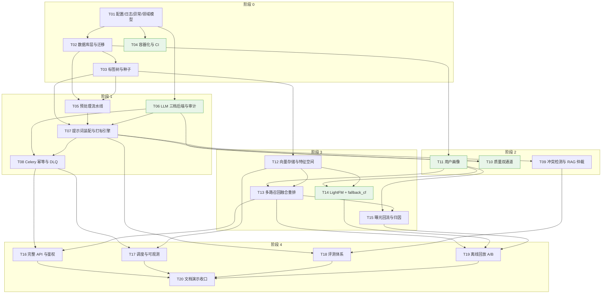

**可并行说明**

| 批次 | 可并行的任务 | 理由 |
| --- | --- | --- |
| 阶段 0 | **T04** 可与 T02 / T03 并行 | 容器化不依赖业务代码，只需 T01 的配置结构 |
| 阶段 0 | **T03** 可与 T04 并行 | 标签种子只依赖 T02 的表结构 |
| 阶段 1 | **T05** 与 **T06** 可并行 | 预处理不依赖 LLM；LLM 后端不依赖清洗 |
| 阶段 1 | **T07** 依赖 T03+T05+T06 三者汇合 | 是阶段 1 的汇聚点 |
| 阶段 2 | **T09**、**T10**、**T11** 三者可并行 | 冲突消解、质量审核、用户画像互不依赖 |
| 阶段 3 | **T12** 与 **T14** 可部分并行 | T14 需要 T12 的交互数据落库，但 CF 实现可先写 |
| 阶段 3 | **T15** 依赖 T13 | 曝光回流要带召回源归因 |
| 阶段 4 | **T16**、**T17**、**T18**、**T19** 可并行 | 收口阶段，四个子域互不阻塞 |
| 阶段 4 | **T20** 是唯一的汇聚点 | 文档需要全部实测数据才能写 |

> **关键路径**（最长链）：`T01 → T02 → T03 → T05 → T07 → T08 → T11 → T13 → T15 → T19 → T20`，共 11 步。按每任务 3–5 天估算约 **8.5 周**，与 PRD §9 的 10 周计划相容（余量 1.5 周用于阶段门禁返工）。

### 15.4 各阶段文件数分布

| 阶段 | 源文件（.py） | 测试文件 | 主要产出 |
| --- | --- | --- | --- |
| 阶段 0 | 49 | 10 | 配置/日志/异常/领域模型/DB 层/6 版迁移/标签树/容器/CI |
| 阶段 1 | 33 | 18 | 清洗/分块/脱敏/规则/LLM 三档/装配器/约束/Celery/DLQ |
| 阶段 2 | 13 | 10 | 冲突检测/检索/仲裁/规则通道/LLM 通道/闸门/画像 |
| 阶段 3 | 25 | 13 | 向量后端/特征空间/多路召回/融合/重排/CF 双实现/曝光 |
| 阶段 4 | 16 | 12 | API/鉴权/调度/可观测/金标/κ/F1/回放/文档 |
| **合计** | **136** | **63** | — |

**口径说明**：

- **136 个 Python 源文件** = `src/tagmind/` 127 + `scripts/` 4 + `migrations/` 5（`env.py` + 5 个 version）。其中 `migrations/script.py.mako` 是模板不是 `.py`，未计入。
- 上限口径是「90–130 个源文件（不含测试）」。本设计的 136 略高于该区间上界，**超出部分全部集中在 `db/`（18 个文件：3 基础 + 7 ORM 模型 + 8 仓储）**。这是 16 张物理表的必然结果 —— 若要压到 130 以内，唯一的做法是合并仓储（当前 8 个按聚合根划分）为一个 `db/repositories.py` 单文件，我判断**不值得为凑数牺牲可施工性**，特此说明并交由主理人裁决。
- **63 个测试文件** = 单元 32 + 集成 22 + 顶层 `conftest.py` 1 + 夹具目录 8。满足 `pyproject.toml` 的 `--cov-fail-under=70`。
- 数据/配置资源（`rules/`、`data/`、`config/`、`Dockerfile`、`Makefile`、CI、文档）不计入源文件统计，见 §4.4。

---

## §16 ADR 索引与待确认歧义

### 16.1 ADR 索引

| ADR | 标题 | 一句话结论 |
| --- | --- | --- |
| [ADR-0001](./adr/ADR-0001-vector-store-pgvector.md) | 向量库选型：pgvector 为主，Chroma 为开发态可插拔替代 | 生产用 pgvector（可 JOIN、可同事务、避免双写），Chroma 仅保留为无 PG 开发态的实现，接口由 `VectorStore` Protocol 抽象 |
| [ADR-0002](./adr/ADR-0002-label-taxonomy-scale-and-sharding.md) | 标签体系规模与提示词分片装载 | 总量锁定 1200–1800；L1–L3/L11–L12 全量注入 system prompt，L4 及以下按内容向量检索 top-N 分支注入，把 prompt 压到 1.5–2 万 token |
| [ADR-0003](./adr/ADR-0003-llm-backend-tiers.md) | LLM 后端三档抽象，`deterministic` 为一等公民 | 定义 `LLMBackend` Protocol + 三档实现，默认 `deterministic`（零密钥、确定性可复现），`llm_local`/`llm_api` 为可选加速通道，降级链单向不可回 |
| [ADR-0004](./adr/ADR-0004-orchestration-without-llamaindex.md) | 不引入 LlamaIndex，自写仲裁编排 | 仲裁 = 向量检索 + 固定提示模板 + 结构化解析，用三个薄函数自写，比引入框架少 8 个依赖且完全可控 |
| [ADR-0005](./adr/ADR-0005-cf-fallback-numpy.md) | 协同过滤双后端：LightFM 可选 + 纯 NumPy `fallback_cf` 必交付 | LightFM 编译失败即降级，但纯 NumPy 的 item-based 共现 + ALS 是**独立后端**，结果以 `algo` 标签分列、绝不混算 |
| [ADR-0006](./adr/ADR-0006-redis-db-separation.md) | Redis 三库分离与离线回放不读缓存 | `/0` 应用缓存、`/1` Celery broker、`/2` 结果缓存；回放强制 `cache_bypass=True` 并按回放时间窗重算热门榜，保证仿真可复现 |
| [ADR-0007](./adr/ADR-0007-tag-vector-space.md) | 标签向量空间：层权 + IDF 归一化，与画像同空间 | 定义 $v(c)[\ell]=w_{layer}\cdot idf(\ell)\cdot p(c,\ell)$，层权与 IDF 全部可配且记入 `tag_space_version`，两侧版本不一致时拒绝打分 |
| [ADR-0008](./adr/ADR-0008-label-tree-storage.md) | 标签树存储：邻接表 + 物化路径 + 祖先数组三写 | 邻接表为真相，物化路径与祖先数组为派生索引，使 C1/C2/C3 校验全部变成单表 O(1) 判定，零 LLM 成本 |
| [ADR-0009](./adr/ADR-0009-idempotency-and-dlq.md) | 幂等与死信：以数据库唯一约束为最终保证 | 接入幂等靠 `idempotency_key` UNIQUE，任务幂等靠 DB 状态判定，checkpoint 只做加速不做保证；DLQ 保留原始 payload 与重试计数，可重放 |
| [ADR-0010](./adr/ADR-0010-honest-metrics-and-rollback.md) | 口径诚实与可回滚：指标绑定版本 + 五类回滚 | 每个指标强制携带 `evidence_type`/`sample_size`/`as_of` 与 `pipeline_version`；体系/提示/模型/迁移/灰度五类回滚各自有确定的操作与验证路径 |

### 16.2 发现的 PRD 歧义与建议

> 以下是我在落架构时发现的 **PRD 内部矛盾或与拍板决策的冲突**。我已按标注的「工程处理」落地，不阻塞施工；但**建议产品经理在下一版 PRD 中修订措辞**。

#### A-01 · `label_def.code` 的全局唯一性与跨版本稳定性冲突

| 项 | 内容 |
| --- | --- |
| **冲突点** | PRD §6.2 字段表把 `code` 标为 `UNIQUE NOT NULL`，同时在同节说明「稳定编码，跨版本不变」，并在 §4.6/§10-Q2 明确需要多版本共存（P4-TAG-006 版本化与灰度）。全局 UNIQUE 使「同一 code 在 v1/v2 各存一行」不可能实现。 |
| **影响面** | 标签体系版本化与灰度双版本并行（US-03、US-12、P4-TAG-006）——这是 §2.2 明确承诺的能力。 |
| **工程处理** | 改为 `UNIQUE(version, code)` + `UNIQUE(version, path)`，另建 `ix_label_def_code` 索引支持跨版本按 code 定位。`code` 仍跨版本不变。 |
| **建议** | PRD §6.2 的 `code` 约束描述改为「同一 `version` 内 `code` 唯一；`code` 跨版本不变」。 |

#### A-02 · `user_profile.tag_weights` 的「skip 权重 ≤ 0」与「归一化后总和为 1」不能同时成立

| 项 | 内容 |
| --- | --- |
| **冲突点** | P4-USR-001 同时要求「被 `skip` 的内容标签权重 ≤ 0」与「权重归一化后总和为 1（误差 ≤ 1e-6）」。若存在负权重，则含负项的和不可能为 1；若截断负项为 0，则「skip 权重 ≤ 0」虽成立但信息丢失。 |
| **影响面** | 用户画像 P4-USR-001/002/003 的验收断言；离线回放中画像的口径解释。 |
| **工程处理** | **双字段**：`tag_weights` 存归一化后的非负权重（和 = 1，用于召回打分与验收）；新增扩展列 `label_affinity` 存带符号原始分（可负，用于「skip ≤ 0」的语义与漂移解释）。 |
| **建议** | PRD P4-USR-001 拆成两条断言：「`tag_weights` 归一化后总和为 1」与「`label_affinity` 中被 skip 标签的权重 ≤ 0」。 |

#### A-03 · PRD §6 表数与 NF-S03 的 `egress_log`

| 项 | 内容 |
| --- | --- |
| **冲突点** | PRD §6.0 说「12 张表」，但按物理表拆开是 15 张（三个成对分组各含 2 张）；同时 NF-S03 要求「所有外发请求记录 `egress_log`」，但 §6 表清单中**没有** `egress_log`。 |
| **影响面** | P4-DAT-001 的验收「全部 12 张表与索引创建成功」会与实际表数不符；NF-S03 无处落库。 |
| **工程处理** | 建 16 张物理表 = PRD 15 张 + `egress_log`。迁移脚本与一致性校验脚本均以「16 张」为准。 |
| **建议** | PRD §6.0 改为「12 个逻辑分组 / 15 张物理表 + `egress_log` = 16 张」，P4-DAT-001 的断言同步改为「全部物理表」。 |

#### A-04 · `exposure_log` 分区与 PRD 的 `id BIGSERIAL PRIMARY KEY`

| 项 | 内容 |
| --- | --- |
| **冲突点** | Q10 要求按月分区；但 PRD §6.5 规定 `id` 为 `BIGSERIAL PRIMARY KEY`。PostgreSQL 的分区表**要求唯一约束必须包含分区键**，因此 `PRIMARY KEY (id)` 在分区表上不合法。 |
| **影响面** | Q10 的分区落地；P4-REC-005 的 `request_id` 唯一性断言。 |
| **工程处理** | `PRIMARY KEY (id, ts)`（`id` 仍用 identity 序列，全局单调）；`request_id` 唯一性由 `ux_exposure_idem (request_id, content_id, action, ts)` 承担。 |
| **建议** | PRD §6.5 补充说明「分区表的唯一约束需包含分区键」。 |

#### A-05 · `content_vector.tag_vector` 的存储形态与 PRD 的 `JSONB`

| 项 | 内容 |
| --- | --- |
| **冲突点** | PRD §6.6 把 `tag_vector` 定为 JSONB。但路 A 召回要求「用户权重 × 内容标签向量」的点积，在 10 万行规模上必须走稀疏矩阵计算，逐行解 JSONB 无法满足 P99 ≤ 100 ms。 |
| **影响面** | P4-REC-002 的「两路召回各占 ≥ 10%」与 NF-P03 的 P99 ≤ 100 ms。 |
| **工程处理** | **DB 仍是真相源**（JSONB `tag_vector` + `tag_vector_norm`），但读路径走**进程内 CSR 稀疏矩阵**（`vector/tag_space.py` 构建，`vector/indexer.py` 周期刷新，Redis `/2` 缓存快照）。DB 侧另加 `content.label_ids` GIN 倒排做候选筛选。 |
| **建议** | PRD §6.6 补充说明「`tag_vector` 为持久化真相源，在线召回使用由其构建的进程内稀疏索引」。 |

#### A-06 · P4-REC-003 的 `algo=lightfm` 与 Q7 的「不混算」在响应体中的呈现

| 项 | 内容 |
| --- | --- |
| **冲突点** | P4-REC-003 要求响应标识 `algo=lightfm`；但 Q7 要求 LightFM 与 `fallback_cf` 的结果「不混算、口径分别标注」。若只回 `lightfm`，则 `fallback_cf` 时该字段无定义。 |
| **影响面** | 响应契约；曝光日志 `algo` 列的统计口径；离线回放的分组对比。 |
| **工程处理** | `algo` 取值域扩展为 `lightfm` / `fallback_cf` / `recall_only` / `hot` / `latest` / `explore`；`fallback_cf` 时 `debug.fallback_reason` 注明 `lightfm_unavailable` 或 `insufficient_interactions`。曝光与回放报表按 `algo` 分组，不做跨后端平均。 |
| **建议** | PRD P4-REC-003 的 `algo` 取值表补充 `fallback_cf` 与对应降级原因。 |

#### A-07 · MQ-01「12 层宏 F1」与 Q12「分层达标」的口径连接

| 项 | 内容 |
| --- | --- |
| **冲突点** | MQ-01 定义 `macro_F1 = (1/12)·Σ F1_L`；但 Q12 把验收基线改为「≥6 个 L1 子集宏 F1 ≥ 90%」，且 MQ-02 规定 `support<10` 的层不计入平均。分母到底是 12 还是「有效层数」需要明确。 |
| **影响面** | P4-EVA-002 的「整体 macro F1」输出与 §7.1.1 表述模板 A/B。 |
| **工程处理** | 报告同时输出三个数：`macro_f1_all12`（固定 12 层平均，含低支撑层）、`macro_f1_supported`（仅 `support≥10` 的层平均，即 MQ-01 的正式口径）、`macro_f1_by_l1_subset`（按 L1 子集）。表述模板 A 使用 `macro_f1_supported` 并列出被剔除的层名。 |
| **建议** | PRD MQ-01 补一句「若存在 `support<10` 的层，正式口径以剔除后的 `macro_f1_supported` 为准，同时披露 `macro_f1_all12`」。 |

#### A-08 · `deterministic` 后端的准确率是否计入正式结论

| 项 | 内容 |
| --- | --- |
| **冲突点** | P4-ENG-002 规定 fallback 后端的准确率「必须标记为 `fallback_backend` 口径，不计入正式准确率结论」。但 Q3 把 `deterministic` 定为**默认档**（一等公民），不是降级产物。若默认档结果一律不计入正式结论，CI 中就没有任何可断言的准确率数字。 |
| **影响面** | P4-EVA-002 的验收判定；§7.1.1 表述模板的选择。 |
| **工程处理** | 区分两个标记：`provider='deterministic'`（后端身份）与 `degraded=true`（是否由降级链进入）。评测报告对 `provider='deterministic'` 的结果**单独成节**并显式标注「规则后端结果，非大模型能力评估」；`degraded=true` 的结果额外标 `degraded_backend=true` 且**不计入**正式结论（对齐 P4-ENG-002 与 MQ-15）。 |
| **建议** | PRD §7.1 增加一行口径说明：「`provider=deterministic` 的评测结果单独报告，用于验证流水线的确定性与口径，不作为大模型准确率结论」。 |

#### A-09 · `fallback_cf` 与 LightFM 的训练数据窗口

| 项 | 内容 |
| --- | --- |
| **冲突点** | P4-REC-003 用「≥ 20 条 `exposure_log`」作为重排阈值，但未定义「有效交互」的口径（`view` 是否算一条交互？）。不同口径会导致同一用户在不同时间点被判定为「交互不足」。 |
| **影响面** | P4-REC-003 的降级判定稳定性；离线回放的可复现性。 |
| **工程处理** | 定义「有效交互」= `action ∈ {click, dwell}`（`skip` 与 `view` 不计入交互数，但计入 `behavior_count` 的 0.5 倍）。阈值 20 为 `TAGMIND_REC_CF_MIN_INTERACTIONS`（新增可配项，默认 20），在回放中按回放时间窗统计。 |
| **建议** | PRD P4-REC-003 补充「有效交互」的定义。 |

#### A-10 · 灰度能力与 P4-TAG-006 的「本期降级方案」不一致

| 项 | 内容 |
| --- | --- |
| **冲突点** | P4-TAG-006（P1）的降级方案写的是「标签体系单版本运行，仅保留 `labels_version` 字段以便未来兼容」；但 Q10/Q2 的体系版本化需求与 §10.5 的灰度流程要求**实际支持**双版本并行。 |
| **影响面** | 灰度回滚能力（§12.2）；US-03「改标签不影响已发布内容」的实现成本。 |
| **工程处理** | **本架构实现完整的多版本并存 + 灰度分流**（`TAGMIND_LABEL_CANARY_RATIO` / `TAGMIND_LABEL_CANARY_VERSION`），因为多版本并存是版本回滚的前提，而回滚是「可运营资产」目标 G3 的必要条件。多版本并存的**增量成本低**（复制行 + 指针），而事后补建的成本高（历史数据的 `labels_version` 已经写死）。 |
| **建议** | 把 P4-TAG-006 从 P1 提到 P0，或在 PRD 中说明「版本化（多版本并存）」属 P0、「灰度比例配置」属 P1 —— 两者依赖关系是单向的。 |

---

## 附录 A · 架构师交接说明

### A.1 工程师开工前必须知道的 5 件事

1. **`deterministic` 后端是一等公民**。它不是桩，必须能产出结构合法、置信度合理、**逐位可复现**的标签树与质量分。CI 与评测都跑在它上面（ADR-0003）。
2. **`domain/` 零框架依赖**。只用 `dataclass` + `Enum`，禁止 import fastapi / sqlalchemy / pydantic / numpy / celery。这条红线由 CI 静态检查强制（§14.2）。
3. **幂等的最终保证在 DB 唯一约束**，不在 Redis checkpoint，也不在应用层的 SELECT-then-INSERT（ADR-0009）。
4. **`evidence_type` 无默认值**。构造 `MetricValue` 时忘记填会在开发期直接 `TypeError`。这不是烦人的限制，是 §7.5 声明 2 的代码化（ADR-0010）。
5. **诚实的口径写在代码里，不写在文档里**。README 的指标表由 `evaluation/report.py` 生成；回放报告的首页文案是常量，不允许调用方改。

### A.2 最容易做错的三件事

| 容易做错 | 正确做法 |
| --- | --- |
| 在 `labeling/engine.py` 里直接 `import psycopg` 查库 | 只经 `db/repositories`；打标链路的 DB 访问全部走仓储（§3 依赖红线） |
| 在 `recommendation/service.py` 里读 Redis 热门榜（回放时也读） | 回放必须 `cache_bypass=True` 并按回放时间窗从 `exposure_log` 重算（ADR-0006） |
| 把 `fallback_cf` 的结果标成 `algo='lightfm'` | `algo` 必须反映**实际使用的后端**；两者分列统计，绝不混算（ADR-0005） |

### A.3 阶段门禁与本文章节的对应

| 阶段 | 出口标准（PRD §9） | 对应本文章节 |
| --- | --- | --- |
| 阶段 0 | DAT-001 / API-004 / OPS-002 / ENG-001 | §5.3、§10.1、§12.7 |
| 阶段 1 | PRE 全部 / TAG 全部 / LLM-AUDIT / OPS-001/003 | §6、§9.4、§14.7 |
| 阶段 2 | RAG 全部 / QA 全部 | §10.3、§11.10 |
| 阶段 3 | REC 全部 / USR 全部 | §8、§11.6~§11.9 |
| 阶段 4 | EVA 全部 / ENG 全部 / §7 全章口径自检 | §11.3、§12.7、§14.3 |

### A.4 与既有工程资产的对齐（施工时必须遵守）

仓库中 `Dockerfile`、`Makefile`、`.env.example`、`pyproject.toml`、`.gitattributes`、`.dockerignore`、`.gitignore` **已存在**（本架构在其基础上扩展，不重建）。以下既有约定**优先于本文档的早期推断**：

| 既有资产 | 已定义的契约 | 对本架构的影响 | 裁决 |
| --- | --- | --- | --- |
| `Dockerfile` 基础镜像 `python:3.12-slim` | Python 3.12 | `pyproject.toml` 的 `requires-python = ">=3.11"` 兼容；`lightfm-next` 有 cp312 wheel（PRD §10-Q5 提到的路径 (b)） | **沿用 3.12 镜像**。但 §3.11 的 ADR-0003 结论不变：`fallback_cf` 仍是必交付项，不因 3.12 有 wheel 而降级为可选 |
| `Dockerfile` 健康检查 `GET /healthz` | 探针路径为 `/healthz` | 我在 §4/§14 中多处写 `/health` | **统一为 `/healthz`**（既有契约优先）。PRD P4-OPS-002 的验收表述是「调用健康检查」，未指定路径；`/health` 可作为别名同时挂载，但**容器探针必须指向 `/healthz`** |
| `Dockerfile` 启动命令 `uvicorn tagmind.api.app:create_app --factory` | `api/app.py` 必须导出 `create_app` 工厂函数 | §4.1 的 `api/app.py` 职责已写明「FastAPI 应用工厂」 | **一致**，无需改动。`create_app()` 必须是零参可调用（依赖从 `api/deps.py` 内部解析） |
| `Dockerfile` 单镜像 + `TAGMIND_ROLE` 未定义 | api / worker / beat 三种角色 | 我在 §4.4 写「单一镜像，`TAGMIND_ROLE` 切换」 | **需新增环境变量 `TAGMIND_ROLE`**（取值 `api`/`worker`/`beat`，默认 `api`），并写入 `docker-compose.yml`。这是既有 Dockerfile 与本架构之间的**唯一新增契约**，请在 T04 中一并落地 |
| `Makefile` 已有目标 `run / migrate / labels / seed / demo / bench / test / lint / typecheck` | CLI 子命令名：`serve`（`run` 用）/ `migrate` / `seed-labels` / `seed` / `demo` / `bench` | 我在 §4.1 把 `cli.py` 的子命令写成 `seed / eval / replay / drift / bench / demo / migrate` | **对齐既有命名**：`cli.py` 必须提供 `serve` / `migrate` / `seed-labels` / `seed` / `demo` / `bench` 六个**已在 Makefile 中被引用**的子命令；`eval` / `replay` / `drift` / `dlq` 作为新增子命令补充。**`make demo` 与 `make bench` 的语义按 Makefile 定义执行** |
| `Makefile` `seed` 参数 `--contents 1000 --users 100 --days 30` | 种子生成器的参数契约 | 我在 §15.4/T18 提到 500 条金标与 20 条演示语料 | **对齐**：种子生成器支持 `--contents` / `--users` / `--days` 三个参数；金标集是 `seed` 的一个独立子集（500 条），不受这三个参数影响 |
| `Makefile` `bench` 注释「three baselines」 | 离线基准跑三条基线 | 与 Q13 决策一致（业务基线 + 消融基线） | **一致**。`bench` 即 §15 的 T19 离线回放 A/B，输出必须含三条基线与 `evidence_type=offline_simulation` |
| `.env.example` 的 `TAGMIND_*` 键名 | 已有 40+ 个键 | §14.1 要求逐项对齐 | **沿用**，仅新增 3 个（`TAGMIND_LLM_BACKEND` / `TAGMIND_LABEL_CANARY_RATIO` / `TAGMIND_LABEL_CANARY_VERSION`）。**注意 `.env.example` 已有 `TAGMIND_LLM_ENABLED`，它与新增的 `TAGMIND_LLM_BACKEND` 存在语义重叠** —— 裁决见下 |
| `.env.example` 已有 `TAGMIND_LLM_ENABLED=false` | 「是否启用真实 LLM」 | ADR-0003 的三档后端需要一个选择键 | **裁决**：以 `TAGMIND_LLM_BACKEND` 为**唯一权威**（`deterministic`/`llm_local`/`llm_api`）。`TAGMIND_LLM_ENABLED` 保留但**降级为派生语义**：`LLM_ENABLED=false` 且 `LLM_BACKEND≠deterministic` 时**启动报错**（防误配外发）；`LLM_ENABLED=true` 且 `LLM_BACKEND=deterministic` 时**告警并以 `deterministic` 为准**。实现放在 `config/settings.py` 的 `model_post_init` 校验中 |
| `pyproject.toml` 已有 `[rec]` / `[embeddings]` / `[pgvector]` / `[llm]` extras | 依赖分层已定 | §15.1 的依赖清单 | **完全一致**，无需改动。`chromadb` 与 `scikit-learn` 仍列为可选、不进默认安装（ADR-0001 / ADR-0005） |
| `pyproject.toml` `pytest` 已配 `--cov-fail-under=70` 与三个 marker | 测试门禁已定 | §14.8 的测试约定 | **一致**。§14.8 的 marker 名 `unit`/`integration`/`slow` 与既有配置完全吻合 |
| `pyproject.toml` ruff `select` 含 `ARG`/`PTH`/`RUF` | lint 规则较严 | §14.2 的依赖红线扫描脚本 | 依赖红线检查可写成 `ruff` 自定义规则或独立 AST 脚本；**注意 `ARG001` 已在既有配置中被 ignore**，Protocol 桩不受影响 |
| `.gitattributes` `* text=auto eol=lf` | LF 规范化 | 迁移 `.sql` 与 shell 脚本 | 一致。`scripts/*.sh` 与 `migrations/*.py` 均为 LF，无需额外处理 |

**需要工程师在 T04 中新增的 3 处**（对既有资产的小幅扩展，非重建）：

1. `Dockerfile`：新增 `ENV TAGMIND_ROLE=api`，并在 `CMD` 处按 `TAGMIND_ROLE` 分派（`api` → uvicorn；`worker` → celery worker；`beat` → celery beat）。保持单镜像。
2. `docker-compose.yml`（尚不存在）：五个服务 `api` / `worker` / `beat` / `postgres`（`pgvector/pgvector:pg16`）/ `redis`，通过 `TAGMIND_ROLE` 复用同一镜像。
3. `.env.example`：新增 `TAGMIND_LLM_BACKEND` / `TAGMIND_LABEL_CANARY_RATIO` / `TAGMIND_LABEL_CANARY_VERSION` 三行，并加注释说明与 `TAGMIND_LLM_ENABLED` 的派生关系。

### A.4 变更记录

| 版本 | 日期 | 变更 | 作者 |
| --- | --- | --- | --- |
| v1.0 | 2026-11-08 | 首版：分层/组件/文件清单/DDL/标签策略/向量选型/召回链路/调度/标签建模/数学定义/回滚/一致性/共享知识/20 任务分解 + 10 篇 ADR | 高见远（Gao） |

