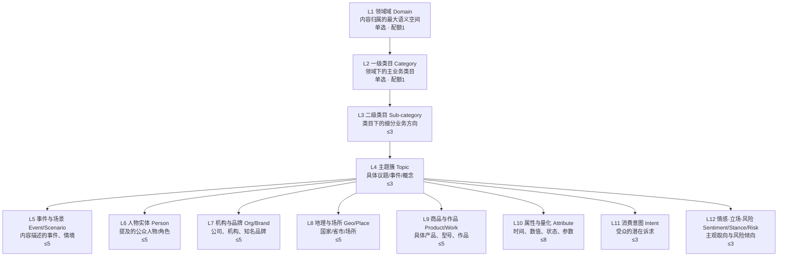
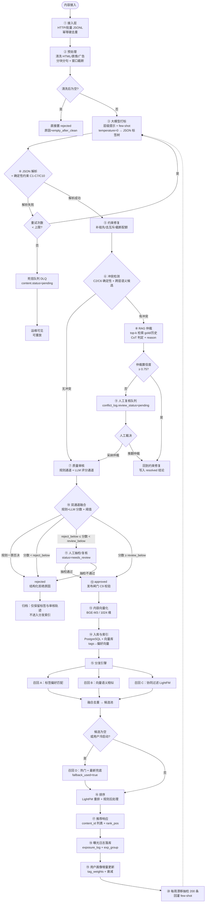
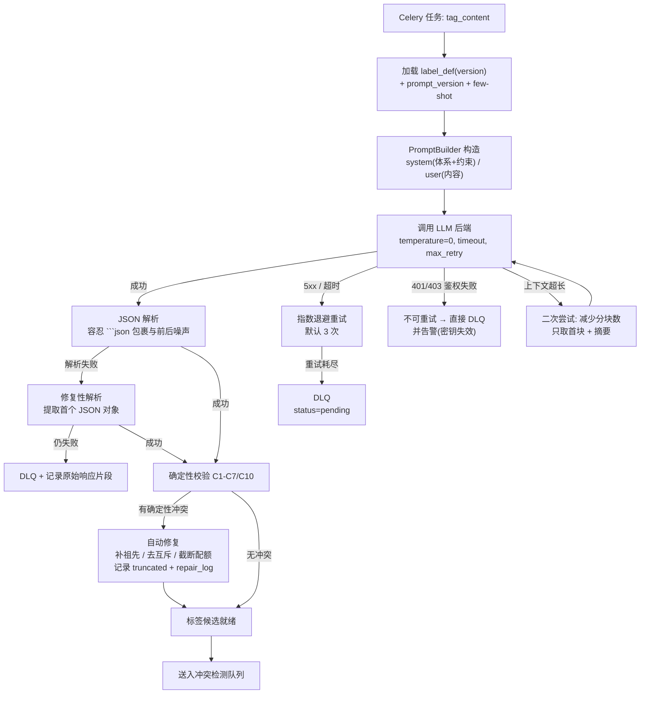
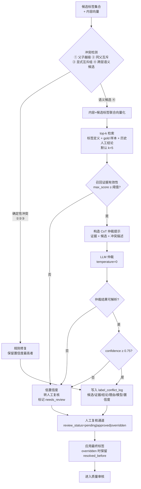
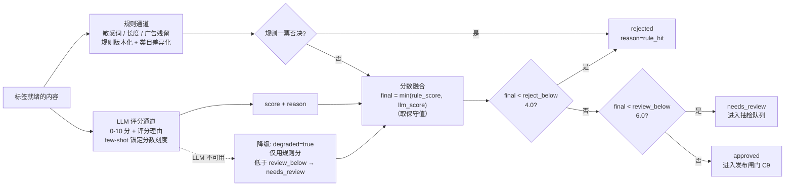
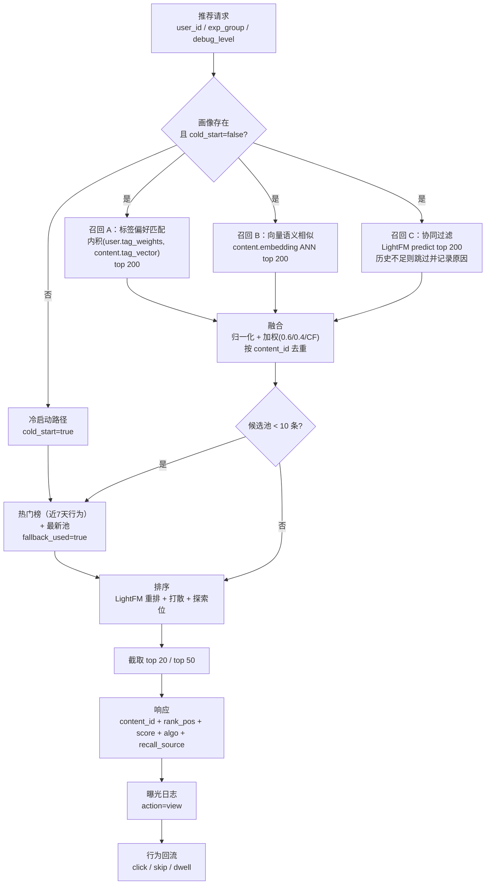
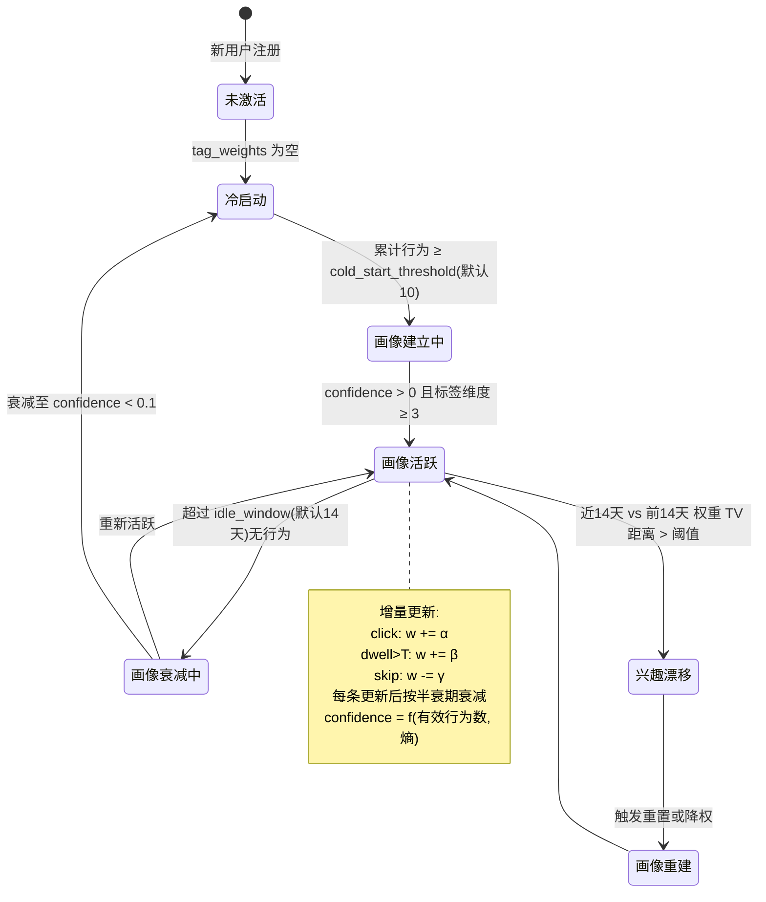
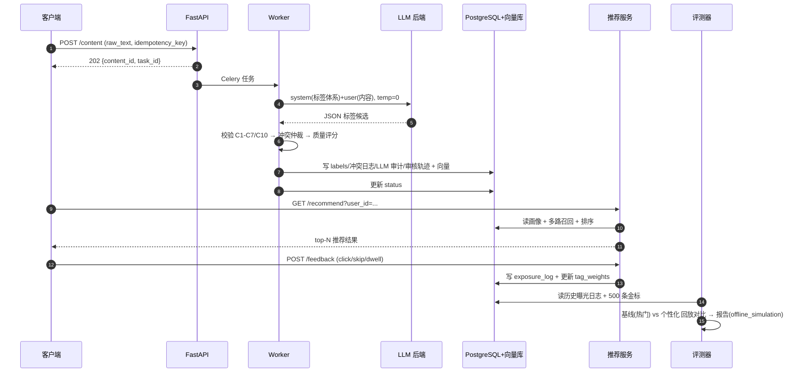
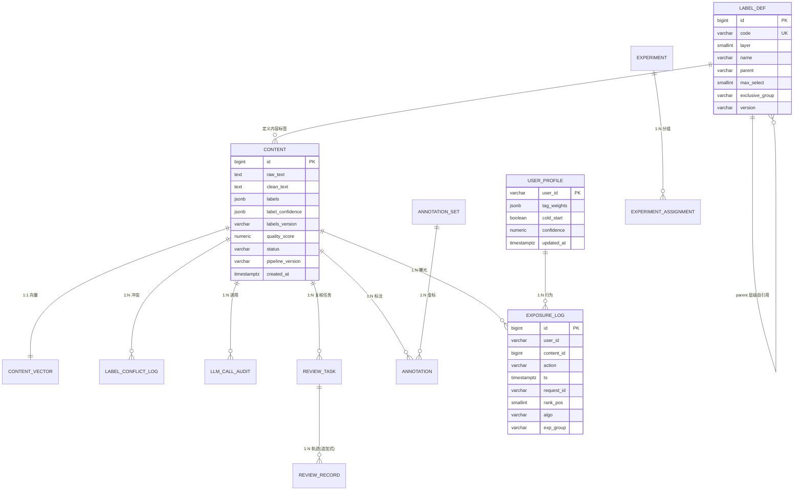
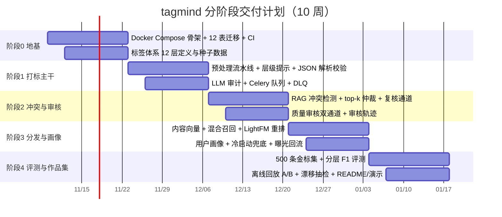

# 大模型智能标签与个性化内容分发系统 · 产品需求文档（PRD）

| 项 | 值 |
| --- | --- |
| 文档类型 | 简单 PRD（默认档）+ 按项目四要求强制的「需求池／12 层标签体系／指标口径」专章 |
| 项目代号 | `tagmind` |
| 版本 | v1.0 |
| 编写 | 产品经理 许清楚（Xu） |
| 日期 | 2026-11-08 |
| 语言 | 简体中文 |
| 目标仓库 | `Nephets1010/tagmind`（GitHub 新建，公开开源） |
| Programming Language | Python 3.11+ / FastAPI / Redis / Celery / PostgreSQL / 向量库 |
| 部署形态 | 单机 Docker Compose；目标规模 **10 万级内容 / 千级用户** |
| 交付形态 | 企业级生产标准 + 开源作品集（面试可演示、可复现、**指标口径诚实**） |
| 业务蓝本 | 《十大AI项目设计文档汇编》项目四章节 |

> **下游交接提示**：架构师重点看 §4（12 层标签体系）、§6（数据模型）、§8（非功能）、§10（待确认问题）；工程师重点看 §5（流程）、§6、§7（指标口径）；QA 重点看 §3 验收列、§7.5（诚实口径声明）、§9（阶段验收）。
>
> **本 PRD 的红线声明**：本文所有业务目标与量化成果均继承蓝本文档，但**所有指标在落地前必须按 §7.5 的「诚实口径」标注类型**（离线仿真 / 灰度 / 线上真实）。任何未标注类型的指标表述视为交付缺陷。

---

## 目录

| 章节 | 内容 | 负责人关注点 |
| --- | --- | --- |
| §0 | 项目信息 | 全体 |
| §1 | 产品目标与价值定位 | 全体 |
| §2 | 目标用户与用户故事 | 产品/设计 |
| §3 | 需求池（P0/P1/P2） | 架构/工程/QA |
| §4 | 12 层标签体系设计（核心资产） | 架构/算法 |
| §5 | 核心业务流程 | 架构/工程 |
| §6 | 数据模型初稿 | 架构/工程 |
| §7 | 指标体系与口径 | 产品/算法/QA |
| §8 | 非功能需求 | 架构/运维 |
| §9 | 分阶段交付计划 | 全体 |
| §10 | 待确认问题 | 架构师/工程师 |

---

## 0. 项目信息

### 0.1 原始需求复述

面向资讯平台、短视频公司、新媒体机构与内容电商，利用大模型的零样本/少样本能力，对日均数万条 UGC/PGC 内容进行**自动多标签打标**与**个性化分发**，替代高成本、低效率的人工标注流程。系统由三大支柱构成：

1. **12 层多标签体系** —— 兼顾业务可解释性与模型可打标性；
2. **RAG 标签冲突消解** —— 处理父子标签冲突、互斥标签冲突；
3. **轻量推荐引擎** —— 混合召回 + 协同过滤 + 冷启动回退。

蓝本给定六个核心模块：预处理、大模型打标、RAG 冲突消解、质量审核、分发引擎、用户画像；五张数据表；以及五条风险对策与一套「量化成果设计原则」。

### 0.2 三个正交产品目标

| 目标 | 表述 | 可判定性 |
| --- | --- | --- |
| **G1 标注替代** | 把「人工逐条标注」替换为「LLM 批量自动打标 + 抽样人工复核」，使单位内容标注成本与工时显著下降 | 以 §7.4 工程效率指标（每万条人工工时、单条 token 成本）判定 |
| **G2 分发精准** | 用标签体系 + 用户画像向量提升「内容—用户」匹配度，使分发从「热门/最新单点」升级为「标签偏好驱动的多路召回 + 协同过滤重排」 | 以 §7.3 业务效果指标判定，且必须区分仿真与真实流量 |
| **G3 体系可运营** | 标签体系本身是一份**可运营资产**：可配置、可版本化、可审计、可回放，任何一条标签结论都能追溯到「依据 + 模型 + 提示词 + 仲裁记录」 | 以 §7.1/§7.4 覆盖率、冲突日志完整率、抽检回灌闭环判定 |

> 三个目标互不重叠：G1 关心**成本**，G2 关心**效果**，G3 关心**可控与可信**。任何指标若同时服务两个目标，须在 §7 拆成两条独立口径，不得合并计算。

### 0.3 业务蓝本 → 本 PRD 的转化对照表

| 蓝本原文要点 | 本 PRD 落点 |
| --- | --- |
| 预处理：清洗 HTML/表情/广告并分块分句；去噪、长度截断 | §3 P4-PRE-001~004；§5.1 |
| 大模型打标：层级提示（system=标签体系, user=内容），输出 JSON 标签树；少样本约束、温度 0 | §3 P4-TAG-001~005；§4.6；§6.3 |
| RAG 冲突消解：标签定义与历史样本入库；语义检索 + LLM 仲裁；top-k + CoT | §3 P4-RAG-001~004；§5.3 |
| 质量审核：规则（敏感词/长度）+ LLM 评分（0-10）双通道；阈值可配、拒绝可解释 | §3 P4-QA-001~004；§5.4 |
| 分发引擎：内容特征向量 + 用户画像标签偏好相似召回；LightFM 重排；冷启动回退热门/最新 | §3 P4-REC-001~005；§5.5 |
| 用户画像：聚合点击/停留构建标签权重向量；增量更新与衰减 | §3 P4-USR-001~003；§5.6 |
| 风险对策 1：打标成本高 → 本地小模型 + 批量异步队列 | §3 P4-TAG-004、P4-OPS-003；§8.1；§10-Q3 |
| 风险对策 2：标签漂移 → 每周人工抽检 200 条回灌为 few-shot | §3 P4-EVA-005（P1）；§7.4；§9-阶段 4 |
| 风险对策 3：冷启动无行为 → 热门+最新兜底 | §3 P4-REC-004 |
| 风险对策 4：RAG 误仲裁 → 保留人工复核通道，冲突 log 全量可追溯 | §3 P4-RAG-003、P4-RAG-004 |
| 风险对策 5：推荐指标难验证 → 离线日志回放 A/B 仿真佐证 CTR 提升 | §3 P4-EVA-003；§7.3；§7.5 |
| 成果原则：准确率 90%+ 用 500 条人工标注集算宏 F1，注明「在 X 类目子集上」 | §7.1；§3 P4-EVA-001/002 |
| 成果原则：CTR +40% / 留存 +25% 必须写明是离线回放还是小流量灰度 2 周 | §7.3；§7.5 |
| 成果原则：12 层体系展示层级图与打标覆盖率 | §4.1；§7.1 |
| 成果原则：诚信原则，严格区分线上真实与离线仿真 | §7.5（本 PRD 强制章节） |

---

## 1. 产品目标与价值定位

### 1.1 一句话定位

> **tagmind = 用一套可运营的 12 层标签体系，把 UGC/PGC 内容在分钟级变成「机器可读的兴趣向量」，同时用大模型替代人工标注、用混合召回替代热门单点分发。**

拆解为三句可被面试官复述的价值主张：

1. **对内容方**：一条内容进来，几分钟内拿到 12 层语义标签 + 质量分 + 冲突仲裁记录，替代人工逐条标注。
2. **对分发方**：标签不止是展示用的分类，而是**可直接进入召回与排序的用户偏好坐标**（`user_profile.tag_weights` 与 `content.labels` 同构）。
3. **对平台方**：每一条标签结论都可追溯、可回放、可抽检、可回灌，形成「越用越准」的闭环。

### 1.2 目标业务 KPI

| 层级 | KPI | 目标值 | 口径类型 | 归属 |
| --- | --- | --- | --- | --- |
| 业务北极星 | **有效分发率**（被曝光且产生有效行为的曝光 / 总曝光） | ≥ 基线 + 30% | 离线回放仿真 | G2 |
| 业务北极星 | **标注人力替代率** = 1 − 人工工时/自动工时 | ≥ 85% | 工程统计（可审计） | G1 |
| 运营指标 | **打标覆盖率**（有 ≥1 个 L1-L4 树标签的内容占比） | ≥ 95% | 离线全量统计 | G3 |
| 运营指标 | **层级路径完整率**（L1-L4 祖先闭包无断裂的内容占比） | 100%（硬约束） | 离线全量统计 | G3 |
| 运营指标 | **冲突可追溯率**（冲突事件中 100% 有完整仲裁记录） | 100%（硬约束） | 离线全量统计 | G3 |
| 成本指标 | **单条打标 token 成本 + 单条平均耗时** | 建立基线并在阶段报告公示 | 实测统计 | G1 |
| 风险指标 | **错误标签外泄率**（抽检发现明显错误且未进入复核队列的比例） | ≤ 5% | 抽样人工复核 | G3 |

> 全部 KPI 的「口径类型」与「计算公式」以 §7 为唯一事实来源；§1.2 只做索引，不得在此处另立口径。

### 1.3 范围边界（In / Out）

**In scope（本项目交付）**

- 内容接入 → 清洗 → 打标 → 冲突消解 → 审核 → 入库 → 召回 → 排序 → 曝光回流 全链路；
- 12 层标签体系的**配置化**（定义、少样本、互斥组、每层配额可通过数据/配置驱动，非硬编码在提示词里）；
- RAG 冲突消解（父子冲突、互斥冲突）；
- 质量审核双通道 + 阈值配置 + 人工复核通道；
- 轻量推荐（标签偏好召回 + 协同过滤重排 + 冷启动回退）；
- 500 条人工标注金标集 + 离线评测 + 离线回放 A/B 仿真；
- 单机 Docker Compose 一键启动、可复现 seed。

**Out of scope（本期明确不做，且不得以「顺手做了」的方式悄悄补齐）**

| 不做项 | 理由 | 如需实现的前置条件 |
| --- | --- | --- |
| 真实线上流量 A/B 平台对接 | 无生产流量与账号 | §9 阶段 5 之后，且需明确实验平台与流量划分方案 |
| 多模态打标（图/视频关键帧） | 超出蓝本 6 模块 | 需先定义视觉标签体系（与 12 层的关系） |
| 分布式 / 多机部署 | 目标为单机 Compose | 需先定 pgvector vs Milvus 与状态外置方案 |
| 多租户 / RLS 细粒度隔离 | 单机单租户 | 需先定租户模型与鉴权方案 |
| 实时推送 / 标签订阅 | 非蓝本要求 | 需先定订阅协议 |
| 版权内容识别 / 去重指纹 | 蓝本未含 | 需补 P0 需求并重估工期 |

> **Out of scope 纪律**：任何交付物中出现本表所列能力，均属范围外新增，须走需求变更，不得混入本期验收。

### 1.4 风险与对策（蓝本 5 条 → PRD 验收转化）

| # | 蓝本风险 | PRD 中的对策 | 对应需求 | 验收方式 |
| --- | --- | --- | --- | --- |
| R1 | 打标成本高 | 双后端（本地 Ollama Qwen2.5-14B / 免费 API GLM-4-Flash）+ Celery 批量异步队列 + 幂等重试 | P4-TAG-004、P4-OPS-003 | 1000 条批量打标的 token 消耗、GPU/CPU 耗时、失败重试次数三项均有实测报告 |
| R2 | 标签漂移 | 每周人工抽检 200 条 → 回灌为 few-shot → 提示词版本号递增 | P4-EVA-005（P1）、P4-TAG-006（P1） | 抽检记录、few-shot 变更 diff、版本号三者可关联 |
| R3 | 冷启动无行为 | 热门 + 最新兜底，显式标记 `cold_start=true` | P4-REC-004、P4-USR-003 | 新用户首次请求 100% 命中兜底路径且响应体标明兜底来源 |
| R4 | RAG 误仲裁 | 保留人工复核通道；冲突 log 全量可追溯（候选/检索证据/结论/理由/模型版本） | P4-RAG-003、P4-RAG-004 | 任意一条内容的标签结论可回放出仲裁全过程；仲裁置信度低于阈值自动转人工 |
| R5 | 推荐指标难验证 | 离线日志回放 A/B 仿真；明确标注「仿真」 | P4-EVA-003、§7.3、§7.5 | 仿真报告显式携带 `evidence_type=offline_simulation` 字段，且报告首页写明「非线上真实流量」 |

---

## 2. 目标用户与用户故事

### 2.1 角色画像

| 角色 | 核心诉求 | 最痛的现状 | 在 tagmind 中的高频动作 |
| --- | --- | --- | --- |
| **内容运营** | 内容进来就能用，标签要能看懂、能改 | 人工标注贵；标签粒度粗，无法做精细分发 | 看标签树、调阈值、批量重打、给抽检结果回灌标签 |
| **算法工程师** | 模型/提示词/标签体系可版本化、可对比、可回放 | 黑盒；改一个 few-shot 不知道影响多少内容 | 跑离线评测、对比模型版本、回放 LLM 调用记录、定位错标样本 |
| **风控审核员** | 低质/敏感内容必须被拦住，且拒绝要能解释 | 规则黑名单误伤多；拒绝无理由无法申诉 | 查敏感词命中、查质量分与评分理由、批量复核、放行/驳回 |
| **广告投放** | 需要「内容—人群」定向标签，且标签语义稳定 | 投放侧标签体系与内容侧标签对不上 | 按标签筛选内容、查标签覆盖度、导出标签维度报表 |
| **平台运营** | 分发效果要能看，冷启动不能开天窗 | 只能上热门/最新，缺乏个性化 | 看曝光/点击分布、冷启动兜底占比、实验分组对比 |

### 2.2 用户故事清单

| 编号 | 角色 | 用户故事 | 对应需求 |
| --- | --- | --- | --- |
| US-01 | 内容运营 | 作为内容运营，我希望一条原始内容提交后系统自动完成清洗、打标、冲突消解和质量审核，以便我不用逐条手工标注 | P4-PRE-001、P4-TAG-003、P4-RAG-003、P4-QA-003 |
| US-02 | 内容运营 | 作为内容运营，我希望看到的标签是一个**树状结构**（如「科技数码 › 人工智能 › 大模型发布」）而不是一串扁平标签，以便我理解模型在做什么 | P4-TAG-003、P4-TAG-001 |
| US-03 | 内容运营 | 作为内容运营，我希望可以调整某个标签的描述和示例后，对**新进内容**生效而不影响已发布内容，以便运营迭代不引发线上事故 | P4-TAG-006（P1） |
| US-04 | 内容运营 | 作为内容运营，我希望低质内容被拒绝时能看到「命中了哪条敏感词 / LLM 评分理由」，以便我判断是否申诉 | P4-QA-001、P4-QA-002、P4-QA-004 |
| US-05 | 算法工程师 | 作为算法工程师，我希望用 500 条人工标注的金标集一键跑出**分层宏 F1**，以便我知道模型在新标签体系下的真实水位 | P4-EVA-001、P4-EVA-002 |
| US-06 | 算法工程师 | 作为算法工程师，我希望在提示词或模型版本变更后，能对比「哪些内容标签发生了变化、变化方向是否正确」，以便做有依据的迭代 | P4-EVA-006（P1）、P4-LLM-AUDIT-001 |
| US-07 | 算法工程师 | 作为算法工程师，我希望每条内容的 LLM 调用有审计记录（模型、提示词版本、token、耗时、原文摘要），以便复现与归因 | P4-LLM-AUDIT-001 |
| US-08 | 风控审核员 | 作为风控审核员，我希望敏感词和长度规则是**可配置**的且能按类目生效，以便不同业务线用不同尺度 | P4-QA-001、P4-QA-003 |
| US-09 | 风控审核员 | 作为风控审核员，我希望标签冲突（例如「正面/负面情感」同时命中）能被自动仲裁并把低置信度案例推给我复核，以便我不必审查全部内容 | P4-RAG-002、P4-RAG-003、P4-RAG-004 |
| US-10 | 风控审核员 | 作为风控审核员，我希望被拒内容有完整审核轨迹（规则命中项、评分、拒绝原因、复核人），以便申诉与合规审计 | P4-QA-004 |
| US-11 | 广告投放 | 作为广告投放，我希望按标签定向筛选内容（如「科技数码 › 人工智能」）并看到该标签下的内容量与覆盖率，以便评估可投库存 | P4-API-005、P4-TAG-001 |
| US-12 | 广告投放 | 作为广告投放，我希望标签有稳定版本号，以便我的投放规则不会因为模型升级而失效 | P4-TAG-006（P1）、P4-DAT-002 |
| US-13 | 平台运营 | 作为平台运营，我希望新用户首次进入就能拿到内容（热门+最新兜底）而不是空列表，以便冷启动不掉量 | P4-REC-004、P4-USR-003 |
| US-14 | 平台运营 | 作为平台运营，我希望看到「标签召回 / 协同过滤 / 冷启动兜底」三路各自的曝光占比，以便判断个性化是否真的生效 | P4-REC-002、P4-REC-003、P4-REC-004 |
| US-15 | 平台运营 | 作为平台运营，我希望用历史日志做离线回放对比「个性化基线 vs 热门基线」的点击率，以便在没有真实流量时也能获得方向性结论 | P4-EVA-003 |
| US-16 | 平台运营 | 作为平台运营，我希望 A/B 分组在日志与推荐请求中可追踪，以便事后按组统计 | P4-EVA-004（P1）、P4-REC-008 |
| US-17 | 全体 | 作为使用者，我希望系统密钥不写在代码里、用户 PII 在送入大模型前被脱敏，以便满足合规要求 | P4-SEC-001、P4-SEC-002 |
| US-18 | 全体 | 作为使用者，我希望服务不可用时给出明确降级状态（而不是静默失败），以便我知道结果是否可信 | P4-OPS-002、P4-QA-003 |

### 2.3 角色 → 核心任务 → 痛点 → 成功信号

| 角色 | 主要依赖的 tagmind 能力 | 成功信号（对应指标） |
| --- | --- | --- |
| 内容运营 | 12 层标签体系 + RAG 冲突消解 | 标注人力替代率 ≥ 85%（EE-01） |
| 算法工程师 | 标签体系可配置 + LLM 审计 + 离线评测 | 分层宏 F1 可复现、版本差异可对比（MQ-01/MQ-14） |
| 风控审核员 | 质量审核双通道 + 冲突仲裁 + 复核通道 | 冲突可追溯率 100%、审核轨迹完整（EE-06/NF-O07） |
| 广告投放 | 标签元数据查询 + 覆盖率 | 可投库存可查、标签版本稳定（BE-11） |
| 平台运营 | 混合召回 + CF 重排 + 冷启动兜底 | 个性化曝光占比 ≥ 70%（BE-06）、冷启动覆盖 100%（BE-04） |

---

## 3. 需求池

### 3.0 编号规范与优先级定义

**编号规范**：`P4-<模块缩写>-<序号>`

| 模块缩写 | 含义 | 蓝本对应模块 |
| --- | --- | --- |
| `PRE` | 预处理 | 1. 预处理模块 |
| `TAG` | 大模型打标 | 2. 大模型打标模块 |
| `RAG` | RAG 冲突消解 | 3. RAG 冲突消解模块 |
| `QA` | 质量审核 | 4. 质量审核模块 |
| `REC` | 分发引擎 | 5. 分发引擎 |
| `USR` | 用户画像 | 6. 用户画像模块 |
| `DAT` | 数据层与迁移 | 5 张表 + 扩展 |
| `API` | 对外服务接口 | — |
| `LLM` | LLM 调用审计 | — |
| `OPS` | 运维与可观测 | — |
| `SEC` | 安全与合规 | — |
| `EVA` | 评测与实验 | 风险对策 5 |
| `ENG` | 交付工程 | — |

**优先级定义**

| 优先级 | 含义 | 门禁 |
| --- | --- | --- |
| **P0** | Must have，阻塞验收 | 每条必须可测试；验收标准中禁止出现「用户体验好」「性能良好」等不可测表述 |
| **P1** | Should have，阶段内可延后到次阶段，但需在本期留下接口位 | 必须写明「本期不做的降级方案」 |
| **P2** | Nice to have，本期明确不做 | 只保留需求描述与触发条件，不得进入验收清单 |

**统计**：P0 = **40** 条，P1 = **17** 条，P2 = **10** 条，合计 **67** 条。

---

### 3.1 P0（Must have，40 条）

#### 3.1.1 预处理模块（PRE，4 条）

| 编号 | 用户故事 | 验收标准（可测断言） | 模块 |
| --- | --- | --- | --- |
| **P4-PRE-001** | As a 内容运营, I want 通过一个接口提交任意原始内容（含 HTML/表情/广告片段）, so that 我不必在打标前手工清洗 | Given 构造含 `<script>`、`
`、emoji、广告短语（如「点击购买 >>>」）的 100 条样本，When 调用接入接口，Then `clean_text` 中不含 `<`/`>` 标签符、不含 emoji Unicode 码点、不含广告短语；且 `raw_text` 原样保留在 `content.raw_text` 中可回溯；`clean_text` 长度 ≥ 1 且与 `raw_text` 的字符差值记入 `clean_stats` | PRE |
| **P4-PRE-002** | As a 算法工程师, I want 清洗规则可配置（可插拔正则/停用词表/广告词表）, so that 不同业务线可用不同清洗口径 | Given 修改广告词表配置后重启服务，When 对同一批样本重新清洗，Then 输出 `clean_text` 与预期一致；配置文件缺失时使用内置默认表且不报错；清洗规则版本号写入 `content.pipeline_version` | PRE |
| **P4-PRE-003** | As a 算法工程师, I want 长内容按分块分句后拼接以适配模型上下文窗口, so that 长文不会因超窗被截断成无意义片段 | Given 构造 1 条 50,000 字内容，When 执行预处理，Then 产生 ≥ 2 个分块、每块 token 估算 ≤ 配置上限（默认 2048）、各块顺序可还原原文顺序、总覆盖率 ≥ 99%（字符级）；`content.chunks` 字段记录块数与各块偏移量 | PRE |
| **P4-PRE-004** | As a 算法工程师, I want 每条内容都带清洗与截断的量化统计, so that 我能定位「标签变差」是不是清洗环节导致 | Given 任意已处理内容，When 查询 `content`，Then 返回 `clean_stats`（原始长度、清洗后长度、截断长度、去除标签数、去广告命中数、分块数）；统计字段之和与实际值自洽（误差 = 0） | PRE |

#### 3.1.2 大模型打标模块（TAG，5 条）

| 编号 | 用户故事 | 验收标准（可测断言） | 模块 |
| --- | --- | --- | --- |
| **P4-TAG-001** | As a 内容运营, I want 12 层标签体系通过配置/数据库加载而不是硬编码在提示词里, so that 我能自助扩展标签而无需改代码 | Given 在 `label_def` 新增一个 L3 标签并设置 `parent` 与 `examples`，When 对新内容执行打标（无需重启服务），Then 该标签出现在候选输出中且 `label_def` 变更前后系统对同一内容的其余标签输出完全一致（回归对比，差异仅限新增标签） | TAG |
| **P4-TAG-002** | As a 算法工程师, I want 系统提示固定为「标签体系」、用户提示固定为「待标内容」并分离, so that 我能分别优化两段提示并各自版本化 | Given 抓取任意一次 LLM 调用的审计记录，Then `system_prompt` 中包含当前生效的标签体系全文与规则约束，`user_prompt` 中包含待标内容与输出 JSON Schema 约束；两者分别有独立的 `prompt_version`；`temperature=0` 被强制写入调用参数且出现在审计记录中 | TAG |
| **P4-TAG-003** | As a 内容运营, I want LLM 输出被解析成结构合法的标签树并做层级约束校验, so that 落库的数据不会是散乱标签 | Given LLM 返回「JSON 可解析但违反层级约束」的响应（如 L3 标签缺 L2 祖先、同层选了 2 个互斥标签、超过该层配额），When 执行解析与校验，Then 该条打标进入「约束违规」分支：自动修复可修复项（同父互斥保留置信度最高者），不可修复则标记 `status=needs_review`；任何情况下落库的 `labels` 都满足 §4.5 全部硬约束 C1–C4、C6 | TAG |
| **P4-TAG-004** | As a 平台运营, I want 打标支持本地模型与 API 模型双后端并可切换, so that 我能按成本与隐私要求选路且不因单点故障中断 | Given 后端配置为 `ollama` 时，When 发起打标，Then 请求发往本地 Ollama 服务且不产生任何外网请求；Given 后端配置为 `api`（智谱 OpenAI 兼容端点），When 发起打标，Then 请求走 OpenAI 兼容格式；Given 后端返回 5xx/超时/畸形 JSON，When 触发重试策略，Then 按配置退避重试至上限，最终失败则写入死信队列并把内容置为 `status=pending`，**不得丢失、不得静默丢弃** | TAG |
| **P4-TAG-005** | As a 算法工程师, I want 每个标签带置信度并支持置信度门槛自动丢弃, so that 低把握标签不会污染分发 | Given 一次打标返回 5 个标签及置信度，When 配置 `min_confidence=0.7`，Then 置信度 < 0.7 的标签不出现在最终 `labels` 中但**保留在 `label_raw` 原始输出中**可追溯；`content.labels` 中每项含 `label_id`、`confidence`、`source`（llm/rule/rag/人工）四字段 | TAG |

#### 3.1.3 RAG 冲突消解模块（RAG，4 条）

| 编号 | 用户故事 | 验收标准（可测断言） | 模块 |
| --- | --- | --- | --- |
| **P4-RAG-001** | As a 算法工程师, I want 标签定义与历史人工标注样本入库并可语义检索, so that 仲裁时有可引用的依据 | Given `label_def` 与 ≥ 500 条金标样本已入库，When 对某个候选标签发起 top-k 检索，Then 返回 k 条（默认 k=5）相似样本，每条含 `sample_id`、`score`、`matched_label`、`source=gold|history`；`score` 按余弦相似度归一到 [0,1] 且降序排列 | RAG |
| **P4-RAG-002** | As a 风控审核员, I want 系统能自动识别父子标签冲突与互斥标签冲突, so that 明显矛盾不会流入分发 | Given 构造 4 类冲突样本：① 子标签与另一个非祖先标签同时命中；② 同父节点下命中 2 个互斥标签；③ 显式互斥组（如「正面情感」与「负面情感」）同时命中；④ 跨层语义矛盾（如 L4「新能源车销量下滑」与 L5「新能源车展销会」），When 执行冲突检测，Then 前 3 类被确定性规则命中并标记 `conflict_type=parent|mutual|exclusive`；第 4 类被判为 `conflict_type=semantic_candidate` 并进入 LLM 仲裁 | RAG |
| **P4-RAG-003** | As a 风控审核员, I want 疑似冲突通过 top-k 检索 + CoT 判定由 LLM 仲裁并给出理由, so that 矛盾标签能被自动收敛 | Given 一条命中语义候选冲突的内容，When 执行仲裁，Then 输出含 `resolved_labels`、`winner`、`reason`、`retrieved_evidence_ids`、`arbitrator_model`、`confidence`；`reason` 非空且长度 ≥ 20 字符；`retrieved_evidence_ids` 与实际检索结果集合一致；仲裁置信度 < 阈值（默认 0.75）时该条转入人工复核队列 | RAG |
| **P4-RAG-004** | As a 平台运营, I want 冲突日志全量可追溯且有人工复核通道, so that 误仲裁可以被发现并纠正 | Given 任意一条发生过仲裁的内容，When 调用轨迹查询接口，Then 返回完整 `label_conflict_log`（候选集、检索证据、结论、理由、模型版本、置信度、复核状态、复核人、复核时间）；未复核记录的 `review_status=pending`；人工复核可写回 `resolved_labels` 并保留修改前值（`resolved_before`）与修改人（`reviewer`）；全量冲突记录数量与检测日志数量一致（无丢失） | RAG |

#### 3.1.4 质量审核模块（QA，4 条）

| 编号 | 用户故事 | 验收标准（可测断言） | 模块 |
| --- | --- | --- | --- |
| **P4-QA-001** | As a 风控审核员, I want 敏感词与长度规则可配置且按类目差异化生效, so that 不同业务线用不同尺度 | Given 敏感词表含「违禁词A」，当内容命中该词，Then `quality_score` ≤ 规则上限阈值（默认 2.0）且 `status=rejected`；Given 配置了仅对 L1=「医疗健康」生效的长度阈值 50 字，When 提交一条 30 字医疗内容，Then 不因长度被拒；阈值与词表变更后规则结果随之改变且规则版本号写入审核记录 | QA |
| **P4-QA-002** | As a 风控审核员, I want LLM 给出 0-10 的质量评分并附评分理由, so that 我知道为什么判定为低质 | Given 一条边界质量内容，When 执行 LLM 评分通道，Then `quality_score` 为 0-10 之间的小数（保留 1 位），`quality_reason` 非空且包含评分依据的文本；评分 JSON 解析失败时按 §3.1.4 P4-QA-003 的降级规则处理，不使用默认值 5 静默通过 | QA |
| **P4-QA-003** | As a 平台运营, I want 质量阈值可配置且双通道融合结果确定, so that 我能调档位而不改代码 | Given 阈值配置为 `reject_below=4.0`、`review_below=6.0`，When 依次输入质量分为 2.0/5.0/8.0 的三条内容，Then 分别得到 `rejected`/`pending_review`/`approved`；规则通道直接判定为拒绝时不因 LLM 高分被翻案（一票否决）；双通道均不可用时降级为 `pending_review` 并在结果中标记 `degraded=true`，**不得默认放行** | QA |
| **P4-QA-004** | As a 风控审核员, I want 每次审核留下完整轨迹（命中规则项、评分、阈值、结论、复核动作）, so that 申诉与合规审计有据可查 | Given 任意已审核内容，When 查询审核轨迹，Then 返回规则命中明细（规则 id、命中位置、命中词）、LLM 评分与理由、当时生效的阈值配置版本、最终结论、复核人/时间（如有）；轨迹不可被后续改写（追加式，`review_event` 只增不改） | QA |

#### 3.1.5 分发引擎（REC，5 条）

| 编号 | 用户故事 | 验收标准（可测断言） | 模块 |
| --- | --- | --- | --- |
| **P4-REC-001** | As a 算法工程师, I want 内容被表示为向量并可按标签/类目过滤做相似召回, so that 分发候选来自语义匹配而非纯热门 | Given 10 万条已入库内容均已生成向量（维度与嵌入模型一致，默认 1024），When 执行 top-k 召回，Then 返回 k 条候选、每条含 `content_id`、`score`、`recall_source`；`content.vector` 与 `content.embedding_version` 字段存在；同批次内无重复 `content_id` | REC |
| **P4-REC-002** | As a 平台运营, I want 召回是「标签偏好 + 语义向量」的混合, so that 既有精确偏好又有语义泛化 | Given 一个有画像的用户发起请求，When 执行召回，Then 返回结果中同时包含 `recall_source=tag_preference` 与 `recall_source=vector_similarity` 两路来源且两路各自占比 ≥ 10%；两路分数经归一化后按配置权重（默认 0.6/0.4）融合，融合公式在响应 `debug.fusion` 中可查 | REC |
| **P4-REC-003** | As a 平台运营, I want 候选经协同过滤重排而不是直接按召回分输出, so that 能利用群体行为信号 | Given 有足量交互历史的用户（≥ 20 条 `exposure_log`），When 执行排序，Then 返回 `algo=lightfm` 标识且 `score` 来自 LightFM 预测分（与纯召回分可区分）；交互历史不足时降级为 `algo=recall_only` 并在响应 `debug.fallback_reason` 注明 `insufficient_interactions`；降级路径下**不得报错、不得返回空** | REC |
| **P4-REC-004** | As a 平台运营, I want 冷启动用户能拿到热门+最新兜底内容, so that 新用户首次进入不会看到空列表 | Given `cold_start=true` 的用户发起请求，When 执行召回，Then 返回 ≥ 10 条内容且全部来自 `recall_source=hot|latest`；响应显式标记 `cold_start=true` 与 `fallback_used=true`；热门榜按近 7 天曝光/行为计算并有缓存，缓存 TTL ≤ 60s | REC |
| **P4-REC-005** | As a 算法工程师, I want 曝光与行为全量落库并带请求上下文, so that 离线回放与实验分析有原始数据 | Given 一次推荐返回 20 条候选且用户点了第 3 条，When 记录曝光，Then `exposure_log` 中至少写入该次请求的全部 20 条（`action=view`）与 1 条 `action=click`；每条记录含 `request_id`、`rank_pos`、`exp_group`、`algo`、`latency_ms`；`request_id` 在一次请求内唯一且可跨表关联 | REC |

#### 3.1.6 用户画像模块（USR，3 条）

| 编号 | 用户故事 | 验收标准（可测断言） | 模块 |
| --- | --- | --- | --- |
| **P4-USR-001** | As a 算法工程师, I want 点击/停留行为聚合成标签权重向量, so that 用户偏好可直接与内容标签做相似度计算 | Given 用户在 24 小时内点击 5 条内容、跳过 8 条，When 重建画像，Then `user_profile.tag_weights` 为 `{label_id: weight}` 映射：被点击内容命中的标签权重 > 未命中标签权重；被 `skip` 的内容标签权重 ≤ 0；权重归一化后总和为 1（误差 ≤ 1e-6）；标签维度与 `content.labels` 使用同一套 `label_id` 空间 | USR |
| **P4-USR-002** | As a 算法工程师, I want 画像增量更新并按时间衰减, so that 长期偏好不被一次性噪声行为绑架 | Given 用户 T 时刻点击 10 条科技内容、T+30 天点击 1 条美食内容，When 计算权重，Then 美食标签权重高于科技标签权重（近因 > 远因）；衰减系数可配置（默认半衰期 14 天）；重复消费同一内容 100 次不使权重发散（单标签权重 ≤ 1.0） | USR |
| **P4-USR-003** | As a 平台运营, I want 用户画像带冷启动标记与置信度, so that 分发侧知道何时该信画像 | Given 全新用户（0 行为），When 查询画像，Then `cold_start=true`、`confidence=0`、`tag_weights` 为空对象；Given 用户累计 ≥ 10 条有效行为，When 查询，Then `cold_start=false` 且 `confidence>0`；`cold_start` 由行为条数阈值（可配，默认 10）驱动而非硬编码判断 | USR |

#### 3.1.7 数据层（DAT，1 条）

| 编号 | 用户故事 | 验收标准（可测断言） | 模块 |
| --- | --- | --- | --- |
| **P4-DAT-001** | As a 工程师, I want §6 的 12 张表以可重复执行的迁移脚本建成, so that 从空库到可用 schema 是一条命令 | Given 一个空的 PostgreSQL 实例，When 执行迁移命令，Then 全部 12 张表与索引创建成功且再次执行不报错（幂等）；迁移后表结构与 §6.1~§6.12 的字段清单逐项一致（字段名/类型/可空性/默认值）；种子数据（标签体系基线 12 层 + 金标集）可通过独立命令导入且可重复导入不产生重复行 | DAT |

#### 3.1.8 对外服务接口（API，4 条）

| 编号 | 用户故事 | 验收标准（可测断言） | 模块 |
| --- | --- | --- | --- |
| **P4-API-001** | As a 内容运营, I want 通过 HTTP 接口提交内容并拿到任务 ID, so that 我能批量接入 | Given POST 内容接入接口携带 1 条正文，When 请求返回 202，Then 响应含 `content_id` 与 `task_id`，且 `task_id` 可用于查询状态；同一 `idempotency_key` 重复提交返回**同一** `content_id` 且不产生重复行；非法正文（空串/纯空白）返回 400 且错误体含字段级错误码 | API |
| **P4-API-002** | As a 内容运营, I want 查询单条内容的处理状态与全链路结果, so that 我能确认处理完成并查看结论 | Given 任意 `content_id`，When 查询状态接口，Then 返回 `status`（pending/processing/needs_review/rejected/approved）、`labels`、`quality_score`、`quality_status`、`conflict_count`、`last_error`（如有）；已完成的内容返回标签完整树与置信度；被拒内容返回拒绝原因结构化字段 | API |
| **P4-API-003** | As a 平台运营, I want 一个接口返回给用户的推荐列表, so that 分发端一次调用完成召回与排序 | Given 合法 `user_id`（或匿名请求），When 调用推荐接口，Then 返回 ≥ 10 条 `content_id` 及 `rank_pos`、`score`、`algo`、`recall_source`（可按 `debug_level` 决定是否返回 debug 字段）；匿名请求走冷启动兜底且响应标记 `cold_start=true`；非法 `user_id` 返回 404 而非 500 | API |
| **P4-API-004** | As a 内容运营, I want 通过接口查询标签体系（层级、描述、示例、配额、互斥组）, so that 投放与运营能消费同一份标签元数据 | Given 标签体系已加载，When 查询标签树接口（支持按 layer/parent/code 过滤），Then 返回完整层级结构、每节点配额、互斥组定义、版本号；响应结构与 `label_def` 表内容一致（抽样 20 个节点，字段逐一比对全等）；标签体系版本变化时响应中的 `version` 同步变化 | API |

#### 3.1.9 LLM 调用审计（LLM，1 条）

| 编号 | 用户故事 | 验收标准（可测断言） | 模块 |
| --- | --- | --- | --- |
| **P4-LLM-AUDIT-001** | As a 算法工程师, I want 每次 LLM 调用都有审计记录（模型、提示词版本、token、耗时、重试、错误）, so that 我能复现问题并归因成本 | Given 任意一次打标或仲裁，When 查询审计表，Then 存在唯一 `llm_call_id` 关联记录，含 `provider`、`model`、`purpose`（tagging/arbiter/scoring）、`prompt_version`、`prompt_hash`、`tokens_in`、`tokens_out`、`latency_ms`、`http_status`、`retry_count`、`error`；`tokens_in+tokens_out` 与实际计费口径一致；提示词正文可由 `prompt_version + prompt_hash` 还原（哈希不匹配即报错，不返回错版本提示词） | LLM |

#### 3.1.10 运维与可观测（OPS，3 条）

| 编号 | 用户故事 | 验收标准（可测断言） | 模块 |
| --- | --- | --- | --- |
| **P4-OPS-001** | As a 运维, I want 结构化 JSON 日志且 `trace_id` 贯穿全链路, so that 我能按一次内容处理串起所有日志 | Given 处理一条内容，When 检索该 `content_id` 对应 `trace_id` 的全部日志，Then 能看到清洗→打标→仲裁→审核→入库各阶段日志且顺序正确；每条日志为单行 JSON 且含 `ts`、`level`、`trace_id`、`content_id`、`stage`；日志中不出现 API Key 明文、完整手机号、完整身份证号（脱敏见 P4-SEC-001） | OPS |
| **P4-OPS-002** | As a 运维, I want 一个健康检查接口逐一报告每个外部依赖的可用性, so that 我能立刻定位是哪个环节坏了 | Given 关闭 Redis / PostgreSQL / 向量库 / LLM 后端各一次，When 调用健康检查，Then 对应组件状态变为 `down` 并附错误摘要，其余组件不受影响；全部组件 `up` 时整体 `status=ok`；健康检查自身 P99 < 100ms（不因探测外部依赖超时而拖垮） | OPS |
| **P4-OPS-003** | As a 运维, I want 打标任务走异步队列且失败进死信队列, so that 突发批量不会打垮服务且不丢任务 | Given 一次性提交 1000 条内容，When 观察队列，Then 任务在 Celery 队列中排队处理、无请求超时；人为注入 5% 的 LLM 失败，Then 这些任务经重试后进入死信队列（DLQ）且在 DLQ 列表可见并可重放；DLQ 中每条记录含原始 payload、失败原因、已重试次数；任务处理具备幂等性（同一 `content_id` 重复执行不产生重复标签/重复日志） | OPS |

#### 3.1.11 安全与合规（SEC，2 条）

| 编号 | 用户故事 | 验收标准（可测断言） | 模块 |
| --- | --- | --- | --- |
| **P4-SEC-001** | As a 合规负责人, I want PII 在「送入大模型前」和「落库前」两处都被脱敏, so that 外部模型与数据库都不持有原始 PII | Given 一条含手机号、身份证号、邮箱、银行卡号、姓名的内容，When 执行打标，Then 发往 LLM 的 `user_prompt` 中这些字段已被替换为占位符（如 `[PHONE_1]`）；落库的 `clean_text` 同样脱敏；`content.pii_masked=true` 且记录 `pii_fields` 命中类型（不含原值）；脱敏映射表存于独立表且访问需鉴权（本地演示可仅口令保护） | SEC |
| **P4-SEC-002** | As a 运维, I want 所有密钥通过环境变量/密钥文件注入而不硬编码, so that 代码可以公开开源而不泄露凭据 | Given 全仓库扫描，Then 无任何硬编码的 API Key/密码/token 字面量；`.env.example` 列出全部必需键名但值为空；服务在缺少必需密钥时启动失败并给出明确错误（不得以空密钥静默启动）；`/health` 不回显任何密钥值（仅回显 `configured: true/false`） | SEC |

#### 3.1.12 评测与实验（EVA，3 条）

| 编号 | 用户故事 | 验收标准（可测断言） | 模块 |
| --- | --- | --- | --- |
| **P4-EVA-001** | As a 算法工程师, I want 一份 500 条人工标注的金标测试集, so that 准确率有真实基准 | Given 仓库自带 `data/gold/` 金标文件，When 校验，Then 恰好 500 条、内容 ID 唯一、每条含 ≥ 3 个标签且每个标签带标注人标注的一致性标记；金标覆盖 ≥ 6 个 L1 类目且每个类目 ≥ 30 条；金标文件版本号（如 `gold_v1`）写入评测报告 | EVA |
| **P4-EVA-002** | As a 算法工程师, I want 一条命令跑出分层宏 F1 与覆盖率, so that 我能诚实评估模型水位 | Given 已打标的全量内容与 500 条金标，When 执行评测命令，Then 输出按层（L1-L12）的 `precision`、`recall`、`macro_f1`、`support` 与整体 macro F1；每层标注 `support`，当 `support < 10` 时该层结果标记 `low_support=true` 不参与整体 macro F1 的平均；报告显式标注 `evidence_type=offline_evaluation`；同一版本重复运行结果**逐位一致**（确定性） | EVA |
| **P4-EVA-003** | As a 平台运营, I want 用历史曝光日志做离线回放 A/B, so that 没有真实流量也能得到方向性结论 | Given ≥ 30 天历史 `exposure_log` 且 ≥ 1000 用户，When 执行回放，Then 输出「基线（热门+最新）」与「个性化（标签召回+CF）」两组在同一人群上的点击率/人均曝光/人均点击，对比给出绝对值与相对提升；**每条输出字段旁标注 `evidence_type=offline_simulation`**；报告首页固定文案「本结果为离线日志回放仿真，非线上真实流量，不代表线上 CTR 提升」；回放使用与线上一致的召回与排序代码路径（同一函数，参数化基线） | EVA |

#### 3.1.13 交付工程（ENG，2 条）

| 编号 | 用户故事 | 验收标准（可测断言） | 模块 |
| --- | --- | --- | --- |
| **P4-ENG-001** | As a 面试官/工程师, I want 一条命令拉起完整栈, so that 我能在干净机器上复现演示 | Given 一台仅有 Docker Compose 的干净机器，When 执行启动命令，Then 依次拉起 api / worker / postgres / redis 四个服务且全部健康；首次启动（含镜像拉取）≤ 15 分钟；提供 `make demo` 一键跑通「接入 20 条样例 → 打标 → 仲裁 → 审核 → 召回 → 曝光」的完整链路并打印每步结果摘要 | ENG |
| **P4-ENG-002** | As a 算法工程师, I want 在无 GPU、无 API Key 的环境也有可跑通降级路径, so that 演示不会因外部依赖缺失而中断 | Given 断网且未配置任何 API Key，When 执行降级模式打标，Then 使用内置确定性规则/模板后端产出结构合法的标签与质量分，响应与审计记录中标记 `backend=fallback` 与 `degraded=true`；此时 §7.1 准确率指标**必须**标记为 `fallback_backend` 口径（不计入正式准确率结论） | ENG |

### 3.2 P1（Should have，17 条）

> P1 需求的共同约束：**本期必须留下接口位与降级方案**，但功能实现可落在 §9 的后续阶段。降级方案一栏即为其「不做该功能时系统如何继续工作」。

| 编号 | 用户故事 | 验收标准 | 本期降级方案 |
| --- | --- | --- | --- |
| **P4-PRE-005** | As a 算法工程师, I want 清洗对多语言、繁简、错别字、谐音更鲁棒, so that 噪声内容不拖累标签质量 | Given 100 条含繁体/粤语谐音/错别字的样本集，When 清洗，Then 有效字符保留率 ≥ 85%（人工标注口径），噪声字符单独统计入 `clean_stats` | 仅做 Unicode 归一化 + 常见变体映射，不做语义纠错 |
| **P4-TAG-006** | As a 内容运营, I want 标签体系可版本化并灰度双版本并行, so that 改标签不会立刻影响线上分发 | Given 发布标签体系 v2 并开启 10% 灰度，When 新内容打标，Then 10% 内容用 v2、其余用 v1；`content.labels_version` 记录实际版本；灰度期内新旧版本指标可分别统计；回滚只需把开关切回 v1 | 标签体系单版本运行，仅保留 `labels_version` 字段以便未来兼容 |
| **P4-TAG-007** | As a 算法工程师, I want 低置信度难例自动回流为候选训练样本, so that 标注体系能自我进化 | Given 连续 7 天 `min_confidence` 以下的样本，When 运行回流任务，Then 聚类去重后产出 ≤ 200 条候选样本并带聚类中心相似度；候选样本需人工确认后才进入 `label_def.examples` | 仅导出候选清单为文件，不自动入 few-shot |
| **P4-RAG-005** | As a 算法工程师, I want 仲裁可由多模型投票并记录分歧, so that 单一模型的系统性偏差可被发现 | Given 配置 2 个仲裁后端，When 仲裁，Then 两个结论均入库并记录一致率；一致率 < 80% 的仲裁类型进入人工复核优先队列 | 单模型仲裁，保留 `arbitrator_model` 字段 |
| **P4-RAG-006** | As a 算法工程师, I want 冲突类型可扩展（时序冲突、实体歧义、指代不明）, so that 更多类型的矛盾能被识别 | Given 配置扩展冲突类型规则表，When 检测，Then 新增类型与既有类型走同一套仲裁流程并在 `conflict_type` 中区分；新增类型不影响既有类型检测召回 | 仅支持 §3.1.3 P4-RAG-002 的 4 类 |
| **P4-QA-005** | As a 内容运营, I want 被拒内容的共性反哺预处理规则, so that 同类低质内容下次直接拦在清洗后 | Given 一批被规则拒的内容，When 运行反哺分析，Then 产出高频模式清单（命中词/长度分布），并可一键生成规则草稿供人工确认 | 仅提供统计报表，不自动改规则 |
| **P4-REC-006** | As a 平台运营, I want 推荐结果做同标签去重打散与多样性控制, so that 用户不会连续看到同一类内容 | Given 同一 L2 类目内容占候选前 10 位的比例 > 60% 的场景，When 施加打散约束，Then 前 10 位中同 L2 最多 3 条；打散强度可配置；关闭打散时可还原纯排序结果 | 无打散，仅按分数排序（该缺陷在 README 已知限制中披露） |
| **P4-REC-007** | As a 平台运营, I want 保留少量探索位给新内容, so that 新内容有机会获得曝光 | Given 配置探索位比例 ε（默认 2%），When 线上发推荐，Then 约 ε 比例的位来自随机/热度探索池；曝光日志记录 `algo=explore` 以便与个性化效果区分 | 无探索位，新内容靠「最新」兜底获得曝光 |
| **P4-REC-008** | As a 算法工程师, I want 推荐质量有离线排序指标（NDCG/Recall@K）, so that 排序改动可被离线回归检测 | Given 一组带相关性标注的查询-候选对，When 评估，Then 输出 `Recall@10`、`NDCG@10`、`MRR`；同一版本重复运行结果一致 | 只做端到端 CTR 仿真，不做排序层指标 |
| **P4-USR-004** | As a 平台运营, I want 有用户画像的可视化查询接口, so that 我能向业务方解释「为什么推给他」 | Given 用户 id，When 查询，Then 返回 Top-N 标签、权重、近期行为摘要、置信度、冷启动标记；接口有 QPS 限制与只读权限区分 | 仅提供库表查询，不做接口 |
| **P4-USR-005** | As a 算法工程师, I want 检测兴趣漂移（近期权重分布突变）, so that 画像不会长期锁死在旧偏好 | Given 用户近 14 天与前 14 天权重分布差异超阈值，When 触发检测，Then 记录 `drift_detected=true` 并计算总变差距离（TV distance）；触发后可重置画像权重 | 仅依赖时间衰减隐式处理漂移，无显式检测 |
| **P4-EVA-004** | As a 平台运营, I want A/B 分组可配置且贯穿请求与日志, so that 事后能按组统计 | Given 配置实验 `exp_001` 与 50/50 分流，When 请求，Then 用户稳定落在同一组（按 user_id 哈希），`exp_group` 写入推荐响应与 `exposure_log`；支持按组统计点击率 | 单组，无实验框架；`exp_group` 字段保留但恒为 `default` |
| **P4-EVA-005** | As a 算法工程师, I want 每周自动抽检 200 条并回灌为 few-shot, so that 标签漂移能被及时发现与修正 | Given 配置周检任务，When 每周运行，Then 随机抽取 200 条已发布内容并生成抽检表（含模型标签与待标注位）；人工回填后计算与模型标签的一致率并写入 `label_drift_check`；一致率低于阈值（默认 85%）时告警并产出 few-shot 变更建议 | 手工抽检脚本 + 一致率统计表 |
| **P4-EVA-006** | As a 算法工程师, I want 对比不同模型/提示词版本在同一批内容上的差异, so that 迭代有据可依 | Given 两个 `prompt_version` 或两个 `model` 的打标结果集，When 对比，Then 输出标签级一致率（Jaccard）、新增/删除标签 top-N 分布、分层差异；差异明细可下钻到内容级 | 保留版本字段，支持人工按版本过滤查看 |
| **P4-OPS-004** | As a 运维, I want 暴露 Prometheus 指标与告警规则, so that 线上问题能被主动发现 | Given `/metrics` 端点，Then 暴露打标吞吐/失败率、队列深度、LLM P95 延迟与 token 速率、召回 P99、召回空结果率；提供 ≥ 5 条告警规则文件 | 结构化日志 + 基础 `/health` |
| **P4-SEC-003** | As a 合规负责人, I want 有内容处理与数据访问的审计报表, so that 满足留痕与合规检查 | Given 导出审计报表，Then 覆盖内容处理流水（谁、何时、哪个模型、结果）、数据访问日志（谁在何时读了哪条内容的标签）；报表不含原始 PII；导出动作本身被记录 | 结构化日志可查询，无专门报表 |
| **P4-API-005** | As a 内容运营, I want 支持批量异步导入（文件级）, so that 我能一次导入万条历史内容 | Given 上传一个 JSONL 文件（≤ 1 万行），When 提交，Then 返回批次 ID，批次内逐条进入流水线；进度可查（已处理/失败/待处理）；单行失败不阻断整批；行级失败原因可查 | 逐条 API 提交 + 本地脚本循环 |

### 3.3 P2（Nice to have，本期明确不做，10 条）

| 编号 | 需求描述 | 触发条件（何时启动） | 本期处置 |
| --- | --- | --- | --- |
| **P4-TAG-008** | 从历史已确认样本中**自动挖掘** few-shot 示例（相似内容聚类 → 代表样本 → 注入 examples），替代人工挑选 | 当 §3.2 P4-EVA-006 的版本差异分析常态化、人工挑选 few-shot 成为瓶颈时启动 | 不实现；`label_def.examples` 仅支持人工/种子导入 |
| **P4-TAG-009** | 多模态打标：图片标签、OCR、视频关键帧 + 字幕联合打标 | 当业务方提供图文混排内容且文本标签不足以覆盖语义时启动 | 不实现；`content` 表预留 `media_refs` 字段但不做处理逻辑 |
| **P4-RAG-007** | 标签图谱（Label Graph）可视化编辑器：拖拽调整层级、父子关系、互斥组并实时预览影响面 | 当标签数量 > 300 且运营需要自助调整时启动 | 不实现；标签体系通过数据库/API 管理 |
| **P4-REC-009** | 会话级/序列级重排（考虑用户当前会话内的已消费内容，避免连续重复） | 当单用户日均曝光 > 50 且重复曝光投诉出现时启动 | 不实现；仅提供 `P4-REC-006` 的同标签打散 |
| **P4-REC-010** | 端到端训练：把召回结果蒸馏为排序模型（双塔 → 两塔交叉） | 当已有 ≥ 50 万曝光日志且 LightFM 到达收益瓶颈时启动 | 不实现；使用 LightFM 混合特征 |
| **P4-USR-006** | 跨域/跨端画像迁移（如小程序行为迁移到 App）、画像共享与联邦式聚合 | 当多端接入且存在明显冷启动缺口时启动 | 不实现；画像按 `user_id` 隔离 |
| **P4-EVA-007** | 对接真实线上 A/B 平台（分流、实验配置下发、指标回流） | 当系统接入真实流量且需要可信的业务效果结论时启动 | 不实现；只做离线回放仿真（P4-EVA-003） |
| **P4-API-006** | 标签订阅与实时推送（SSE / Webhook）：内容打标完成后主动通知下游 | 当下游系统需要毫秒级感知新内容时启动 | 不实现；下游轮询状态接口 |
| **P4-OPS-005** | 多机分布式部署方案（API 多副本、worker 横向扩容、向量库外置为 Milvus） | 当单机吞吐成为瓶颈（打标 > 500 条/分钟）或内容 > 1000 万时启动 | 不实现；单机 Compose |
| **P4-SEC-004** | 多租户与行级安全（RLS）：租户隔离标签体系与内容、跨租户检索阻断 | 当服务多客户 SaaS 化时启动 | 不实现；单租户 |

---

## 4. 12 层标签体系设计（核心资产）

### 4.1 设计目标与层级总览

**设计目标**：在「业务可解释」与「模型可打标」之间取平衡。

| 设计约束 | 具体含义 |
| --- | --- |
| 业务可解释 | 运营/风控/投放三方能读懂每一层语义，不需要理解机器学习 |
| 模型可打标 | 每层定义独立、互不混淆，单层内标签语义不重叠（避免同层歧义导致随机选择） |
| 层级有界 | 固定 12 层，不可无限下钻；深度带来的区分度收益在 L4 之后快速衰减 |
| 前紧后松 | L1-L4 为**严格树**（一条内容在每层只有一个主归属），L5-L12 为**开放多选集**（承载实体、属性、意图、情感等可并存维度） |

**层级定位表**

| 层 | 层名 | 语义职责 | 典型问题 | 结构 | 每层配额 | 是否入召回特征 |
| --- | --- | --- | --- | --- | --- | --- |
| L1 | 领域域 Domain | 内容所属的顶层事业域 | 这是科技内容还是财经内容？ | 严格树（单选） | 1 | 是（强特征） |
| L2 | 一级类目 Category | 领域内的主业务类目 | 属于科技里的哪一类？ | 严格树（单选） | 1 | 是（强特征） |
| L3 | 二级类目 Sub-category | 类目下的细分方向 | 是 AI 还是芯片？ | 严格树（同父互斥） | ≤ 3 | 是（强特征） |
| L4 | 主题簇 Topic | 具体议题/概念/事件簇 | 谈的是哪件具体事？ | 严格树（同父互斥） | ≤ 3 | 是（强特征） |
| L5 | 事件与场景 Event/Scenario | 内容所述事件、情境、使用场景 | 发生了什么？在什么情境下？ | 开放多选 | ≤ 5 | 是 |
| L6 | 人物实体 Person | 提及的公众人物/角色/职业群体 | 提到了谁？ | 开放多选 | ≤ 5 | 是（弱特征） |
| L7 | 机构与品牌 Org/Brand | 公司、机构、品牌、IP | 涉及哪家企业？ | 开放多选 | ≤ 5 | 是（弱特征） |
| L8 | 地理与场所 Geo/Place | 国家/省市/场馆/景区 | 发生在哪？ | 开放多选 | ≤ 5 | 是（弱特征） |
| L9 | 商品与作品 Product/Work | 具体产品、型号、书影音、菜品 | 讲的是哪个产品？ | 开放多选 | ≤ 5 | 是（弱特征） |
| L10 | 属性与量化 Attribute | 时间、数值、状态、参数、颜色等客观属性 | 关键数字/状态是什么？ | 开放多选 | ≤ 8 | 否（进画像但不入向量） |
| L11 | 消费意图 Intent | 内容唤起的受众诉求 | 用户看了能满足什么需求？ | 开放多选 | ≤ 3 | 是（强特征） |
| L12 | 情感·立场·风险 | 主观情绪、立场、风险倾向 | 正面/负面/中立？含风险吗？ | 开放多选（互斥组约束） | ≤ 3 | 是（强特征） |

### 4.2 L1 领域域示例标签（基线 20 个）

| code | 名称 | 说明 | 典型 L2 方向 |
| --- | --- | --- | --- |
| `D_TECH` | 科技数码 | 消费电子、软件、AI、通信等技术类内容 | 人工智能、半导体、智能手机 |
| `D_FIN` | 财经商业 | 宏观经济、资本市场、企业经营、电商 | 宏观经济、股票、电商 |
| `D_LIFE` | 生活消费 | 日常生活方式、健康、居家、穿搭 | 美食、家居、穿搭 |
| `D_SOCIAL` | 社会文化 | 时事、民生、社会现象、评论 | 时政、民生、评论 |
| `D_ENT` | 体育娱乐 | 体育赛事、明星、影视综艺 | 赛事、明星、影视 |
| `D_EDU` | 知识教育 | 教程、科普、学历、技能 | 科普、职业技能 |
| `D_GOV` | 政务法律 | 政策、法规、办事流程 | 政策解读、法规 |
| `D_MED` | 医药健康 | 疾病、药物、诊疗、健身健康 | 疾病、药物、健身 |
| `D_AUTO` | 汽车出行 | 汽车、新能源、出行方式 | 新能源车、自动驾驶 |
| `D_BEAUTY` | 时尚美妆 | 美妆、护肤、时尚潮流 | 护肤、潮流 |
| `D_MOM` | 母婴育儿 | 孕产、育儿、教育辅食 | 婴幼儿、学龄前 |
| `D_HOME` | 家居房产 | 装修、家居、房产居住 | 装修、房产 |
| `D_GAME` | 游戏电竞 | 游戏、赛事、攻略、电竞 | 手游、端游、电竞 |
| `D_TRAVEL` | 旅行户外 | 旅游目的地、户外运动 | 国内游、露营 |
| `D_FOOD` | 美食餐饮 | 菜谱、餐厅、探店、饮品 | 菜谱、餐厅 |
| `D_EMO` | 情感生活 | 情感、星座、两性、关系 | 星座、两性 |
| `D_AGRI` | 农业乡村 | 种植、养殖、乡村振兴 | 种植、畜牧 |
| `D_ENERGY` | 能源环保 | 能源转型、碳中和、环保政策 | 光伏、碳市场 |
| `D_ART` | 文化艺术 | 绘画、音乐、舞蹈、传统工艺 | 绘画、音乐 |
| `D_CAMERA` | 摄影绘画 | 摄影技法、器材、后期 | 器材、技法 |

### 4.3 L2 一级类目示例标签（节选，覆盖 6 个 L1）

| L1 | L2 code | L2 名称 | 说明 |
| --- | --- | --- | --- |
| `D_TECH` | `C_AI` | 人工智能 | 大模型、AI 应用、机器学习、算力 |
| `D_TECH` | `C_CHIP` | 半导体与芯片 | 芯片设计、制造、封测、设备材料 |
| `D_TECH` | `C_PHONE` | 智能手机 | 终端、系统、影像、续航 |
| `D_TECH` | `C_CLOUD` | 云计算与大数据 | 公有云、数据平台、数仓 |
| `D_TECH` | `C_SEC` | 网络安全 | 攻防、漏洞、隐私合规 |
| `D_FIN` | `C_MACRO` | 宏观经济 | GDP、通胀、政策、汇率 |
| `D_FIN` | `C_STOCK` | 股票与证券 | A股、港股、美股、研报解读 |
| `D_FIN` | `C_FUND` | 基金与理财 | 基金、理财、保险配置 |
| `D_FIN` | `C_IPO` | 创业与投融资 | 融资、并购、估值、BP |
| `D_FIN` | `C_ECO` | 零售与电商 | 大促、消费趋势、渠道 |
| `D_LIFE` | `C_HEALTH` | 健康养生 | 饮食作息、慢病管理、保健品 |
| `D_LIFE` | `C_HOME` | 居住与收纳 | 户型、收纳、装修风格 |
| `D_SOCIAL` | `C_CURR` | 热点时事 | 突发事件、舆论事件 |
| `D_SOCIAL` | `C_LEGAL` | 权益与维权 | 消费者权益、劳动权益 |
| `D_ENT` | `C_STAR` | 明星与 IP | 艺人动态、饭圈、作品 |
| `D_ENT` | `C_SPORT` | 体育赛事 | 足球、篮球、电竞赛事 |
| `D_MED` | `C_DISEASE` | 疾病与诊疗 | 病症、就诊、用药 |
| `D_MED` | `C_FIT` | 运动健身 | 力量、有氧、康复 |
| `D_AUTO` | `C_EV` | 新能源汽车 | 纯电、插混、智驾、充电 |
| `D_EDU` | `C_SCI` | 科普与前沿 | 科学概念、前沿发现 |

> **标签体系规模建议**：L1 = 20，L2 = 60~80，L3 = 150~250，L4 = 400~800，L5-L12 每层 50~300。总标签量控制在 1500~2500 —— 低于 1500 区分度不足，高于 3000 则 LLM 提示词过长导致打标质量与成本双升。这是**本 PRD 给架构师的关键约束**，最终数量见 §10-Q2。

### 4.4 L3/L4 示例（节选，用于说明层级粒度）

| 层级 | 路径 | 名称 | 说明 |
| --- | --- | --- | --- |
| L3 | `D_TECH › C_AI` | 大模型与 LLM | 大语言模型、多模态模型 |
| L3 | `D_TECH › C_AI` | AI 应用 | 落地场景、SaaS、Agent |
| L3 | `D_TECH › C_AI` | 算力与芯片 | 训练推理算力、国产替代 |
| L3 | `D_TECH › C_CHIP` | 存储芯片 | NAND、DRAM、HBM |
| L3 | `D_TECH › C_CHIP` | 先进封装 | CoWoS、先进制程 |
| L4 | `D_TECH › C_AI › 大模型与 LLM` | 模型发布 | 新模型上线与能力公告 |
| L4 | `D_TECH › C_AI › 大模型与 LLM` | 开源生态 | 开源权重、许可证争议 |
| L4 | `D_TECH › C_AI › 大模型与 LLM` | 推理成本 | 降价、Token 经济学 |
| L4 | `D_TECH › C_AI › AI 应用` | 企业落地 | 行业案例、ROI |
| L4 | `D_TECH › C_AI › AI 应用` | 消费级应用 | AI 助手、AI 硬件 |

### 4.5 层级约束规则（硬约束，打标落库前必须全部满足）

| 规则号 | 规则 | 判定方式 | 违反时处理 |
| --- | --- | --- | --- |
| **C1 树层唯一性** | L1-L4 构成严格树；每层每条内容**有且仅有**一条该层主标签（L1/L2 恒为 1 条，L3/L4 ≤ 配额） | 按 `parent` 链自上而下核对 | 缺父标签 → 补齐最近祖先；多同级 → 保留置信度最高者，其余记录为冲突 |
| **C2 同父互斥** | 同一父节点下的兄弟标签互斥，不得同时命中 | 查询兄弟标签集合求交 | 保留置信度最高者，其余进冲突日志 `conflict_type=mutual` |
| **C3 祖先闭包** | 命中第 k 层标签，必须同时携带 L1…L(k−1) 的全部祖先标签 | 自底向上回溯 `parent` 链 | 自动补齐缺失祖先并标记 `labels[].source=derived`（区别于 `llm`） |
| **C4 跨层可多选** | L5-L12 各层之间、各层内部（除显式互斥组外）**互不排斥**，允许跨层多选 | 不做跨层排斥检查 | — |
| **C5 每层配额** | 每层命中数不超过 §4.1 表中的配额 | 计数校验 | 超出部分按置信度升序截断，截断事实写入 `label_stats.truncated` |
| **C6 显式互斥组** | 同一互斥组内的标签最多命中 1 个（如情感组「正面/负面/中立」三选一） | 查 `label_def.exclusive_group` | 保留置信度最高者，进冲突日志 `conflict_type=exclusive` |
| **C7 置信度门槛** | 落库标签的 `confidence ≥ min_confidence`（默认 0.7） | 阈值比较 | 低于门槛者不进入 `labels`，但保留在 `label_raw` |
| **C8 语义冲突仲裁** | 跨层语义矛盾（如 L4 与 L5 叙事相反）需经 RAG 仲裁后才可落库 | 冲突检测 + 仲裁 | 仲裁置信度 < 0.75 → 转人工复核，内容置 `needs_review` |
| **C9 覆盖率** | 已发布内容（`status=approved`）的 L1-L4 覆盖率 = 100%（硬门槛），不满足则不允许进入分发索引 | 发布前校验 | 阻断发布并回退到打标重试 |
| **C10 版本一致性** | 一条内容的 `labels` 全部来自同一个 `label_def.version`；混版视为数据损坏 | 比对 `content.labels_version` 与各标签的 `def_version` | 视为脏数据，重新打标 |

> **约束执行位置**：C1–C7、C10 为**确定性后处理校验**（在标签解析层，无 LLM 参与，零成本、可解释）；C8 需要 LLM 仲裁（异步任务）；C9 为**发布闸门**。这一划分是成本控制的关键——把 80% 的约束用规则解决，只有真正语义模糊的才花钱调 LLM。

### 4.6 层级提示模板结构（P4-TAG-002 的输入契约）

系统提示（`system`）与用户提示（`user`）严格分离，两者独立版本化。整体调用链为：
`Celery 消费任务 → PromptBuilder 加载 system(标签体系+约束) / user(内容+Schema) → 注入 few-shot → LLM(temperature=0) → JSON 解析 → 确定性校验(C1-C7,C10) → 冲突则走 §5.3 的 RAG 仲裁 → 落库(labels + label_confidence + 审计记录)`。

**提示词骨架（结构契约，非代码）**

| 段 | 内容 | 版本化 |
| --- | --- | --- |
| ① 角色定义 | 「你是内容标注引擎，只输出 JSON」 | `prompt_version` |
| ② 标签体系 | L1-L12 全部层级定义（名称 + 描述）+ 配额约束 | `label_def.version` + `prompt_version` |
| ③ 规则约束 | C1/C2/C6 的自然语言表述 + 冲突示例 | `prompt_version` |
| ④ Few-shot | 每层 2-5 个正例（`label_def.examples`） | `label_def.version` |
| ⑤ 输出 Schema | JSON 结构约束 + 一个完整样例 | `prompt_version` |
| ⑥ 待标内容 | 分块后的 `clean_text`（已脱敏） | — |
| ⑦ 辅助信息 | 来源、时间、语言、内容类型 | — |

> **关键决策**：标签体系（②）与规则（③）随 `label_def.version` 走，提示词模板（①⑤）随 `prompt_version` 走 —— 两者解耦，使得「运营改标签」与「算法改提示词」互不干扰，这是 §3.2 P4-TAG-006 灰度双版本能成立的前提。

### 4.7 标签体系与推荐引擎的耦合关系

**核心设计**：标签不是「展示用的分类」，而是**与用户画像同构的坐标**。

| 侧 | 结构 | 存储 |
| --- | --- | --- |
| 内容侧 | `content.labels` = `[{label_id, confidence, source}]`，按层展开为 12 维稀疏向量 | PostgreSQL（JSONB） |
| 用户侧 | `user_profile.tag_weights` = `{label_id: weight}`，同一 `label_id` 空间 | PostgreSQL（JSONB） |
| 交互 | 内积 `Σ w_content[label] × w_user[label]` = 标签偏好匹配分 | 计算时向量化 |

**关键收益**：`content.labels` 与 `user_profile.tag_weights` 共享 `label_id` 空间，因此标签偏好匹配可以退化为一次向量点积，无需额外训练映射层；LightFM 只需把标签作为**特征**（而非 item ID）即可实现「新品冷启」（新内容即使没有交互数据，也能通过标签特征被召回）。这是 §4.7 与 §3.1.5 P4-REC-003 关联的关键设计。

---

## 5. 核心业务流程

### 5.1 端到端主流程（内容接入 → 曝光回流）

### 5.2 标签打标子流程（含失败与降级分支）

### 5.3 RAG 冲突消解子流程

**仲裁的可解释性契约**：`label_conflict_log` 必须同时包含「候选集」「检索证据（可点击查看样本正文）」「结论」「自然语言理由」「仲裁模型与版本」「置信度」「复核状态」七要素，缺一不可 —— 这是 §1.2 中「冲突可追溯率 100%」与 §3.1.3 P4-RAG-004 的直接依据。

### 5.4 质量审核双通道

### 5.5 分发引擎（召回 → 排序 → 兜底）

**召回源可归因**：每条推荐结果必须携带 `recall_source ∈ {tag_preference, vector_similarity, collaborative, hot, latest, explore}`，这是 §2.2 US-14（各路曝光占比）与 §7.3 业务归因分析的基础。

### 5.6 用户画像生命周期

### 5.7 端到端时序（含离线回放 A/B）

---

## 6. 数据模型初稿

### 6.0 总览与设计原则

**扩展说明**：蓝本给定 5 张表（`content` / `label_def` / `label_conflict_log` / `user_profile` / `exposure_log`）。本 PRD 在保留其**原有字段语义**的前提下，扩展字段并新增 7 张表，合计 **12 张表**。

**三条设计原则**

1. **原始数据不可变**：清洗后的正文、LLM 原始输出、审计记录只增不改；一切修正通过新版本记录表达（`label_raw` 保留原始输出）。
2. **结论必带来源与版本**：任何标签/评分/排序结果都携带 `source`（谁产生的）+ `*_version`（用的哪套定义/模型），否则无法回放与归因。
3. **时间戳统一 UTC**：所有 `ts` / `created_at` 使用 UTC 存储，展示层做本地化，避免跨时区统计错误。

**表清单**

| # | 表名 | 用途 | 蓝本来源 |
| --- | --- | --- | --- |
| 1 | `content` | 内容主表 + 标签 + 质量 + 状态 | 扩展自蓝本 |
| 2 | `label_def` | 标签体系定义（12 层） | 扩展自蓝本 |
| 3 | `label_conflict_log` | 冲突检测与仲裁全量日志 | 扩展自蓝本 |
| 4 | `user_profile` | 用户标签权重画像 | 扩展自蓝本 |
| 5 | `exposure_log` | 曝光与行为流水 | 扩展自蓝本 |
| 6 | `content_vector` | 内容向量（与 content 分离，便于重建） | **新增** |
| 7 | `llm_call_audit` | LLM 调用审计 | **新增** |
| 8 | `review_task` / `review_record` | 人工复核任务与审核轨迹 | **新增** |
| 9 | `experiment` / `experiment_assignment` | A/B 实验分组 | **新增** |
| 10 | `annotation_set` / `annotation` | 人工标注金标集 | **新增** |
| 11 | `label_drift_check` | 标签漂移周检记录 | **新增** |
| 12 | `pii_mask_map` | PII 脱敏映射（受控访问） | **新增** |

### 6.1 `content` — 内容主表

| 字段 | 类型 | 约束 | 说明 | 来源 |
| --- | --- | --- | --- | --- |
| `id` | BIGSERIAL | PK | 内容 ID | 蓝本 |
| `raw_text` | TEXT | NOT NULL | 原始正文（未脱敏，访问受控） | 蓝本 |
| `clean_text` | TEXT | NOT NULL | 清洗+脱敏后的正文 | 蓝本 |
| `labels` | JSONB | NOT NULL DEFAULT '[]' | 标签树：`[{label_id, layer, confidence, source, def_version}]` | 蓝本 |
| `label_raw` | JSONB | NULL | LLM 原始输出（未经约束修复），可追溯 | **新增** |
| `label_confidence` | JSONB | NULL | `{label_id: confidence}` 扁平置信度视图 | **新增** |
| `labels_version` | VARCHAR | NOT NULL | 标签体系版本（打标当时生效） | **新增** |
| `quality_score` | NUMERIC(3,1) | NULL CHECK (0 ≤ quality_score ≤ 10) | 质量分 0-10 | 蓝本 |
| `quality_reason` | TEXT | NULL | LLM 评分理由 | **新增** |
| `quality_status` | VARCHAR | NOT NULL | `approved`/`rejected`/`needs_review` | **新增**（原 `status` 语义拆分） |
| `status` | VARCHAR | NOT NULL | `pending`/`processing`/`approved`/`rejected`/`needs_review`/`archived` | 蓝本 |
| `reject_reason` | JSONB | NULL | 结构化拒绝原因 `{code, detail, rule_id}` | **新增** |
| `clean_stats` | JSONB | NULL | 清洗统计（原始长度/清洗后/截断/去标签数/去广告数/分块数） | **新增** |
| `chunks` | JSONB | NULL | 分块信息 `[{idx, offset, len, token_est}]` | **新增** |
| `pii_masked` | BOOLEAN | NOT NULL DEFAULT false | 是否已脱敏 | **新增** |
| `pii_fields` | JSONB | NULL | 命中的 PII 类型（不含原值） | **新增** |
| `source` | VARCHAR | NULL | 来源渠道（RSS/爬取/API/上传） | **新增** |
| `content_hash` | VARCHAR | INDEX | 归一化后内容哈希（去重用） | **新增** |
| `idempotency_key` | VARCHAR | UNIQUE | 幂等键 | **新增** |
| `embedding_version` | VARCHAR | NULL | 向量模型版本 | **新增** |
| `model_version` | VARCHAR | NULL | 打标时使用的模型标识（如 `glm-4-flash@2026xx`） | **新增** |
| `prompt_version` | VARCHAR | NULL | 提示词模板版本 | **新增** |
| `pipeline_version` | VARCHAR | NOT NULL | 流水线版本（清洗+打标+校验的组合版本） | **新增** |
| `created_at` | TIMESTAMPTZ | NOT NULL | 创建时间 | 蓝本 |
| `updated_at` | TIMESTAMPTZ | NOT NULL | 更新时间 | **新增** |
| `published_at` | TIMESTAMPTZ | NULL | 发布时间 | **新增** |

**索引**：`GIST(labels)`（JSONB GIN，用于标签过滤）；`idx_content_status_qscore(status, quality_score)`；`idx_content_created(created_at DESC)`；`idx_content_hash(content_hash)`。

### 6.2 `label_def` — 12 层标签体系定义

| 字段 | 类型 | 约束 | 说明 | 来源 |
| --- | --- | --- | --- | --- |
| `id` | BIGSERIAL | PK | 标签 ID | **新增** |
| `code` | VARCHAR | UNIQUE NOT NULL | 稳定编码（如 `C_AI`），跨版本不变 | **新增** |
| `layer` | SMALLINT | NOT NULL CHECK (1 ≤ layer ≤ 12) | 层级 1-12 | 蓝本 |
| `name` | VARCHAR | NOT NULL | 标签名 | 蓝本 |
| `description` | TEXT | NOT NULL | 语义定义（进 system 提示） | 蓝本 |
| `examples` | JSONB | NOT NULL DEFAULT '[]' | 少样本示例 `[{text, labels}]` | 蓝本 |
| `parent` | VARCHAR | NULL | 父标签 code（L1 为 NULL） | 蓝本 |
| `max_select` | SMALLINT | NOT NULL DEFAULT 1 | 该层每条内容最多命中数 | **新增** |
| `exclusive_group` | VARCHAR | NULL | 显式互斥组名（同组最多 1 个） | **新增** |
| `sibling_exclusion` | JSONB | NULL | 与之互斥的兄弟标签 code 列表 | **新增** |
| `is_feature` | BOOLEAN | NOT NULL DEFAULT true | 是否作为推荐特征（§4.7） | **新增** |
| `status` | VARCHAR | NOT NULL | `active`/`deprecated` | **新增** |
| `version` | VARCHAR | NOT NULL | 标签体系版本 | **新增** |
| `created_at` / `updated_at` | TIMESTAMPTZ | NOT NULL | 时间戳 | **新增** |

**约束**：同一 `version` 内 `code` 唯一；`parent` 必须存在于同版本且 `layer = parent.layer + 1`；L1 的 `parent` 必须为 NULL。

### 6.3 `label_conflict_log` — 冲突检测与仲裁日志

| 字段 | 类型 | 约束 | 说明 | 来源 |
| --- | --- | --- | --- | --- |
| `id` | BIGSERIAL | PK | 冲突记录 ID | **新增** |
| `content_id` | BIGINT | NOT NULL FK→content | 关联内容 | 蓝本 |
| `candidates` | JSONB | NOT NULL | 候选标签集 `[{label_id, confidence, source}]` | 蓝本 |
| `resolved` | JSONB | NULL | 仲裁后标签 | 蓝本 |
| `reason` | TEXT | NULL | 自然语言理由 | 蓝本 |
| `conflict_type` | VARCHAR | NOT NULL | `parent`/`mutual`/`exclusive`/`semantic_candidate` | **新增** |
| `detected_by` | VARCHAR | NOT NULL | `rule`/`llm` | **新增** |
| `retrieved_evidence_ids` | JSONB | NULL | 检索证据（样本/标签定义 ID 列表） | **新增** |
| `retrieved_scores` | JSONB | NULL | 各证据相似度 | **新增** |
| `arbitrator_model` | VARCHAR | NULL | 仲裁模型标识 | **新增** |
| `arbitrator_prompt_version` | VARCHAR | NULL | 仲裁提示版本 | **新增** |
| `confidence` | NUMERIC(4,3) | NULL | 仲裁置信度 | **新增** |
| `review_status` | VARCHAR | NOT NULL | `pending`/`approved`/`overridden`/`auto` | **新增** |
| `reviewer` | VARCHAR | NULL | 复核人 | **新增** |
| `reviewed_at` | TIMESTAMPTZ | NULL | 复核时间 | **新增** |
| `resolved_before` | JSONB | NULL | 人工推翻前的仲裁结果（可追溯） | **新增** |
| `created_at` | TIMESTAMPTZ | NOT NULL | 发生时间 | **新增** |

### 6.4 `user_profile` — 用户画像

| 字段 | 类型 | 约束 | 说明 | 来源 |
| --- | --- | --- | --- | --- |
| `user_id` | VARCHAR | PK | 用户 ID | 蓝本 |
| `tag_weights` | JSONB | NOT NULL DEFAULT '{}' | 标签权重 `{label_id: weight}`，与 `label_id` 空间一致 | 蓝本 |
| `cold_start` | BOOLEAN | NOT NULL | 冷启动标记 | 蓝本 |
| `confidence` | NUMERIC(4,3) | NOT NULL DEFAULT 0 | 画像置信度 | **新增** |
| `behavior_count` | INTEGER | NOT NULL DEFAULT 0 | 有效行为累计数 | **新增** |
| `label_dims` | INTEGER | NOT NULL DEFAULT 0 | 已覆盖标签维度数 | **新增** |
| `decay_lambda` | NUMERIC(6,4) | NOT NULL | 衰减系数（半衰期推导） | **新增** |
| `last_behavior_at` | TIMESTAMPTZ | NULL | 最近行为时间 | **新增** |
| `drift_detected` | BOOLEAN | NOT NULL DEFAULT false | 兴趣漂移标记 | **新增** |
| `drift_score` | NUMERIC(6,4) | NULL | 漂移距离（TV distance） | **新增** |
| `model_version` | VARCHAR | NULL | 画像算法版本 | **新增** |
| `updated_at` | TIMESTAMPTZ | NOT NULL | 更新时间 | **新增** |

**索引**：`GIN(tag_weights)`（支持按标签查用户）。

### 6.5 `exposure_log` — 曝光与行为流水

| 字段 | 类型 | 约束 | 说明 | 来源 |
| --- | --- | --- | --- | --- |
| `id` | BIGSERIAL | PK | 流水 ID | 蓝本 |
| `user_id` | VARCHAR | NOT NULL | 用户 ID | 蓝本 |
| `content_id` | BIGINT | NOT NULL | 内容 ID | 蓝本 |
| `action` | VARCHAR | NOT NULL | `click`/`view`/`skip`（扩展 `dwell`） | 蓝本 |
| `ts` | TIMESTAMPTZ | NOT NULL | 行为时间 | 蓝本 |
| `dwell_ms` | INTEGER | NULL | 停留时长 | **新增** |
| `request_id` | VARCHAR | NOT NULL | 请求 ID（关联一次推荐） | **新增** |
| `rank_pos` | SMALLINT | NULL | 展示位次 | **新增** |
| `score` | NUMERIC(8,5) | NULL | 该条最终得分 | **新增** |
| `algo` | VARCHAR | NULL | `lightfm`/`recall_only`/`hot`/`explore` | **新增** |
| `recall_source` | VARCHAR | NULL | 召回来源 | **新增** |
| `exp_group` | VARCHAR | NOT NULL DEFAULT 'default' | 实验分组 | **新增** |
| `request_latency_ms` | INTEGER | NULL | 本次推荐总延迟 | **新增** |
| `created_at` | TIMESTAMPTZ | NOT NULL | 落库时间 | **新增** |

**索引**：`idx_exp_user_ts(user_id, ts DESC)`；`idx_exp_content(content_id)`；`idx_exp_group_ts(exp_group, ts)`。

### 6.6 `content_vector` — 内容向量（新增）

| 字段 | 类型 | 约束 | 说明 |
| --- | --- | --- | --- |
| `content_id` | BIGINT | PK FK→content | 内容 ID |
| `embedding` | VECTOR(1024) | NOT NULL | BGE-M3 向量 |
| `embedding_model` | VARCHAR | NOT NULL | 嵌入模型标识 |
| `embedding_version` | VARCHAR | NOT NULL | 嵌入版本 |
| `dim` | SMALLINT | NOT NULL | 维度 |
| `norm` | NUMERIC(10,6) | NULL | 向量模长（归一化用） |
| `tag_vector` | JSONB | NULL | 12 层标签稀疏向量（与画像同构） |
| `created_at` | TIMESTAMPTZ | NOT NULL | 写入时间 |

> **选型待定**：`VECTOR` 类型的物理存储取决于 §10-Q1 的向量库决策（pgvector vs Chroma）。本表采用**逻辑定义**，物理落点由架构师裁决。

### 6.7 `llm_call_audit` — LLM 调用审计（新增）

| 字段 | 类型 | 约束 | 说明 |
| --- | --- | --- | --- |
| `id` | BIGSERIAL | PK | 审计 ID |
| `llm_call_id` | VARCHAR | UNIQUE NOT NULL | 调用唯一 ID（业务侧引用） |
| `trace_id` | VARCHAR | NOT NULL | 全链路追踪 ID |
| `content_id` | BIGINT | NULL | 关联内容 |
| `purpose` | VARCHAR | NOT NULL | `tagging`/`arbiter`/`scoring`/`fewshot_mining` |
| `provider` | VARCHAR | NOT NULL | `ollama`/`zhipu`/`fallback` |
| `model` | VARCHAR | NOT NULL | 模型标识 |
| `system_prompt_version` | VARCHAR | NOT NULL | system 提示版本 |
| `user_prompt_version` | VARCHAR | NOT NULL | user 提示版本 |
| `prompt_hash` | VARCHAR | NOT NULL | 提示词内容哈希（防错版本） |
| `label_def_version` | VARCHAR | NULL | 标签体系版本 |
| `tokens_in` | INTEGER | NOT NULL DEFAULT 0 | 输入 token |
| `tokens_out` | INTEGER | NOT NULL DEFAULT 0 | 输出 token |
| `latency_ms` | INTEGER | NOT NULL | 耗时 |
| `http_status` | INTEGER | NULL | HTTP 状态码 |
| `retry_count` | SMALLINT | NOT NULL DEFAULT 0 | 重试次数 |
| `cost` | NUMERIC(10,6) | NOT NULL DEFAULT 0 | 成本（本地模型按 GPU 秒折算） |
| `degraded` | BOOLEAN | NOT NULL DEFAULT false | 是否降级后端产出 |
| `error` | TEXT | NULL | 错误信息（截断至 2KB） |
| `created_at` | TIMESTAMPTZ | NOT NULL | 调用时间 |

### 6.8 `review_task` / `review_record` — 人工复核（新增）

**`review_task`**：`id` PK、`task_type`（`conflict`/`quality`/`drift`）、`target_id`（内容 ID 或冲突 ID）、`priority`、`status`（`pending`/`claimed`/`done`）、`assignee`、`reason`、`created_at`、`claimed_at`、`done_at`。
**`review_record`**：`id` PK、`task_id` FK、`reviewer`、`action`（`approve`/`reject`/`override`/`modify`）、`before_json`、`after_json`、`comment`、`created_at` —— **追加式，不可改写**（满足 §3.1.4 P4-QA-004 的「轨迹不可被后续改写」）。

### 6.9 `experiment` / `experiment_assignment` — A/B 实验（新增）

**`experiment`**：`id` PK、`name`、`hypothesis`、`baseline_algo`、`treatment_algo`、`traffic_split`（JSONB，如 `{"control":0.5,"treatment":0.5}`）、`status`（`draft`/`running`/`paused`/`ended`）、`metric_definitions`（JSONB）、`evidence_type`（**固定为 `offline_simulation` 或 `online_gray`，不可为 `online_real` 除非 P2-007 落地**）、`started_at`、`ended_at`。
**`experiment_assignment`**：`user_id` + `experiment_id` 联合 PK、`group`（`control`/`treatment`）、`assigned_at`、`hash_salt` —— 用户分组由 `hash(user_id, salt)` 决定，保证稳定性（§3.2 P4-EVA-004）。

### 6.10 `annotation_set` / `annotation` — 人工标注金标集（新增）

**`annotation_set`**：`id` PK、`version`（如 `gold_v1`）、`description`、`sample_count`、`label_def_version`、`created_at`、`author`。
**`annotation`**：`id` PK、`set_id` FK、`content_id`、`labels`（JSONB，多标注人时含 `[{label_id, annotator}]`）、`annotator`、`agreement`（双人标注一致性，Cohen's κ）、`is_gold`（布尔，标记是否进入评测集）、`created_at`。
**约束**：`annotation_set.sample_count = 500`（§3.1.12 P4-EVA-001 硬约束）；`is_gold=true` 的样本恰好 500 条且 `content_id` 唯一。

### 6.11 `label_drift_check` — 标签漂移周检（新增）

`id` PK、`check_week`（ISO 周）、`sample_size`（=200）、`consistency_rate`（与人工回填一致率）、`drift_detected`（布尔）、`low_support_labels`（JSONB，低频标签分布）、`fed_back_examples`（JSONB，回灌的 few-shot 变更）、`reviewer`、`created_at`。

### 6.12 `pii_mask_map` — PII 脱敏映射（新增，受控）

`id` PK、`content_id`、占位符（如 `[PHONE_1]`）、`pii_type`（`phone`/`id_card`/`email`/`bank_card`/`name`/`address`）、`original_hash`（**只存哈希，不存原值**）、`created_at`。
**安全约束**：该表**不保存原始 PII**，仅保存占位符与原值哈希（用于一致性校验）；访问需鉴权。

### 6.13 关键关系图

---

## 7. 指标体系与口径

### 7.0 口径总纲

**四组指标与它们的边界**

| 组 | 回答什么问题 | 数据来源 | 能否离线获得 | 口径风险 |
| --- | --- | --- | --- | --- |
| **模型质量** | 标签打得准不准？ | 500 条人工金标集 | **可**（离线评测） | 高估风险：测试集与训练/提示词同源 |
| **系统性能** | 系统跑得快不快、稳不稳？ | 服务端埋点 + 压测 | **可**（压测） | 低估风险：压测流量非真实分布 |
| **业务效果** | 分发有没有变好？ | 曝光日志 + 行为 | 离线可仿真；真实需流量 | **最高风险**：仿真被当成线上 |
| **工程效率** | 团队省了多少人力与钱？ | 工时台账 + token 账单 + 抽检 | **可**（工程统计） | 口径争议：什么算「替代」 |

**每条指标必须携带的三个标签**

| 标签 | 取值 | 含义 |
| --- | --- | --- |
| `evidence_type` | `offline_evaluation` / `offline_simulation` / `load_test` / `engineering_stat` / `online_gray` / `online_real` | 证据来源类型 |
| `sample_size` | 整数 | 计算所依据的样本量 |
| `as_of` | 日期 | 数据截止日期 |

> **强制门禁**：任何对外汇报的指标，若缺少 `evidence_type` 标签，视为交付缺陷。§7.5 是本 PRD 的诚信条款。

### 7.1 模型质量指标（Model Quality）

| 编号 | 指标 | 计算公式 | 数据来源 | 目标值 | 口径声明 |
| --- | --- | --- | --- | --- | --- |
| MQ-01 | **整体宏 F1**（12 层） | 对每一层 L∈{1..12} 计算该层的 precision/recall/F1，再取算术平均：`macro_F1 = (1/12)·Σ F1_L` | 500 条金标 vs 模型输出（§3.1.12 P4-EVA-001/002） | **不做全局承诺**；按 §7.1.1 分层声明 | `offline_evaluation`；`sample_size=500` |
| MQ-02 | **分层宏 F1**（逐层） | 同上，按层拆开；每层单列 `support` | 同上 | 见 §7.1.1 | `offline_evaluation`；`support<10` 的层标记 `low_support` 且**不计入 MQ-01 平均** |
| MQ-03 | **标签准确率（Precision）** | `TP/(TP+FP)`，按层与整体分别统计 | 同上 | 同上 | `offline_evaluation` |
| MQ-04 | **标签召回率（Recall）** | `TP/(TP+FN)` | 同上 | 同上 | `offline_evaluation` |
| MQ-05 | **微平均 F1** | `ΣTP / (ΣTP+ΣFP+ΣFN)`，按标签实例而非按类计算 | 同上 | 辅助参考 | `offline_evaluation`；与 MQ-01 并列呈现，不相互替代 |
| MQ-06 | **打标覆盖率** | 有 ≥1 个 L1-L4 树标签的内容数 / 已处理内容数 | 全量内容表 | ≥ 95%（已发布内容口径要求 100%） | `engineering_stat`；全量统计 |
| MQ-07 | **层级路径完整率** | 满足 C3 祖先闭包的已发布内容占比 | 全量内容表 | **100%（硬约束）** | `engineering_stat` |
| MQ-08 | **约束违规率** | 落库后仍违反 C1/C2/C6 的标签比例 | 全量内容表 | **0%（硬约束）** | `engineering_stat`；由 §3.1.2 P4-TAG-003 校验层保证 |
| MQ-09 | **打标 JSON 一次解析成功率** | 首次解析成功次数 / 总调用次数 | `llm_call_audit` | ≥ 98% | `engineering_stat`；分模型统计，不跨模型平均 |
| MQ-10 | **仲裁准确率** | 人工复核判定的仲裁正确数 / 已复核仲裁数 | `label_conflict_log` + `review_record` | ≥ 85% | `offline_evaluation`（基于复核样本）；`sample_size` = 复核样本数 |
| MQ-11 | **仲裁转人工率** | `confidence<0.75` 转人工的仲裁数 / 仲裁总数 | `label_conflict_log` | ≤ 15% | `engineering_stat`；越低越好但**不为指标刻意调高置信度阈值**，阈值变更需记录版本 |
| MQ-12 | **冲突检出覆盖** | 被检出冲突数 / 人工复核发现的冲突数 | 抽检 | ≥ 90% | `offline_evaluation`；分母来自抽检发现，口径须在报告写明 |
| MQ-13 | **质量评分一致性** | LLM 评分与人工评分（0-10）的 Spearman 相关系数 + MAE | 金标 + 人工评分 | ρ ≥ 0.6，MAE ≤ 2.0 | `offline_evaluation` |
| MQ-14 | **模型/提示词版本差异率** | 两版本间标签集 Jaccard 相似度 `|A∩B|/|A∪B|` | 两版本打标结果 | 报告值（无目标） | `engineering_stat`；用于迭代决策，非质量指标 |
| MQ-15 | **降级后端准确率** | 使用 `fallback` 后端时的 MQ-01 | 降级跑批结果 | **仅作参考** | `offline_evaluation` + `degraded_backend=true`；**不得计入正式准确率结论**（§3.1.13 P4-ENG-002） |

#### 7.1.1 「标签准确率 90%+」的诚实声明模板

蓝本提出「标签准确率 90%+」，本 PRD 明确其**不可脱离口径单独陈述**。所有对外表述必须使用下列模板之一：

> **表述 A（在类目子集上达标）**
> 「在 **{类目名}** 类目子集上，标签宏 F1 达 **{X}%**（500 条人工标注测试集，{support} 条属于该类目，`support<10` 的层已剔除；离线评测，非线上流量）。全 12 层整体宏 F1 为 **{Y}%**，其中 {Z} 个低样本层不计入平均。」

> **表述 B（未达标时的强制写法）**
> 「500 条人工标注测试集上，整体宏 F1 为 **{X}%**，**未达到 90% 目标**。分层结果：{逐层表格}。已识别的差距集中在 {层名/类目}，改进计划见 §9 阶段 4。」

**禁止表述**：
- ❌「标签准确率 90%+」（无类目、无样本量、无口径）
- ❌「标签准确率 90%+，优于人工标注」（无对照基线）
- ❌ 把 `support<10` 的层计入平均后宣称达标
- ❌ 把降级后端（MQ-15）结果作为正式准确率

### 7.2 系统性能指标（System Performance）

| 编号 | 指标 | 计算公式 | 数据来源 | 目标值 | 口径声明 |
| --- | --- | --- | --- | --- | --- |
| SP-01 | 打标吞吐 | 单位时间完成打标的内容条数 `= 完成数 / 窗口时长` | Celery 任务日志 | API 模式 ≥ 30 条/分；本地模式 ≥ 5 条/分/worker | `load_test`；**必须注明后端与硬件**，两种模式不混算 |
| SP-02 | 打标端到端延迟 | `入库完成 - 提交时间` 的 P50/P95/P99 | 任务日志 | P95 ≤ 60s，P99 ≤ 180s | `load_test`；含队列等待 |
| SP-03 | LLM 调用延迟 | 单次 LLM 请求耗时的 P50/P95/P99 | `llm_call_audit.latency_ms` | P95 ≤ 10s（API）/ ≤ 30s（本地 14B） | `load_test`；分模型统计 |
| SP-04 | 推荐接口延迟 | 服务端处理耗时（不含网络）的 P50/P95/P99 | API 埋点 | **P99 ≤ 100ms** | `load_test`；10 万内容、单机、固定候选 k |
| SP-05 | 推荐接口吞吐 | 稳态 QPS | 压测 | **≥ 200 QPS** | `load_test`；并发 50，错误率 < 0.1% |
| SP-06 | 召回空结果率 | 返回候选数 < 10 的请求占比 | 推荐接口埋点 | ≤ 1%（冷启动请求单独剔除） | `load_test` |
| SP-07 | 队列积压深度 | Celery 队列未处理任务数的最大值与均值 | Redis 队列长度 | 均值 ≤ 1000；最大 ≤ 10000 | `load_test`；超过阈值触发扩容告警 |
| SP-08 | 打标失败率 | 最终进入 DLQ 的任务数 / 总任务数 | Celery / DLQ | ≤ 2% | `engineering_stat`；区分「后端故障」与「数据问题」两类原因 |
| SP-09 | 幂等成功率 | 重复提交返回同一 `content_id` 且无重复行的比例 | 幂等测试 | **100%** | `engineering_stat` |
| SP-10 | 端到端一致性 | `status=approved` 且 `labels` 非空且满足 C9 的内容占比 | 全量巡检 | **100%** | `engineering_stat` |

### 7.3 业务效果指标（Business Effect）

> ⚠️ **本组是全 PRD 诚信风险最高的部分。** 蓝本提出「CTR +40% / 留存 +25%」，在**没有真实流量**的前提下，这两个数字**只能以「离线回放仿真相对基线提升」的形式陈述**，且必须显式携带 `evidence_type=offline_simulation`。

| 编号 | 指标 | 计算公式 | 数据来源 | 目标值 | 口径声明 |
| --- | --- | --- | --- | --- | --- |
| BE-01 | 仿真 CTR 提升 | `(CTR_个性化 − CTR_基线) / CTR_基线`，其中基线 = 热门+最新，个性化 = 标签召回+CF | 历史 `exposure_log` 回放（§3.1.12 P4-EVA-003） | 蓝本目标 +40%；**实测值以报告为准** | **`offline_simulation`**；报告首页固定文案「非线上真实流量」 |
| BE-02 | 仿真人均点击提升 | `(人均点击_个性化 − 人均点击_基线) / 人均点击_基线` | 同上 | 报告值 | `offline_simulation` |
| BE-03 | 仿真人均曝光提升 | 同上口径 | 同上 | 报告值 | `offline_simulation` |
| BE-04 | **冷启动覆盖保证** | 冷启动用户请求中返回 ≥ 10 条内容的比例 | 推荐接口埋点 | **100%** | `load_test` + `engineering_stat`；这是**可硬承诺**的指标（不依赖流量效果） |
| BE-05 | 召回源多样性 | 一次推荐中 `recall_source` 的不同取值数 / 覆盖用户比例 | 曝光日志 | ≥ 60% 的活跃用户请求覆盖 ≥ 2 路召回 | `engineering_stat`；反映个性化是否真的生效 |
| BE-06 | 个性化占比 | 非兜底召回（`hot`/`latest`）产生的曝光占比 | 曝光日志 | 目标 ≥ 70%（活跃用户） | `engineering_stat`；这是**过程指标**，比 CTR 更可信 |
| BE-07 | 内容消耗深度 | 用户单次会话内点击的不同内容数 | 曝光日志 | 报告值 | `engineering_stat` |
| BE-08 | 留存（D1/D7） | 次日/7 日回访用户数 ÷ 首日新增用户数 | 曝光日志 + 登录事件 | 蓝本目标 +25%；**当前无法验证** | `evidence_type=online_gray`（若接入灰度）/ 否则**不报数**，报告写明「无真实流量，暂无法验证」 |
| BE-09 | 灰度 CTR 提升 | 小流量灰度 2 周，处理组 vs 对照组 CTR 差异 | 真实流量 | 蓝本目标 +40% | `online_gray`；需 ≥ 2 周且 ≥ 1000 用户/组，否则**样本不足不下结论** |
| BE-10 | 标签精准度（业务侧） | 人工抽检 200 条中「标签与内容确实匹配」的比例 | 每周抽检 | ≥ 90% | `offline_evaluation`（人工抽检）；与 MQ-01 口径不同：MQ-01 比对金标，BE-10 是运营抽检 |
| BE-11 | 投放可投库存 | 满足定向条件的已发布内容数 / 总已发布内容数 | `content` + 标签查询 | 报告值（按标签分组） | `engineering_stat`；面向广告投放 US-11 |

#### 7.3.1 「CTR +40% / 留存 +25%」的诚实声明模板

> **模板 A —— 离线仿真（当前唯一可用）**
> 「在 **{N}** 天、**{M}** 条历史曝光日志、**{U}** 名用户构成的离线回放实验中，个性化方案相对『热门+最新』基线的 **CTR 提升 {X}%**（{CTR_基线}% → {CTR_个性化}%）。**口径声明：本结果为离线日志回放仿真，非线上真实流量；因回放无法复现真实环境的反馈循环与标题效应，该数值不等同于线上 CTR 提升预期。**」

> **模板 B —— 小流量灰度（需真实流量）**
> 「在 **{日期区间}** 的 **{流量比例}%** 小流量灰度中，处理组（{n} 用户）CTR 为 {a}%，对照组（{m} 用户）CTR 为 {b}%，**相对提升 {X}%**，95% 置信区间 [{lo}%, {hi}%]。**口径声明：灰度结果，样本量 {n}，实验期 {周数} 周；未达显著性 (p={p}) 时结论不成立。**」

> **模板 C —— 无数据时（禁止省略）**
> 「**留存 +25% 当前无法验证**：本系统当前无真实生产流量与用户登录回流数据，该目标待接入灰度（预计阶段 5 后）后补充实测。在此之前，**不以任何仿真数值替代留存结论**。」

**强制规则**
- BE-01/BE-02/BE-03 允许给出数字，但**必须**以 `offline_simulation` 出现，且**必须**紧跟模板 A 的口径声明段落；
- BE-08 在无灰度数据时**必须**使用模板 C，**不得**用仿真数字替代；
- 任何汇报材料若把 `offline_simulation` 数值表述为「线上提升」，视为**诚信事故**。

### 7.4 工程效率指标（Engineering Efficiency）

| 编号 | 指标 | 计算公式 | 数据来源 | 目标值 | 口径声明 |
| --- | --- | --- | --- | --- | --- |
| EE-01 | **标注人力替代率** | `1 − 人工复核工时 / 全量标注所需工时`；分母 = 内容数 × 人均单条标注工时（口径须写明） | 工时台账 + 复核记录 | ≥ 85% | `engineering_stat`；**「人工标注工时」的单条基准须在报告中显式声明**（如 3 分钟/条） |
| EE-02 | 单条打标 token 消耗 | `Σ tokens_in+tokens_out / 完成条数` | `llm_call_audit` | 报告值 | `engineering_stat`；分后端统计 |
| EE-03 | 单条打标成本 | `Σ cost / 完成条数` | `llm_call_audit` | 报告值 | `engineering_stat`；本地模型按 GPU 秒折旧折算，折算口径须声明 |
| EE-04 | 人工复核占比 | 复核任务数 / 已处理内容数 | `review_task` | 目标 ≤ 8% | `engineering_stat` |
| EE-05 | 抽检一致率（漂移） | 每周抽检 200 条中模型标签与人工回填一致的比例 | `label_drift_check` | ≥ 85%（低于则告警） | `engineering_stat`；`sample_size=200` |
| EE-06 | 冲突可追溯率 | 有完整 7 要素仲裁记录的冲突数 / 冲突总数 | `label_conflict_log` | **100%（硬约束）** | `engineering_stat` |
| EE-07 | 标签漂移闭环时长 | 从抽检发现漂移到新 few-shot 发布生效的自然日数 | `label_drift_check` + `label_def` | ≤ 7 天 | `engineering_stat` |
| EE-08 | 流水线幂等重放成功率 | 重复执行同一 `content_id` 产生相同结果的次数比例 | 幂等测试 | **100%** | `engineering_stat` |
| EE-09 | LLM 审计完整率 | 有对应审计记录的 LLM 调用比例 | `llm_call_audit` vs 调用计数 | **100%（硬约束）** | `engineering_stat` |
| EE-10 | 自动化覆盖率 | 无人工干预完成全链路的批次数 / 总批次数 | 流水线日志 | ≥ 90%（已发布内容口径） | `engineering_stat`；人工复核过的批次不计入分母 |
| EE-11 | 单位内容处理成本 | 总 LLM 成本 / 已发布内容数 | `llm_call_audit` | 报告值 | `engineering_stat` |

### 7.5 诚实口径声明（诚信条款 —— 强制章节）

**声明 1 —— 三类证据不可混淆**

| 类型 | 何时可用 | 可对外承诺吗 | 报告必带 |
| --- | --- | --- | --- |
| `offline_evaluation` | 有金标集（离线） | 可承诺「在该测试集上的准确率」 | 样本量、类目、支撑度 |
| `offline_simulation` | 有历史日志（离线回放） | **不可**承诺「线上 CTR 提升」 | 「非线上真实流量」固定文案 |
| `online_gray` / `online_real` | 有真实流量 | 可承诺（需显著性） | 实验期、样本量、置信区间 |

**声明 2 —— 每个对外数字必须带来源标签**

所有指标展示位（README、报告、演示 PPT、答辩材料）必须呈现 `evidence_type`，缺失即视为缺陷。

**声明 3 —— 被深挖时的可回答性**

任何数字必须能在 10 分钟内回答：「分子是什么？分母是什么？数据从哪来？口径有什么已知偏差？」—— 回答不了的数字不得展示。

**声明 4 —— 已知偏差必须主动披露**

以下偏差必须在相关报告中主动写明（不待追问）：

| 偏差 | 影响 | 披露方式 |
| --- | --- | --- |
| 金标集与提示词 few-shot 同源 | 高估准确率 | 报告注明「金标集与 few-shot 存在来源重叠，指标偏高」 |
| 离线回放无法复现反馈循环 | 高估 CTR | 模板 A 固定文案 |
| 回放使用曝光过的内容而非新内容 | 乐观偏差 | 报告注明「未排除已曝光内容」 |
| 单机压测流量非真实分布 | 低估/高估延迟 | 注明压测参数 |
| 「人工标注工时替代率」依赖单条工时基准 | 口径敏感 | 注明基准值与来源 |
| 冲突检出覆盖的分母来自抽检 | 低估冲突总数 | 注明分母口径 |

**声明 5 —— 失败也是交付物**

若某指标未达标（如整体宏 F1 未达 90%），必须**保留原始报告并说明差距原因**，不得通过调整口径（如剔除低支撑层而不声明）使其「达标」。低支撑层剔除必须在报告中显式列出。

**声明 6 —— 版本绑定**

任何指标必须绑定其产生时的 `label_def.version` / `model_version` / `prompt_version` / `pipeline_version`。跨版本比较必须声明。

---

## 8. 非功能需求

### 8.1 性能

| 编号 | 需求 | 指标 | 验收方式 |
| --- | --- | --- | --- |
| NF-P01 | 打标吞吐 | API 模式 ≥ 30 条/分钟；本地 Ollama 模式 ≥ 5 条/分钟/worker（基准硬件见 §10-Q4） | 批量压测 1000 条，报告分后端吞吐与失败率 |
| NF-P02 | 打标端到端延迟 | P95 ≤ 60s、P99 ≤ 180s（含队列） | 压测统计 |
| NF-P03 | 推荐接口延迟 | **P99 ≤ 100ms**（10 万内容、单机、k=50 候选、不含网络） | 压测报告 |
| NF-P04 | 推荐接口吞吐 | **≥ 200 QPS**，错误率 < 0.1% | 压测报告 |
| NF-P05 | 单条内容向量生成 | ≤ 2s（本地嵌入模型，1024 维） | 基准测试 |
| NF-P06 | 批量导入吞吐 | 10,000 条 JSONL 导入的接收与入队 ≤ 60s（入队完成，不含处理） | 压测报告 |
| NF-P07 | 存储容量 | 10 万内容 + 1000 用户 + 1000 万曝光日志的存储与索引构建 ≤ 30 分钟；向量检索索引常驻内存 ≤ 2GB | 建库计时与内存采样 |
| NF-P08 | 背压 | 队列深度超过阈值时，新接入请求返回 429 而非无限排队（可配阈值） | 压测验证 |

### 8.2 可靠性

| 编号 | 需求 | 验收方式 |
| --- | --- | --- |
| NF-R01 | **接入幂等**：`idempotency_key` 重复提交返回同一 `content_id`，不产生重复内容与重复标签 | 幂等测试套件 |
| NF-R02 | **至少一次投递 + 幂等消费**：Celery 任务可能重复执行，但结果一致（无重复标签、无重复曝光日志） | 故障注入（重复投递）测试 |
| NF-R03 | **死信队列**：最终失败任务进入 DLQ，可查询、可重放、可导出 | DLQ 清单 + 重放演示 |
| NF-R04 | **重试与退避**：LLM 调用按配置指数退避重试（默认 3 次），区分可重试（5xx/超时）与不可重试（401/403/参数错） | 故障注入测试 |
| NF-R05 | **状态机一致性**：不允许出现 `status=approved` 但 `labels` 为空、或 `quality_score` 缺失的状态 | 全量巡检脚本，每次发布前执行 |
| NF-R06 | **部分失败隔离**：单条内容处理失败不影响批次内其他内容；单次 LLM 后端故障不导致服务整体不可用 | 批量导入 10 条中 1 条失败场景验证 |
| NF-R07 | **降级可见**：任何降级（无 LLM/无嵌入模型/无 CF 模型）都在响应与日志中标记 `degraded=true` + `fallback_reason` | 逐项断依赖验证 |
| NF-R08 | **优雅停机**：收到 SIGTERM 后停止接收新任务，等待在途任务完成（上限 60s）后退出，不产生半写状态 | 停机演练 |
| NF-R09 | **数据备份与恢复**：PostgreSQL 可 `pg_dump` 备份并恢复；向量索引可从内容表重建（不需单独备份） | 备份恢复演练 |
| NF-R10 | **外部依赖不可用时的最小可用**：PostgreSQL 或 Redis 宕机时，服务 `/health` 返回 `down` 并明确原因，不返回误导性的 200 | 断依赖验证 |

### 8.3 可观测性

| 编号 | 需求 | 验收方式 |
| --- | --- | --- |
| NF-O01 | **结构化日志**：单行 JSON，含 `ts`、`level`、`trace_id`、`content_id`/`request_id`、`stage`、`duration_ms`；日志级别可配 | 日志样本检查 |
| NF-O02 | **全链路 trace_id**：一次内容处理/一次推荐请求的所有日志可由一个 `trace_id` 串起 | 检索验证 |
| NF-O03 | **敏感信息不入日志**：API Key、完整手机号/身份证/银行卡、原始 prompt 中的 PII 一律脱敏；提供自动化扫描测试 | 日志扫描测试用例 |
| NF-O04 | **Prometheus 指标**：暴露 ≥ 15 个指标（打标吞吐/失败率、队列深度、LLM P95 与 token 速率、冲突率、审核通过率、召回空结果率、推荐 P99、各召回源占比、DLQ 深度、画像更新速率等） | `/metrics` 抓取检查 |
| NF-O05 | **告警规则**：≥ 5 条可执行规则（打标失败率 > 5%、队列深度 > 5000、DLQ 非空、LLM 鉴权失败、P99 > 200ms） | 规则文件 + 演练 |
| NF-O06 | **健康检查**：分组件报告 PostgreSQL / Redis / 向量库 / LLM 后端 / Celery worker 的 `up`/`down` + 延迟 + 错误摘要；健康检查自身 P99 < 100ms | 逐项断依赖验证 |
| NF-O07 | **审计留痕**：LLM 调用、审核动作、标签修正、数据导出均有审计记录且**追加不可改写** | 审计表查询 + 追加式校验 |
| NF-O08 | **运行手册**：`docs/runbook.md` 覆盖常见故障（后端 429、DLQ 堆积、向量库损坏、模型版本回滚）的处置步骤 | 文档评审 |

### 8.4 安全与合规

| 编号 | 需求 | 验收方式 |
| --- | --- | --- |
| NF-S01 | **PII 双点脱敏**：送入 LLM 前 + 落库前均脱敏（手机号、身份证、邮箱、银行卡、姓名、地址）；记录命中类型不含原值 | 用例集 + prompt 抓取检查 |
| NF-S02 | **PII 映射受控**：`pii_mask_map` 不存原值（只存哈希）；访问需鉴权 | 表结构检查 + 访问测试 |
| NF-S03 | **LLM 数据出境管控**：默认后端为本地模型；切换到外部 API 需显式配置开关 + 强制先经过脱敏；所有外发请求记录 `egress_log`（时间、模型、字节数、脱敏标记，**不含内容正文**） | 配置测试 + egress_log 检查 |
| NF-S04 | **密钥零硬编码**：全部密钥走环境变量或密钥文件；`.env.example` 只列键名；**预提交钩子扫描密钥模式**（AWS AKIA/sk-/Bearer/token= 等），命中即阻止提交 | 钩子演示 + 全仓扫描 |
| NF-S05 | **缺少密钥即启动失败**：必需密钥缺失时服务拒绝启动并给出明确错误（不得静默以空密钥启动） | 启动测试 |
| NF-S06 | **注入防护**：全部 SQL 参数化；无字符串拼接 SQL；无命令拼接；文件路径白名单 + 路径穿越防护 | 代码审计 + 攻击用例 |
| NF-S07 | **限流与鉴权**：API 具备基础限流（按 IP/用户）；管理类接口（标签体系写、复核操作）需鉴权；**无鉴权的只读演示接口须在 README 明确披露** | 用例验证 + 披露文档 |
| NF-S08 | **依赖漏洞扫描**：CI 中执行依赖漏洞扫描，高危漏洞阻断发布 | CI 配置 + 扫描报告 |
| NF-S09 | **数据保留与删除**：支持按 `content_id` / `user_id` 的级联删除（含向量、画像、曝光日志、审计引用） | 删除演练 + 一致性检查 |
| NF-S10 | **开源合规**：无 License 冲突依赖；`LICENSE` 明确（建议 Apache-2.0）；README 声明「本项目为工程演示，不含生产数据」 | 合规检查 |

### 8.5 可扩展性

| 编号 | 需求 | 验收方式 |
| --- | --- | --- |
| NF-E01 | **LLM 后端可插拔**：新增一个后端只需实现统一接口（chat + 嵌入可选），不改动上层流水线 | 提供一个 mock 后端并跑通全链路 |
| NF-E02 | **向量库可插拔**：召回层通过统一接口访问向量存储，pgvector / Chroma 可切换（见 §10-Q1） | 双后端切换测试 |
| NF-E03 | **标签体系零代码扩展**：新增/修改标签、调整配额、配置互斥组、调整 few-shot **无需改代码、无需重启** | 运营操作演示 |
| NF-E04 | **流水线阶段可插拔**：清洗/打标/仲裁/审核/向量化阶段可增删与替换（如把 LLM 打标替换为分类器） | 插入自定义阶段演示 |
| NF-E05 | **规模扩展路径**：明确 10 万 → 100 万内容的扩容动作（向量库切换、PostgreSQL 分区、worker 横向扩容、embedding 批量重建） | §8.5.1 扩容表 |
| NF-E06 | **多语言扩展**：标签体系与提示词支持语言维度（当前基线为简体中文），新增语种不改动数据模型 | `label_def` 预留语言维度设计说明 |

#### 8.5.1 规模扩展路径

| 维度 | 10 万内容（本期） | 100 万内容 | 1000 万内容 |
| --- | --- | --- | --- |
| 向量库 | pgvector（+ HNSW）或 Chroma | **pgvector 强制**（Chroma 单进程在 10M 级性能不可用） | Milvus / Qdrant |
| PostgreSQL | 单实例 | 单实例 + `exposure_log` 按月分区 | 只读副本 + 分区 + 归档 |
| Worker | 2-4 并发 | 8-16 并发 | K8s HPA |
| 索引构建 | 30 分钟内 | 需离线重建窗口 | 增量重建 |
| 推荐模型 | LightFM 全量重训 | LightFM 增量 | 端到端模型 |

---

## 9. 分阶段交付计划

**总周期**：10 周（2 周/阶段 × 5 阶段）。
**阶段门禁**：每阶段结束必须通过「可运行成果验证」全部条目方可进入下一阶段；未通过则该阶段回滚，不带着红灯进入下一阶段。

### 9.1 阶段 0：地基与标签体系（第 1-2 周）

| 项 | 内容 |
| --- | --- |
| **目标** | 仓库可一键启动；数据模型与标签体系就位；CI 可跑 |
| **可运行成果** | ① `docker compose up` 拉起 api / worker / postgres / redis 四个服务且全部健康；② 12 张表迁移成功且幂等；③ 12 层标签体系种子数据入库（§4.2 的 20 个 L1 + 60 个 L2 + 若干 L3/L4 示例）；④ `/health` 分组件返回状态；⑤ 空标签树查询接口可返回层级结构 |
| **验证方法** | ① 干净机器 15 分钟内启动（NF-P06 的启动侧）；② 迁移脚本连续执行两次无报错；③ 标签树查询返回的层级、配额、互斥组与 §4 逐项一致（抽样 20 节点比对）；④ CI（lint + 迁移幂等测试）绿灯 |
| **出口标准** | §3.1.7 P4-DAT-001、§3.1.8 P4-API-004、§3.1.10 P4-OPS-002、§3.1.13 P4-ENG-001 通过 |

### 9.2 阶段 1：打标主干（第 3-4 周）

| 项 | 内容 |
| --- | --- |
| **目标** | 一条内容从接入到产出合规标签树 |
| **可运行成果** | ① POST 内容 → Celery → 清洗 → 层级提示 → LLM → JSON 解析 → 约束修复 → 落库 → 状态可查；② 双后端可切换（本地 Ollama / API），无密钥时走 fallback 且标记 `degraded`；③ LLM 审计表完整写入；④ DLQ 可查可重放；⑤ 单条标签的完整链路可回放（`trace_id` 串联） |
| **验证方法** | ① 1000 条批量打标跑通，产出吞吐/延迟/token/失败率四项实测报告；② 构造违反 C1/C2/C6 的响应，落库结果必须满足全部硬约束（§3.1.2 P4-TAG-003）；③ 断网 + 无密钥场景跑通且全部标记 fallback（§3.1.13 P4-ENG-002）；④ 幂等测试：同 key 提交 10 次只产生 1 条内容 |
| **出口标准** | §3.1.1 全部、§3.1.2 全部、§3.1.9、§3.1.10 P4-OPS-001/003 通过 |

### 9.3 阶段 2：冲突消解与质量审核（第 5-6 周）

| 项 | 内容 |
| --- | --- |
| **目标** | 矛盾标签自动收敛；低质内容可拦可解释 |
| **可运行成果** | ① 4 类冲突检测全部可触发；② 语义冲突走 top-k 检索 + CoT 仲裁，产出含 7 要素的 `label_conflict_log`；③ 人工复核通道可领取/裁决/回写；④ 质量审核双通道 + 可配阈值 + 结构化拒绝原因；⑤ 审核轨迹追加式不可改写 |
| **验证方法** | ① 用 §3.1.3 P4-RAG-002 的 4 类冲突样本逐一验证检出；② 仲裁记录 7 要素齐全性自动检查；③ 阈值配置 4.0/6.0 时 2.0/5.0/8.0 三条内容得到 rejected/pending_review/approved；④ 规则一票否决不可被 LLM 高分翻案；⑤ 冲突可追溯率 = 100% |
| **出口标准** | §3.1.3 全部、§3.1.4 全部通过 |

### 9.4 阶段 3：分发引擎与用户画像（第 7-8 周）

| 项 | 内容 |
| --- | --- |
| **目标** | 端到端「内容入库 → 推荐 → 曝光 → 画像回流」闭环跑通 |
| **可运行成果** | ① 内容向量化入库；② 标签偏好 + 向量 + CF 三路召回与融合；③ LightFM 重排（交互不足时降级 `recall_only`）；④ 冷启动兜底热门+最新；⑤ 曝光日志全量落库；⑥ 用户画像增量更新与衰减；⑦ 召回源可归因 |
| **验证方法** | ① 压测：P99 ≤ 100ms、≥ 200 QPS（NF-P03/NF-P04）；② 冷启动用户请求 100% 返回 ≥ 10 条且标记 `fallback_used=true`；③ 一次推荐中 3 路召回占比各自 ≥ 10%（§3.1.5 P4-REC-002）；④ 曝光日志 20 条 view + 1 条 click 且含 `rank_pos`/`exp_group`/`algo`；⑤ 画像衰减测试：T+30 天的近因标签权重高于 T 时刻的远因标签 |
| **出口标准** | §3.1.5 全部、§3.1.6 全部通过 |

### 9.5 阶段 4：评测、实验与作品集化（第 9-10 周）

| 项 | 内容 |
| --- | --- |
| **目标** | 产出**可复现、可演示、口径诚实**的作品集交付物 |
| **可运行成果** | ① 500 条人工标注金标集 + 双人标注一致性；② 一条命令产出分层宏 F1 / 覆盖率 / 支撑度报告；③ 离线回放 A/B 仿真报告（含「非线上真实流量」固定文案）；④ 每周 200 条漂移抽检流水线；⑤ `make demo` 一键演示；⑥ README 含架构、快速启动、指标口径表、已知限制（含「留存无法验证」声明）；⑦ CI 含测试、密钥扫描、依赖扫描 |
| **验证方法** | ① 评测报告每层含 `support`，`support<10` 标记 `low_support` 且不计入平均；② 仿真报告首页文案校验（自动化断言）；③ 全部对外指标均携带 `evidence_type`；④ 断网环境下 `make demo` 仍可完整跑通并标记 fallback；⑤ 指标复现：同版本两次运行报告逐位一致 |
| **出口标准** | §3.1.12 全部、§3.1.13 全部通过；§7 全章口径自检通过 |

### 9.6 交付物清单（阶段 4 结束时的仓库状态）

| 类别 | 交付物 |
| --- | --- |
| 代码 | `src/`（6 模块 + API + Worker）、`migrations/`（12 表）、`tests/`（单测 + 集成 + 幂等 + 压测脚本）、`data/gold/`（500 条金标） |
| 配置 | `docker-compose.yml`、`.env.example`、`config/`（标签体系版本、阈值、融合权重、提示词模板） |
| 文档 | `README.md`（架构 + 快速启动 + **指标口径表** + 已知限制）、`docs/prd.md`（本文）、`docs/architecture.md`、`docs/runbook.md`、`docs/metrics-report.md` |
| 报告 | 阶段 1 吞吐报告、阶段 4 分层 F1 报告、阶段 4 离线回放 A/B 报告（含口径声明） |
| 演示 | `make demo` 一键脚本 + 5 分钟演示脚本（讲稿） |

---

## 10. 待确认问题

> 以下问题由 PRD 设计过程中发现，**需要架构师/工程师决策**，我给出倾向性建议但不单方面锁死。标注 **[阻塞]** 的问题会阻塞对应阶段开工。

### 10.1 架构与选型类

| # | 问题 | 背景与影响 | 倾向性建议 | 阻塞 |
| --- | --- | --- | --- | --- |
| **Q1** | **向量库选型：pgvector 还是 Chroma？** | 蓝本给出「Chroma/Milvus 单机」。本 PRD 目标 10 万内容（1024 维）。实测参考：10 万向量时 Chroma p95 ≈ 45ms、约 800-1500 QPS，但 Chroma 为单进程嵌入式，**并发写入与生产并发能力弱**；pgvector p95 ≈ 35ms、约 600-1100 QPS @100k，且能直接与 `content` 表 JOIN（省一套存储与一致性维护），代价是索引构建更慢且与业务负载争抢资源 | **选 pgvector**：本项目已依赖 PostgreSQL，10 万级远低于 pgvector 的舒适区（< 500 万），且能省掉 Chroma 的单进程并发短板与双写一致性。**Chroma 仅作为「无 PostgreSQL 时的开发态替代」保留**（NF-E02 可插拔） | **[阻塞] 阶段 0** |
| **Q2** | **12 层标签体系的总规模定多少？** | §4.3 建议 L1=20、L2=60~80、L3=150~250、L4=400~800、L5-L12 每层 50~300，总量 1500~2500。总量直接决定 system 提示长度：2000 个标签的描述按每条 30 字估算 ≈ 6 万字 ≈ 4-6 万 token，**每条内容都要付这个成本**（× 每日数万条 = 主要成本项） | 总量控制在 **1200-1800**；L4 深度标签改为**按需注入**（system 放 L1-L3 全量 + L4 检索 top-N 注入），把 prompt 长度压到 1.5-2 万 token | **[阻塞] 阶段 0**（标签种子数据设计） |
| **Q3** | **LLM 后端：本地 Ollama Qwen2.5-14B 还是 API GLM-4-Flash，还是双轨并存？** | 影响成本、隐私、演示可复现性。GLM-4-Flash 有**30 并发硬限制**（免费版），本地 14B 需要 16GB+ 显存或 CPU 慢推理。蓝本「本地小模型 + 批量异步队列」是成本对策，但 14B 在 CPU 上的吞吐可能低于 API | **双轨并存且默认本地**：本地为默认（隐私 + 成本可控），API 为可选加速通道。**演示环境必须保证零密钥可跑**（P4-ENG-002），API 仅作为「性能彩蛋」可选开启 | [阻塞] 阶段 1 |
| **Q4** | **基准硬件是什么？** | §8.1 的吞吐/延迟目标全部依赖硬件。当前工作站级配置的 CPU/内存/GPU 型号与是否独显会直接改变承诺值 | 建议以「8 核 CPU / 16GB 内存 / 无独显 / PCIe SSD」为**保底基准**（保证任何面试官机器都能复现），有 GPU 时另报一档 | [阻塞] 阶段 1（性能验收） |
| **Q5** | **LightFM 的依赖编译问题如何解决？** | LightFM 自 2023-03 后未再发版，PyPI 上 **15 个 release 全是源码分发、无任何 wheel**，当前 pip 直接安装会在元数据生成阶段失败。可行路径有两条：(a) `pip install git+https://github.com/lyst/lightfm@master`（需 git + C 工具链，锁未打标签提交）；(b) 社区分支 `lightfm-next`（模块名与 API 不变，但**只提供 cp312/cp313 wheel，Python 3.11 仍需源码编译**） | **本项目锁定 Python 3.11**（与项目约束一致），因此 (b) 无法免编译。**建议 (a) + 在 Dockerfile 中预装编译依赖（build-essential + git）**，并把 `lightfm` 置于**可选依赖**：缺失时降级为 `recall_only` 排序（§3.1.5 P4-REC-003 已设计该降级路径），保证核心链路不被依赖卡死。**同时提请确认是否愿意把 Python 版本提到 3.12 以换取预编译 wheel** | **[阻塞] 阶段 3** |
| **Q6** | **编排框架：是否引入 LlamaIndex？** | 蓝本提到「编排 LlamaIndex」。但本项目的 RAG 环节是「标签定义 + 金标样本 → top-k → CoT 仲裁」，逻辑很薄，LlamaIndex 的价值（文档切分、检索抽象、多步 Agent）在此处收益有限，却显著增加依赖面与学习成本 | **不引入 LlamaIndex**：仲裁检索是「向量检索 + 固定提示模板 + 结构化解析」，用 BGE-M3 + 向量库 + 自写编排即可，可控性更强、依赖更少。若后续要做标签图谱推理再引入 | [不阻塞] 阶段 2 |
| **Q7** | **推荐算法：LightFM 之外是否需要备选实现？** | LightFM 无 wheel（Q5）、维护停滞、且需要编译 Cython。若编译在目标环境失败，协同过滤这一路将缺失 | 建议实现一个**纯 Python 的轻量备选**（基于标签共现的 item-based 相似度 + 简单的 ALS/BPR 纯 NumPy 实现），作为 `fallback_cf` 后端；口径上明确标注「非 LightFM 结果」，与 LightFM 结果**不混算** | [不阻塞] 阶段 3 |
| **Q8** | **Redis 的角色边界？** | Redis 用于 Celery broker/result、缓存热门榜、可能用作推荐结果缓存。多用途下缓存 key 与队列 key 冲突风险、以及「热门榜缓存 TTL ≤ 60s」与「离线回放需要历史一致热门榜」之间的矛盾需要澄清 | 明确分离：队列用独立 DB 索引（`redis://.../1`），热门榜缓存用 `/2`；离线回放**不读缓存**，而是按回放时间窗从 `exposure_log` 重算热门榜，保证仿真可复现 | [不阻塞] 阶段 3 |
| **Q9** | **多标签向量表示方式？** | §4.7 提出标签与画像同构（标签稀疏向量 × 权重向量内积）。但「L1-L12 各层如何加权合成一个标签向量」尚无定义：是否按层赋权（树层权重递减）？是否用 IDF 抑制高频标签？ | 建议：**按层赋权（L1-L4 权重高，L5-L12 低）+ IDF 归一化**，权重在配置中可调并写入 `pipeline_version`，保证口径可复现；用 `content_vector.tag_vector` 与 `user_profile.tag_weights` 存同一空间 | [不阻塞] 阶段 3 |
| **Q10** | **`exposure_log` 的数据量与保留策略？** | 1000 用户 × 50 条/天 × 30 天 ≈ 150 万行/月的量级在单机 PostgreSQL 完全可控，但若演示期灌入百万级日志，索引构建与回放耗时上升 | 保留期 90 天 + 按月分区；提供「种子数据生成器」按参数生成 N 天 N 用户的合成日志（**明确标注 synthetic**，不与真实数据混淆） | [不阻塞] 阶段 4 |

### 10.2 数据与指标类

| # | 问题 | 背景与影响 | 倾向性建议 | 阻塞 |
| --- | --- | --- | --- | --- |
| **Q11** | **500 条金标集由谁标注？标注标准是什么？** | MQ-01/MQ-02 的分母就是这 500 条。若由开发方自己标注（且自己写提示词），会与 §7.5 声明 4 的「来源重叠偏差」叠加高估 | 建议**双人独立标注 + 分歧仲裁（第三人）**，并留存 Cohen's κ；金标集**独立于提示词 few-shot**（few-shot 只用 §4.4 的 10 条手写示例，且不进入金标集） | **[阻塞] 阶段 4 验收**（需人工资源排期） |
| **Q12** | **「标签准确率 90%+」的验收基线以谁为准？** | §7.1.1 提供了 A/B 两种表述模板，但需确认对外面板采用哪种。若整体宏 F1 未达 90%，交付是否仍算合格 | 建议：验收标准改为「**分层达标 + 达标子集明确**」，即 ≥ 6 个 L1 类目子集上的宏 F1 ≥ 90%，整体值如实报告；把 90% 绑定在「X 类目子集」而非「全 12 层平均」 | [不阻塞] 但影响阶段 4 验收判定 |
| **Q13** | **离线回放 A/B 的基线如何定义才有说服力？** | BE-01 的基线若是「热门+最新」，则对比的是「个性化 vs 无个性化」；若对比「标签召回 vs 纯向量召回」，则是算法组件对比。两者结论完全不同 | 建议**同时跑两个基线**：(a) 业务基线 = 热门+最新；(b) 算法消融 = 纯标签召回 / 纯向量召回 / 全量融合。三条线并列，才能说明增量来自「个性化」还是「某个组件」 | [不阻塞] 阶段 4 |
| **Q14** | **「留存」指标用什么代理？** | 无真实用户登录数据时，留存无定义。常见替代是「次周再次活跃曝光」 | 建议在离线仿真中给出**「7 日回访率」代理指标**（第 8 天仍有曝光的用户占比），**明确标注为代理指标**且**不与蓝本的「留存 +25%」直接等同**；真实留存留待灰度（模板 C） | [不阻塞] 阶段 4 |
| **Q15** | **敏感词表与合规规则的来源？** | P4-QA-001 需要真实可用的敏感词/广告词表。蓝本未提供 | 建议仓库内置**一份示例规则集**（公开的违禁/广告/垃圾词模板，约 200-500 条），并在 README 声明「示例集，生产需替换为平台自有规则」，同时支持外部规则文件热加载 | [不阻塞] 阶段 2 |
| **Q16** | **「广告残留」的判定标准？** | 蓝本只写「清洗 HTML/表情/广告」，未定义广告 | 建议规则 = ① 高频广告短语模式；② 营销话术模板（正则）；③ 短链/联系方式；④ 与内容相关度低（与 §4.7 的标签相关度结合）。**规则命中项必须可解释**（给出命中位置），否则 QA 无法复核 | [不阻塞] 阶段 1 |

### 10.3 产品与交付类

| # | 问题 | 背景与影响 | 倾向性建议 | 阻塞 |
| --- | --- | --- | --- | --- |
| **Q17** | **API 鉴权范围？** | §8.4 NF-S07 要求管理类接口鉴权，但演示环境若强制鉴权会增加评委使用门槛 | 建议**双模式**：`DEMO_MODE=1` 时管理接口免鉴权但启动日志显式披露；非 DEMO 模式强制鉴权。README 明确披露「演示模式无鉴权，仅限本机/可信内网」 | [不阻塞] 阶段 0 |
| **Q18** | **开源许可与数据版权？** | 仓库公开开源，需明确 LICENSE 与「不使用任何受版权保护的原始内容」 | 建议 Apache-2.0 + README 声明「演示数据全部为合成或公开许可语料，不含任何平台真实 UGC」 | [不阻塞] 阶段 0 |
| **Q19** | **演示数据集从哪来？** | 需要 20-1000 条真实感内容用于演示打标效果 | 建议提供**合成语料生成器**（按 20 个 L1 类目 × 5 个 L2 生成带真实结构的长文本）+ 公开许可中文语料抽样；二者标注来源 | [不阻塞] 阶段 1 |
| **Q20** | **「每周人工抽检 200 条」谁来做？** | 属于运营职责，但本项目是工程交付，无运营团队 | 建议：工程侧实现**抽检流水线与一致性计算**（自动化到「生成抽检表」为止），人工回填标注作为**可选输入**；README 明确「抽检回填需业务方参与，工程侧不代劳也不伪造」 | [不阻塞] 阶段 4 |

### 10.4 问题优先级汇总

| 优先级 | 问题 | 影响阶段 |
| --- | --- | --- |
| **P-阻塞（需在阶段 0 结束前决策）** | Q1 向量库、Q2 标签规模、Q3 LLM 后端 | 阶段 0/1 |
| **P-高（阶段 1-2 内决策）** | Q4 基准硬件、Q5 LightFM 编译、Q11 金标标注资源、Q17 鉴权模式 | 阶段 1/2/4 |
| **P-中（阶段 3-4 内决策）** | Q6/Q7/Q8/Q9/Q10、Q12-Q16、Q18-Q20 | 阶段 3/4 |
| **P-低（可迭代）** | Q14 的留存代理细化 | 阶段 4 后 |

---

## 附录 A：需求池索引（67 条）

| 模块 | P0 | P1 | P2 | 小计 |
| --- | --- | --- | --- | --- |
| PRE 预处理 | 4 | 1 | 0 | 5 |
| TAG 大模型打标 | 5 | 3 | 2 | 10 |
| RAG 冲突消解 | 4 | 2 | 1 | 7 |
| QA 质量审核 | 4 | 1 | 0 | 6 |
| REC 分发引擎 | 5 | 3 | 2 | 10 |
| USR 用户画像 | 3 | 2 | 1 | 6 |
| DAT 数据层 | 1 | 0 | 0 | 1 |
| API 对外接口 | 4 | 1 | 1 | 6 |
| LLM 调用审计 | 1 | 0 | 0 | 1 |
| OPS 运维可观测 | 3 | 1 | 1 | 5 |
| SEC 安全合规 | 2 | 1 | 1 | 4 |
| EVA 评测实验 | 3 | 3 | 1 | 7 |
| ENG 交付工程 | 2 | 0 | 0 | 2 |
| **合计** | **40** | **17** | **10** | **67** |

## 附录 B：12 层标签体系速查

| 层 | 名称 | 结构 | 配额 | 入召回 | 一句话定义 |
| --- | --- | --- | --- | --- | --- |
| L1 | 领域域 Domain | 严格树·单选 | 1 | 强 | 内容的顶层事业归属 |
| L2 | 一级类目 Category | 严格树·单选 | 1 | 强 | 领域内的主业务类目 |
| L3 | 二级类目 Sub-category | 严格树·同父互斥 | ≤3 | 强 | 类目下的细分方向 |
| L4 | 主题簇 Topic | 严格树·同父互斥 | ≤3 | 强 | 具体议题/事件/概念 |
| L5 | 事件与场景 Event/Scenario | 开放多选 | ≤5 | 是 | 发生了什么、在什么情境 |
| L6 | 人物实体 Person | 开放多选 | ≤5 | 弱 | 提到了谁 |
| L7 | 机构与品牌 Org/Brand | 开放多选 | ≤5 | 弱 | 涉及哪家企业/品牌 |
| L8 | 地理与场所 Geo/Place | 开放多选 | ≤5 | 弱 | 发生在哪 |
| L9 | 商品与作品 Product/Work | 开放多选 | ≤5 | 弱 | 讲的是哪个产品/作品 |
| L10 | 属性与量化 Attribute | 开放多选 | ≤8 | 否 | 时间/数值/状态/参数 |
| L11 | 消费意图 Intent | 开放多选 | ≤3 | 强 | 满足受众什么诉求 |
| L12 | 情感·立场·风险 | 开放多选+互斥组 | ≤3 | 强 | 主观取向与风险倾向 |

**层级硬约束**：C1 树层唯一 · C2 同父互斥 · C3 祖先闭包 · C4 跨层可多选 · C5 每层配额 · C6 显式互斥组 · C7 置信度门槛 · C8 语义冲突仲裁 · C9 覆盖率闸门 · C10 版本一致

---

**文档结束**。本 PRD 的下一位读者请优先关注：§4.5（硬约束）、§7.5（诚信条款）、§8（非功能）、§10（待确认问题）。前四项是验收依据，最后一项是开工前必须决策的清单。

